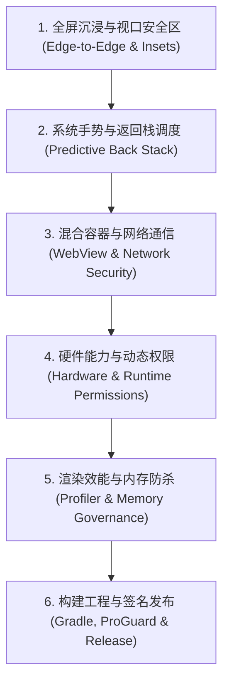

# Android App Engineer Skill (Android App 原生与混合工程架构师)

> **定位**：拒绝粗制滥造的“Web套壳打包”，构建具备 100% Android 原生级交互质感、预测性返回手势闭环、坚固的网络与会话通道、并通过 Android Studio Profiler 与 Google Play 标准检验的顶级移动客户端工程体系。
> **核心原则**：
> 1. **物理设备事实源 (Physical Device Ground-Truth)**：一切手势、渲染与网络行为必须在真实 Android 物理真机（包含全面屏手势模式与各厂商定制 ROM）上客观通过检验，严禁以桌面 Chrome 模拟器结论代替真机表现；
> 2. **反劣质网页化 (Anti-Webby Ergonomics)**：消除 WebView 附带的浏览器残余（如生硬的系统状态栏白条、底部上滑二次呼出白框、侧滑返回直接闪退杀进程、输入法顶起布局抖动），重塑 Android 14/15 官方标准的 Edge-to-Edge 全沉浸触感；
> 3. **确定性返回栈契约 (Deterministic Back Stack Contract)**：严格遵循 Android 预测性返回模型（Predictive Back Navigation），分层优先消费模态浮层、二级路由与根页面防误触，杜绝状态撕裂与误退；
> 4. **指标与内存防杀 (Profiler Metrics & Process Protection)**：以 60/120Hz 丝滑流体帧率、零 GPU 过度绘制（Overdraw）与优雅后台保活/状态持久化作为交付合格门禁。

---

## 1. 触发时机 (Trigger Condition)

当出现以下任一场景时，强制激活并严格执行本 Skill：
1. 启动、重构或升级以 Capacitor / Android WebView / 原生 Kotlin/Java 支撑的 Android 客户端工程时；
2. 页面在 Android 各异形屏（摄像头居中挖孔、水滴屏、药丸双孔、全面屏手势导航条）出现死白横杠、留白遮挡或双重反弹时；
3. 用户在系统侧滑返回（Back Gesture）或底部上滑（Home Gesture）时出现误关应用、白屏闪烁或导航死锁时；
4. 客户端涉及相机（Camera）、相册（MediaStore）、文件存储（FileProvider）、麦克风等系统硬件权限申请与静默拒绝排查时；
5. 处理 Android 9+ Cleartext HTTP 明文传输拦截、WebView 跨域凭证 Cookie 丢失、会话失效（401）原位保护时；
6. 使用 Android Studio Profiler 抓取真机滚动卡顿、内存泄漏（Memory Leak）、过度绘制（GPU Overdraw）与电池过耗时；
7. 配置 Gradle 8+ 构建脚本、JDK 17/21 编译依赖、ProGuard/R8 规则混淆、Keystore 签名及 APK/AAB 打包时。

---

## 2. 全链路 6 大生命周期架构 (6-Stage Android Engineering Lifecycle)



---

## 3. 6 维工业级落地全景规约与门禁检查清单 (Full-Chain Audit Checklist)

### 环节 1：全屏沉浸、挖孔延伸与视口安全区 (Edge-to-Edge & Cutout Architecture)

1. **全面屏无缝铺底与刘海穿透 (Edge-to-Edge Bleed)**：
   - [ ] **刘海与挖孔物理延伸**：在 `MainActivity` 中声明 `LAYOUT_IN_DISPLAY_CUTOUT_MODE_SHORT_EDGES`（API 28+），促使页面渲染直接铺满至物理屏幕最顶层边缘，消除摄像头挖孔两旁的黑色/白色断层；
   - [ ] **状态栏与导航栏透明化**：强制设置 `window.setStatusBarColor(Color.TRANSPARENT)` 与 `window.setNavigationBarColor(Color.TRANSPARENT)`，并调用 `WindowCompat.setDecorFitsSystemWindows(window, false)`；
   - [ ] **系统信息无感融入**：使用 `WindowInsetsControllerCompat` 隐藏状态栏（时间、WiFi、信号等），并配置 `BEHAVIOR_SHOW_TRANSIENT_BARS_BY_SWIPE`，仅在需要时通过轻扫临时浮动展示；
   - [ ] **底栏 Home Indicator 一次直达**：导航栏背景保持 100% 透明，杜绝底部系统栏常驻白块，确保用户从底部轻扫一次即可直接切回桌面（系统级 Home 手势），绝不产生二次拦截。
2. **Web 视口安全区闭环 (Viewport Inset Zeroing)**：
   - [ ] **HTML Viewport**：`meta[name=viewport]` 强制声明 `viewport-fit=cover`；
   - [ ] **CSS 变量自适应**：顶部关键操作避让采用 `padding-top: env(safe-area-inset-top)`，底栏避让采用 `padding-bottom: env(safe-area-inset-bottom)`；
   - [ ] **软键盘 (IME) 顶起防护**：在 `AndroidManifest.xml` 中将 Activity 配置为 `android:windowSoftInputMode="adjustResize"`，防止键盘弹起时破坏 fixed 定位元素或压缩视口。

---

### 环节 2：预测性返回导航与多层返回栈治理 (Predictive Back Navigation)

1. **Android 13/14/15 官方标准适配**：
   - [ ] **清单启用特性**：在 `AndroidManifest.xml` 的 `<application>` 节点显式配置 `android:enableOnBackInvokedCallback="true"`；
   - [ ] **严禁遗留 API**：坚决弃用传统的 `Activity.onBackPressed()` 重写或 `onKeyDown(KEYCODE_BACK)` 暴力拦截，统一接入 AndroidX `OnBackPressedDispatcher`；
   - [ ] **注册单一可信回调**：使用 `getOnBackPressedDispatcher().addCallback(this, new OnBackPressedCallback(true) { ... })`。
2. **分层确定性返回调度 (Deterministic Back Stack Pipeline)**：
   - [ ] **四级返回决策模型**：
     - **第 1 级（模态与抽屉）**：若前端当前有打开的 BottomSheet、Dialog、相册选择器，侧滑手势仅消费并关闭该浮层；
     - **第 2 级（全屏取景与子流程）**：若处于相机拍摄、创建草稿等子流程，侧滑手势回退至上一步；
     - **第 3 级（二级路由）**：若处于设置页、详情页、订阅页，侧滑手势回退到 Home 根页面；
     - **第 4 级（根首页防误触）**：若已在根首页且无任何弹窗，2 秒内连续侧滑两次才触发退出，且必须优先调用 `moveTaskToBack(true)`（平滑推入后台，保持进程内存热启动，对齐微信/小红书原生体验），严禁调用 `System.exit(0)` 或直接强杀。

---

### 环节 3：混合容器、网络通信与会话防撕裂 (WebView & Network Security)

1. **本地调试与明文通信策略**：
   - [ ] **Cleartext 严格受控**：在本地内网与联调阶段，若需请求开发机 HTTP 接口，在 `AndroidManifest.xml` 中配置 `android:usesCleartextTraffic="true"` 或使用安全 network_security_config.xml 白名单放行目标 IP；
   - [ ] **生产环境阻断明文**：生产构建时强制全站 HTTPS，杜绝明文传输凭证。
2. **WebView 会话持久化与跨域凭证**：
   - [ ] **CookieManager 物理同步**：启用 `CookieManager.getInstance().setAcceptCookie(true)` 并配置 `setAcceptThirdPartyCookies(webView, true)`；
   - [ ] **内存写盘强制刷入**：在用户登录成功或关键网络请求后，主动调用 `CookieManager.getInstance().flush()`，防止系统强杀导致内存会话丢失；
   - [ ] **Chrome DevTools 调试开关受控**：仅在 Debug 模式下启用 `WebView.setWebContentsDebuggingEnabled(true)`，Release 构建必须强制置为 `false`，防逆向与 XSS 注入。

---

### 环节 4：系统硬件能力与运行时动态权限 (Hardware & Runtime Permissions)

1. **相机与音频硬件标准 (Camera & Audio)**：
   - [ ] **Manifest 声明齐全**：显式声明 `android.permission.CAMERA`、`android.permission.RECORD_AUDIO`；
   - [ ] **硬件特性软依赖**：必须标记 `android:required="false"`（如 `<uses-feature android:name="android.hardware.camera" android:required="false" />`），防止未配备特定镜头的设备被 Google Play 限制下载；
   - [ ] **WebChromeClient 权限穿透**：必须覆盖 `onPermissionRequest(PermissionRequest request)`，当收到 `VIDEO_CAPTURE` 时，若应用尚未获得系统 Camera 权限，必须先通过 `ActivityCompat.requestPermissions` 向用户弹出系统授权对话框，待授权后再调用 `request.grant(...)`。
2. **相册与文件共享安全**：
   - [ ] **FileProvider 绝对隔离**：严禁直接向外部 Intent 抛出 `file://` URI（抛出 `FileUriExposedException`），所有图片与文件必须使用 `androidx.core.content.FileProvider` 封装为 `content://` URI；
   - [ ] **Android 13+ 媒体权限细分**：适配 `READ_MEDIA_IMAGES` 替代过时的 `READ_EXTERNAL_STORAGE`。

---

### 环节 5：渲染效能、GPU 过度绘制与内存防杀 (Profiler & Performance)

1. **60/120Hz 垂直同步流水线 (Choreographer & Jank Defense)**：
   - [ ] **GPU Overdraw 审计**：开启开发者选项中的“调试 GPU 过度绘制”，确保大部分区域保持在蓝色/浅绿（1~2 层），严禁大面积出现深红（4 层以上严重过度绘制）；
   - [ ] **硬件加速常驻**：在 `AndroidManifest.xml` 的 `application` 节点显式声明 `android:hardwareAccelerated="true"`。
2. **内存泄漏与后台保活 (Memory Leak & OOM Defense)**：
   - [ ] **静态上下文持有规绝**：严禁在单例、静态变量或后台线程中直接持有 `Activity` 或 `WebView` 引用；
   - [ ] **WebView 销毁防腐 SOP**：
     ```java
     if (webView != null) {
         webView.loadDataWithBaseURL(null, "", "text/html", "utf-8", null);
         webView.clearHistory();
         ((ViewGroup) webView.getParent()).removeView(webView);
         webView.destroy();
         webView = null;
     }
     ```

---

### 环节 6：构建工程化、混淆与安装包受控发布 (Gradle & Release Governance)

1. **现代构建工具链标准**：
   - [ ] **JDK 17/21 LTS 基准**：构建环境必须统一基于 JDK 17 或 21 LTS 运行 Gradle 8+；
   - [ ] **Target SDK 时效性**：`targetSdkVersion` 严格对齐最新 Google Play 规定（API 34/35），`minSdkVersion` 不低于 24（覆盖 99% 以上现代 Android 机型）。
2. **ProGuard / R8 混淆与防腐**：
   - [ ] **保留 JSBridge 与 Capacitor 契约**：在 `proguard-rules.pro` 中显式保留与 WebView 交互的实体类与原生 Bridge，严禁混淆 `window.__vivibonHandleBack` 调用的方法与类名；
   - [ ] **无损体积瘦身**：启用 `shrinkResources true` 与 `minifyEnabled true`，剔除未引用的无用多密度 mipmap 与字体资源。
3. **安全自签名与发布门禁**：
   - [ ] **Keystore 凭证安全**：签名密钥（`release.keystore`）与密码绝对严禁直接硬编码入版本库，必须通过环境变量或本地私密属性注入；
   - [ ] **APK 与 AAB 双产物准备**：自测交付使用已签名的 Release/Debug APK，商店提审严格使用 Android App Bundle (`.aab`)。

---

## 4. 门禁一票否决红线 (Blocker Criteria)

任何 Android 构建或代码提交若触发以下任一条目，必须立即一票否决打回重构：
1. **侧滑闪退红线**：在任何非首页视图（如打开抽屉、打开相机、在二级子页面）触发侧滑返回时，直接退出了 App 或导致页面全白；
2. **权限静默崩溃红线**：调用相机或录音时，未在 Manifest 声明权限导致系统静默拒绝、或抛出未捕获的 `SecurityException` 崩溃；
3. **异形屏切断红线**：状态栏呈现生硬的白色死条，未实现与应用顶栏背景同构透明沉浸；
4. **主线程耗时堵塞 (ANR)**：在 `MainActivity` 的生命周期或主线程中执行长时网络/磁盘 IO，触发主线程卡顿超过 500ms。

