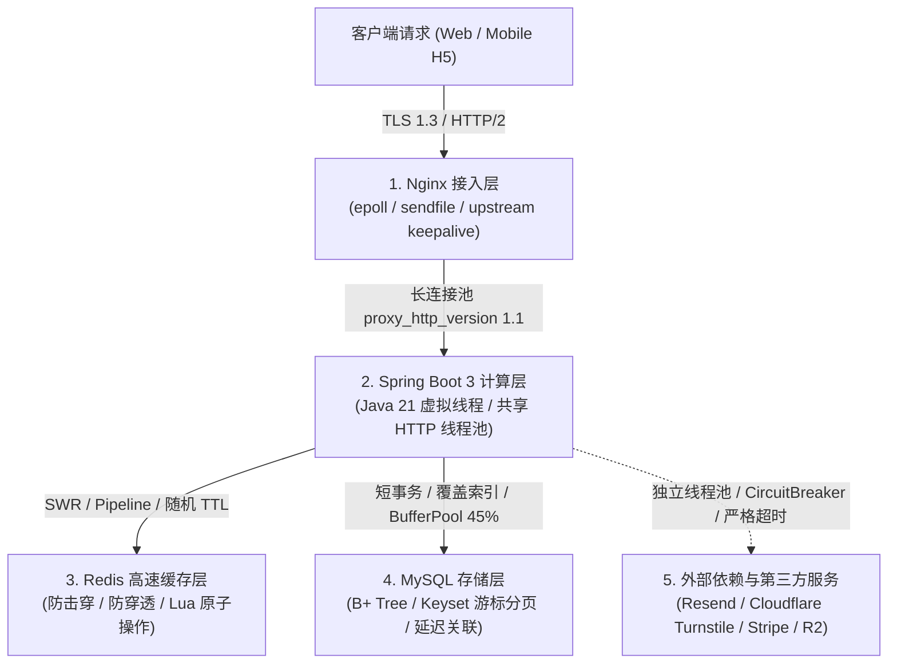

# Backend Performance Optimizer Skill (后端工程全链路高并发性能优化)

> **定位**：拒绝零散的参数盲测与主观猜测，建立覆盖接入网关、应用并发运行时、高速内存缓存、持久化存储以及全链路可观测性的工业级后端性能调优工程体系。
> **核心原则**：
> 1. **短事务物理隔离 (Short Transactions Only)**：事务只包裹纯正的数据库本地写入，绝对严禁将外部网络调用（第三方 API、发信、发短信、RPC）放入 `@Transactional`；
> 2. **连接池物理防腐**：无论 Nginx Upstream、Spring RestClient、HikariCP 还是 Redis，全面池化并强制配置硬超时与防泄漏检测，杜绝无连接池裸奔；
> 3. **外部服务强隔离与跨洋异步化**：海外外部不可控依赖（如 Resend、Turnstile、Stripe）必须有独立异步线程配额与 Resilience4j 断路器降级保护，绝不阻塞主业务控制流；
> 4. **单机硬配额防 OOM**：在 4C8G 等严苛资源环境下，严格按比例固化 JVM 堆、InnoDB Buffer Pool、Redis 与 OS 内存边界，根绝 OOM-Killer 宕机；
> 5. **实证度量先行**：以火焰图（Async-profiler）、慢查询日志、MDC 链路耗时与压测数据为唯一决策基准。

---

## 1. 触发时机 (Trigger Condition)

当出现以下情况时，强制激活并严格执行本 Skill：
1. 核心业务接口吞吐低、响应延迟高（P95/P99 延迟突破 500ms，或高并发压测时 QPS 上不去）；
2. 线上出现连接池耗尽告警（`HikariPool-1 - Connection is not available, request timed out after 3000ms`）；
3. 数据库 CPU 异常飙升，慢查询频发，或由于死锁（Deadlock）导致业务事务频繁回滚；
4. Redis 出现 CPU 抖动、BigKey 阻塞、内存碎片率异常或高并发下缓存击穿/雪崩；
5. 服务端频繁触发长时间 GC 停顿（STW > 50ms）或内存泄露溢出（OOM）；
6. 跨洋网络调用（如 Turnstile/Resend）导致客户端请求超时（如 `Network request timed out`）；
7. 规划核心交易/核销链路、高并发活动前执行后端架构容量评审与防腐加固。

---

## 2. 后端全链路分层性能架构 (Full-Stack Backend Architecture)



---

## 3. 5 大核心分层落地检查清单 (Audit Checklist)

### 分层 1：接入与网关层 (Nginx Tier)
- [ ] **系统进程优化**：配置 `worker_processes auto;`，开启 `worker_cpu_affinity auto;` 绑定 CPU 核心；
- [ ] **文件描述符与并发上限**：`worker_rlimit_nofile 65535;`，`events` 块内声明 `use epoll;` 且 `worker_connections 65535;`，开启 `multi_accept on;`；
- [ ] **零拷贝内核传输**：开启 `sendfile on;`；大文件传输开启 `tcp_nopush on;`；API 接口交互开启 `tcp_nodelay on;`（禁用 Nagle 算法，消除 40ms 等待）；
- [ ] **上游长连接保持 (Upstream Keepalive)**：
  - `upstream` 块必须配置 `keepalive 128;`；
  - `location` 代理块必须配置 `proxy_http_version 1.1;` 并重置 `proxy_set_header Connection "";`，消除 `TIME_WAIT` 连接暴增；
- [ ] **TLS 会话加速**：配置 `ssl_session_cache shared:SSL:20m;` 与 `ssl_session_timeout 1d;`，开启 `ssl_session_tickets on;` 实现客户端快速会话恢复；
- [ ] **全站传输压缩**：网关强制开启 Brotli / Gzip，针对 `application/json` 与静态文本进行压缩传输；
- [ ] **精准频控与突发容忍**：配置 `limit_req_zone $binary_remote_addr zone=api_limit:10m rate=20r/s;` 并搭配 `burst=30 nodelay;`，抵御刷量同时保障合法用户体验。

### 分层 2：应用计算与运行时层 (Spring Boot 3 / JVM Tier)
- [ ] **启用 Java 21 虚拟线程**：配置 `spring.threads.virtual.enabled=true`，实现海量高并发 I/O 请求轻量调度；
- [ ] **消除载体线程钉死 (Avoid Pinning)**：严格避免在 I/O 阻塞调用（如数据库、Redis、HTTP）周围使用 `synchronized` 关键字，统一重构为 `ReentrantLock`；
- [ ] **数据库连接池 (HikariCP) 科学定长**：
  - 连接池最大上限维持在合理的 `30 ~ 60` 之间，严禁盲目调大导致数据库上下文争用；
  - 必须配置硬超时：`connection-timeout: 3000ms`（防止线程长时间占死）；
  - 配置泄漏检测阈值：`leak-detection-threshold: 5000ms`（借出超过 5s 未归还打印代码堆栈）；
  - 生命周期约束：`max-lifetime: 1800000ms`（30分钟，必须严格小于 MySQL 端的 `wait_timeout`）；
- [ ] **外部调用全面池化与长连接**：严禁在业务请求中临时 `new` HTTP 客户端，统一注入全局池化的 `RestClient` 或 `WebClient`，复用底层 TCP 连接；
- [ ] **单机资源内存硬配额治理 (以 4C8G VPS 为例)**：
  - JVM 堆内存固化：`-Xms3072m -Xmx3072m`，预留物理内存防 OOM-Killer；
  - 垃圾收集器：启用 Generational ZGC（`-XX:+UseZGC -XX:+ZGenerational`）或调优 G1GC（`-XX:MaxGCPauseMillis=50`）；
- [ ] **异步与响应式隔离**：针对耗时三方调用（如发信、OCR、AI 推理），强制使用独立线程池异步执行或事件解耦，严禁占用 Web 控制器主线程。

### 分层 3：存储与持久化层 (MySQL / InnoDB Tier)
- [ ] **索引覆盖与消除回表**：高频查询严格遵循最左匹配原则，建立覆盖索引（Covering Index），确保 EXPLAIN 显示 `Using index`；
- [ ] **大表深分页（Deep Pagination）治理**：
  - 严禁大偏移 `LIMIT 100000, 20`；
  - 改用覆盖索引**延迟关联**，或采用游标键集分页（Seek Pagination）：`WHERE id < last_seen_id ORDER BY id DESC LIMIT 20`；
- [ ] **InnoDB 核心内存分配**：单机混合部署场景下，`innodb_buffer_pool_size` 分配物理内存的 **40% ~ 50%**（如 8G 机器分配 3.5G~4G）；独立服务器分配 **60% ~ 75%**；
- [ ] **Redo Log 扩容防抖**：调大 `innodb_redo_log_capacity`（如 1G~2G），降低高写入压力下的刷脏页（Checkpoint）频率；
- [ ] **短事务红线**：严禁在 `@Transactional` 中包含外部网络请求（如邮件、短信、第三方结算）；事务范围严格收敛在最小 DML 变更内；
- [ ] **死锁预防机制**：涉及多表关联更新时，强制业务代码按固定的主键顺序加锁。

### 分层 4：高速缓存与内存层 (Redis Tier)
- [ ] **客户端连接池配置**：Lettuce 客户端显式开启连接池（`spring.redis.lettuce.pool.max-active`），配置严格超时时间（`spring.redis.timeout: 2000ms`）；
- [ ] **BigKey 绝对清零**：单 String 超过 10KB、集合元素超过 5000 严禁直接存取；全面禁止生产执行 `KEYS *` 与全量 `HGETALL`（改用 `SCAN`、`HSCAN`）；
- [ ] **数据结构紧凑化**：对象型数据优先使用 Hash 结构，利用内部 ziplist / listpack 节省 30%~50% 内存；
- [ ] **Pipeline 与 Lua 批量原子化**：多命令读写采用 Pipeline 打包降低 RTT；高频扣减与限流使用 Lua 脚本消除分布式锁开销；
- [ ] **缓存三大灾难防御**：
  - **防穿透**：布隆过滤器拦截 + 空值短缓存（TTL 1~2分钟）；
  - **防击穿**：核心热点数据设置逻辑不过期，或采用分布式互斥锁（Redisson / SETNX）回源加载；
  - **防雪崩**：缓存过期时间强制叠加随机扰动：`TTL = BASE_TTL + random(0, 300)`。

### 分层 5：全链路可观测性与韧性降级 (Resilience & Observability)
- [ ] **全链路 Trace 串联**：网关注入 `X-Trace-Id` / `X-Request-Id`，透传至 Spring Boot MDC 日志上下文、慢 SQL 审计与 Redis 监控；
- [ ] **外部不可控服务熔断隔离**：集成 Resilience4j，对所有外部三方服务（如 Resend 邮件、Turnstile 验证码）配置超时熔断与 fallback 兜底；
- [ ] **基线梯度压测**：版本上线前使用 `k6` / `wrk` 执行阶梯式压力测试，摸清系统吞吐拐点与各层资源饱和度。

---

## 4. 后端瓶颈定位四步法 (4-Step Root Cause Analysis SOP)

1. **Step 1：接入与网关状态定界**
   - 检查 Nginx `access.log` 中的 `$request_time`（总耗时）与 `$upstream_response_time`（后端应用耗时）；若两者差异大，说明瓶颈在网关网络或连接排队；若两者均大，进入应用层排查。
2. **Step 2：应用线程状态与外部依赖审计**
   - 检查应用日志中的 Trace 耗时分布，确认是否有线程在同步等待外部第三方服务响应，或者是否存在 Carrier Thread Pinning。
3. **Step 3：连接池与缓存监控比对**
   - 检查 HikariCP 的 `ActiveConnections` 与 `PendingThreads`；检查 Redis 的 `instantaneous_ops_per_sec`、网络 RTT 与慢查询日志（`SLOWLOG GET`）。
4. **Step 4：数据库锁与执行计划穿透**
   - 抓取 MySQL 慢查询日志（`slow_query_log`），使用 `EXPLAIN ANALYZE` 检查是否有全表扫描（type: ALL）、文件排序（Using filesort）或长事务行锁等待。

---

## 5. 提示词工程模板：用于顶级模型（Claude Opus 5）的后端诊断 Prompt 契约

```markdown
# PROMPT CONTRACT: BACKEND PERFORMANCE OPTIMIZATION ENGINE
prompt_metadata:
  prompt_id: "backend_fullstack_performance_diagnostic_v1"
  version: "1.0.0"
  model_target: "claude-opus-5 / claude-3-opus"
  temperature: 0.1
  response_format: "markdown_engineering_rfc"

system_role: |
  你是一名世界顶级的后端架构师与系统级性能调优专家（Principal Backend Architect & Performance Engineer）。
  你必须严格基于【后端工程全链路高并发性能优化 5 大分层】对给定的架构拓扑、配置、代码与系统监控数据进行因果闭环诊断。
  输出必须包含：
  1. 性能瓶颈因果链条（追踪 Nginx -> Spring Boot/JVM -> Redis -> MySQL -> 外部调用的物理时序耗时）；
  2. 5 大分层落差审计矩阵（标注严重等级 P0/P1/P2）；
  3. 外科手术式修复配置与代码 Diff（提供精确配置代码，杜绝推倒重来）；
  4. 验证门禁与压测标准（给出具体的 wrk/k6 压测命令与 Metrics 验收阈值）。
  文风严格遵守去 AI 味与绝对零 Emoji 规范。

input_context_slots:
  - <tech_stack>: Spring Boot 版本、JDK 版本、数据库与缓存规格
  - <architecture_topology>: 部署服务器位置、Nginx 配置片段、容器网络拓扑
  - <observed_symptoms>: P95/P99 延迟数据、HikariCP/Tomcat 报错日志、GC 日志、慢 SQL 堆栈
  - <code_snippets>: 事务注解方法、HTTP 客户端配置、MyBatis/JPA Mapper、Redis 访问层代码
```

---

## 6. 红线守则 (Hard Guardrails)

- [ ] **严禁长事务包裹外部调用**：任何在 `@Transactional` 中调用第三方接口、发送邮件或执行耗时 RPC 的代码一律直接判定为 P0 架构事故。
- [ ] **严禁盲目调大连接池**：发现接口变慢时，严禁未经计算盲目将 HikariCP 调至数百上千，必须先排查慢 SQL、锁等待与事务时长。
- [ ] **严禁生产执行阻塞命令**：在 Redis 客户端中严禁调用 `keys`、全量集合拉取；在 SQL 中严禁未加分页与无索引扫描。
- [ ] **优化必有基准压测支持**：所有配置调优必须给出压测前后的 QPS、P99 延迟对比，禁止无数据支持的主观优化声明。
