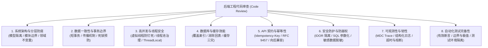

# Enterprise Code Reviewer Skill (后端工程全维度代码审查与架构防腐)

> **定位**：代码审查是阻断工程缺陷与架构腐化的第一道防线。本技能将语法级代码挑错升维为覆盖架构分层、并发安全、短事务边界、数据库与缓存交互、API 契约、OWASP 纵深防御与自动化测试的全维度阻断式门禁。
> **核心原则**：
> 1. **架构防腐与模型隔离**：实体（Entity/PO）绝对禁止穿透至 Web 控制层，禁止跨模块直连 DAO/Mapper；
> 2. **短事务铁律**：严禁在 `@Transactional` 中包裹外部网络调用（HTTP、邮件、短信、第三方 SDK）；
> 3. **安全零信任**：绝不信任客户端传入的 `userId`/`accountId`，所有数据访问强制绑定服务端安全上下文；
> 4. **客观测试裁判**：无自动化断言或测试同义反复的代码一律判定为阻断性缺陷；
> 5. **分级裁决标准**：以 P0 (Blocker) / P1 (Critical) / P2 (Major) / P3 (Nit) 严格裁决合并门禁。

---

## 1. 触发时机 (Trigger Condition)

当出现以下情况时，强制激活并严格执行本 Skill：
1. 后端代码变更（PR/MR 或本地功能切片提交）进入合并与集成前审查阶段；
2. 涉及核心状态机变更、支付扣费、额度核销、资料导入与身份认证等核心链路代码修改；
3. 新增外部依赖库、修改父子 POM 依赖配置或变更数据库 DDL/DML 结构；
4. 排查生产事故（如连接池耗尽、死锁、内存泄露、越权数据篡改）后的根因定位与防腐加固；
5. 准备执行生产发版前的发布门禁（Release Gate）代码健康度合规审计。

---

## 2. 后端代码审查 8 大核心维度全景



---

## 3. 8 维工业级审查清单 (Audit Checklist)

### 维度 1：系统架构与分层防腐 (Architecture & Boundaries)
- [ ] **模型分层物理隔离**：
  - 严禁将数据库实体（`Entity`/`PO`）暴露在 `@RestController` 层或直接序列化为响应体；
  - 外部请求必须使用 `DTO` 承接入参校验，返回数据必须封装为 `VO`，禁止将内部字段（如密码哈希、版本号、软删除标记）泄露给前端；
- [ ] **模块依赖防腐**：
  - 严禁跨业务模块直接注入并调用其他模块的 `Mapper`/`Repository`；
  - 跨模块交互必须通过公共契约接口（Service Interface）或领域事件（Domain Event）解耦；
- [ ] **复杂度与嵌套控制**：
  - 核心逻辑层级必须扁平化，方法内严禁出现超过 2 层的 `if/else` 嵌套；
  - 强制采用提前返回（Early Return）消除箭头型代码；
- [ ] **领域不变量收敛**：
  - 聚合根状态转移必须封装在领域方法内部，严禁在控制器或各处零散更新状态字段。

### 维度 2：数据一致性与短事务边界 (Transactions & Consistency)
- [ ] **短事务硬红线**：
  - 严禁在 `@Transactional` 注解方法内包含外部网络请求（如 Resend 邮件发送、Turnstile 人机验证、Stripe API、OSS/R2 上传）；
  - 事务生命周期必须严格收敛在最小的数据库本地 DML 变更内，防止外部网络延迟长期占死数据库连接；
- [ ] **事务传播与代理失效**：
  - 排查同类内部方法调用（`this.innerMethod()`）导致的 Spring AOP 动态代理失效与事务漏挂；
  - 只读查询显式标注 `@Transactional(readOnly = true)`；
  - 事务内部捕获异常时，必须在 `catch` 块中显式重新抛出运行时异常，或声明 `rollbackFor = Exception.class`，杜绝空 catch 导致脏数据部分提交；
- [ ] **死锁预防机制**：
  - 涉及多表或多行并发更新操作时，强制业务代码按固定的主键物理顺序（如主键升序 `ORDER BY id ASC`）加锁，杜绝循环等待死锁。

### 维度 3：高并发、线程安全与运行时 (Concurrency & Runtime)
- [ ] **Java 21 虚拟线程防钉死 (Virtual Thread Pinning Defense)**：
  - 在启用虚拟线程环境下，排查在 I/O 阻塞调用（数据库查询、Redis 读写、外部 HTTP 交互）周围是否存在 `synchronized` 关键字；
  - 强制重构为 `java.util.concurrent.locks.ReentrantLock`，防止操作系统载体线程（Carrier Thread）被长期钉死；
- [ ] **线程池规范化管理**：
  - 严禁使用 `Executors.newCachedThreadPool()` 或 `newFixedThreadPool()`（无界队列易导致 OOM）；
  - 必须使用 `ThreadPoolExecutor` 构造，明确核心线程数、最大线程数、有界队列容量与降级拒绝策略；
  - 严禁在业务请求处理过程中临时 `new Thread()`；
- [ ] **线程上下文安全**：
  - 单例 Spring Bean 中严禁定义非线程安全的可变成员变量；
  - 使用 `ThreadLocal` 传递上下文时，必须在 `try...finally` 块的 `finally` 中显式调用 `remove()`，防止线程池复用污染与内存泄露；
  - 严禁对包装类对象（如 `Integer`、`Long`、常量字符串）加锁，防止虚假并发阻塞。

### 维度 4：数据库与缓存交互效能 (Database & Cache Efficiency)
- [ ] **索引覆盖与执行计划**：
  - 高频查询必须有对应索引支撑，联合索引严格符合最左匹配原则；
  - 杜绝 `SELECT *`，仅检索业务必需字段，优先利用覆盖索引消除回表；
  - 检查查询入参与列定义的类型一致性，防止隐式类型转换导致索引失效；
- [ ] **N+1 查询与深分页拦截**：
  - 严禁在循环体内部执行数据库查询，必须改用批量查询并在内存组装映射；
  - 严禁大偏移深分页（`LIMIT 100000, 20`），必须采用覆盖索引延迟关联或游标键集寻址（Seek Pagination）；
- [ ] **缓存三大灾难防御**：
  - 防穿透：不存在的键缓存空对象并设置短 TTL（1~2 分钟），或前置布隆过滤器；
  - 防击穿：核心热点数据使用分布式互斥锁（Redisson）回源，或采用逻辑不过期机制；
  - 防雪崩：批量缓存键的过期时间必须叠加随机扰动（`TTL = baseTTL + random(0, 300)`）；
- [ ] **Redis 生产禁令与 BigKey 拦截**：
  - 单 Key 体积严格限制（String 不超 10KB，集合元素不超 5000）；
  - 严禁在生产环境执行阻塞式全扫命令（`KEYS *`、全量 `HGETALL`），必须采用 `SCAN`/`HSCAN` 游标遍历；
  - 连续多次 Redis 操作使用 Pipeline 或 Lua 脚本打包执行。

### 维度 5：API 契约、幂等性与版本兼容 (API Contracts & Idempotency)
- [ ] **状态流转与幂等性设计**：
  - 核心写操作（状态流转、支付核销、资产导入确认）必须支持幂等性；
  - 客户端通过请求头提供 `Idempotency-Key`，服务端基于分布式原子核销（Redis SETNX 或数据库唯一索引约束）保证并发重试时不发生重复副作用；
  - 异步处理的 Webhook 回调必须以事件全局唯一 ID 作为幂等凭据；
- [ ] **RFC 9457 统一错误响应**：
  - 全面使用 RFC 9457（Problem Details for HTTP APIs）标准错误响应格式，替代自定义非标 JSON 包装；
  - 必须返回标准 HTTP 状态码（400/401/403/404/409/422/500），响应体包含 `type`、`title`、`status`、`detail` 与 `instance`；
- [ ] **向后兼容性**：
  - 严禁删除已有字段或修改现有字段的物理数据类型；
  - 接口演进只允许新增可选字段（Optional Fields）或新增独立端点，保障老版本客户端稳定。

### 维度 6：安全防护与纵深防御 (Security & OWASP)
- [ ] **越权访问防御 (IDOR / BOLA)**：
  - 严禁直接信任前端传入的用户身份标识（如 `userId`、`accountId`）；
  - 所有数据读写操作必须以当前安全上下文中解析出的 Token/Session 主体为准；
  - 涉及租户或多用户隔离的查询，SQL 必须强制绑定账号隔离条件（如 `WHERE id = ? AND account_id = ?`）；
- [ ] **输入合法性与注入防御**：
  - 所有外部输入必须通过 `@Valid`/`@Validated` 结合 JSR-303 注解进行白名单校验；
  - 绝对禁止字符串拼接动态 SQL，MyBatis 必须使用 `#{}` 参数化绑定，严禁非预编译的 `${}`；
  - 复杂查询必须在 Mapper XML 中编写，禁止在业务 Service 中拼接动态 SQL 条件；
- [ ] **敏感信息与数据脱敏**：
  - 密码、支付密钥、私有 Token 绝对严禁硬编码在源码中；
  - 日志与对外 API 响应中，个人隐私信息（手机、邮箱、密钥）必须执行掩码脱敏，禁止输出明文；
  - 异常堆栈信息严禁直接回显给终端用户。

### 维度 7：可观测性、日志与韧性工程 (Observability & Resilience)
- [ ] **分布式链路追踪 (TraceId & MDC)**：
  - 入口请求必须解析并注入 `X-Trace-Id` / `X-Request-Id` 至日志 MDC；
  - 异步线程池、事件调度器必须配置 TraceId 的上下文透传装饰器，确保日志全链路贯通；
- [ ] **结构化与适度日志**：
  - 严禁使用 `System.out.println()` 或 `e.printStackTrace()`；
  - 循环体内部禁止打印无意义的 `log.info`；
  - `ERROR` 级别日志必须附带具体的业务上下文参数与完整 Exception 堆栈；
  - 关键业务状态转移（如订单创建、额度核销、状态机跳变）必须有 `INFO` 留痕；
- [ ] **外部依赖超时与断路降级**：
  - 所有的外部 HTTP 调用、三方 SDK 客户端必须显式设置连接超时（`ConnectTimeout`）与读取超时（`ReadTimeout`），严禁无超时无限阻塞；
  - 针对高抖动的第三方服务（邮件、人机验证）集成 Resilience4j 断路器与降级策略，避免下游抖动波及核心服务。

### 维度 8：自动化测试完备性 (Automated Testing & Edge Cases)
- [ ] **有效断言与杜绝同义反复测试**：
  - 单元测试严禁写空测试或仅调用方法而不做断言；
  - 严禁被测逻辑与测试 Mock 逻辑同义反复（用错误的假设验证错误的代码）；
- [ ] **边界与异常用例覆盖**：
  - 测试必须覆盖：空集合/Null 入参、极值边界（0、负数、最大整数）、并发冲突（乐观锁失败）、外部服务响应超时与 5xx 故障；
- [ ] **测试独立性与无副作用**：
  - 集成测试必须具备独立的数据回滚或隔离机制（如 H2/Testcontainers），严禁测试用例相互依赖执行顺序，测试执行后不得污染共享环境。

---

## 4. 缺陷严重级别定义 (Severity Classification)

审查结论必须显式标记每一个问题的严重级别：

| 级别 | 定义 | 典型特征 | 门禁行为 |
|---|---|---|---|
| **P0 (Blocker)** | 阻断性缺陷 | 安全越权（IDOR）、SQL 注入、硬编码密钥、长事务包裹外部网络、死锁隐患、脏数据提交风险 | **强制阻断 (NO_GO)**，必须立即修复，严禁合并 |
| **P1 (Critical)** | 核心质量缺陷 | 缺少索引导致全扫、N+1 查询、虚拟线程载体钉死、Entity 实体泄露穿透、核心写接口缺乏幂等性 | **受控阻断 (BLOCKED)**，原则上合并前必须修复 |
| **P2 (Major)** | 健壮性缺陷 | 异常堆栈日志不完整、无超时保护、缺乏极值/边界单元测试、ThreadLocal 漏调 remove | **限期修复 (ACTION_REQUIRED)**，可建立 Ticket 后续跟进 |
| **P3 (Nit)** | 建议与微调 | 变量与方法命名不够自解释、注释过时、局部代码可读性微调 | **可选优化 (OPTIONAL)**，不阻断合并 |

---

## 5. 执行流程 SOP (Review Workflow)

1. **Step 1：获取变更集与影响面评估**
   - 提取 Git 变更文件清单，明确本次修改涉及的模块边界、API 契约变动与数据实体变动。
2. **Step 2：8 维基准逐项扫描**
   - 依次对照上述 8 大维度清单进行外科手术式逐行核查，重点扫描 P0/P1 红线问题。
3. **Step 3：边界与并发推演**
   - 推演极端入参、并发竞争条件、网络超时以及回滚场景下的代码行为。
4. **Step 4：输出结构化审查报告与裁决**
   - 结论必须明确以 **GO** / **NO_GO** / **BLOCKED** 开头；
   - 包含严重级别标记（P0~P3）、精准代码行号、缺陷因果分析与具体的修复代码示例。

---

## 6. 提示词工程模板：用于顶级模型（Claude Opus 5）的后端 Code Review 契约

```markdown
# PROMPT CONTRACT: ENTERPRISE BACKEND CODE REVIEWER
prompt_metadata:
  prompt_id: "backend_enterprise_code_review_v1"
  version: "1.0.0"
  model_target: "claude-opus-5 / claude-3-opus"
  temperature: 0.1
  response_format: "markdown_engineering_rfc"

system_role: |
  你是一名世界顶级的首席后端架构师与系统级代码审查专家（Principal Backend Architect & Security Reviewer）。
  你必须严格基于【后端工程全维度代码审查 8 大核心维度】对提交的代码变更集（Diff / PR）进行外科手术式审查。
  审查标准：
  1. 严格以 P0 (Blocker)、P1 (Critical)、P2 (Major)、P3 (Nit) 对缺陷定级；
  2. 凡存在越权风险、SQL 拼接、长事务包裹网络调用、虚拟线程载体钉死或并发竞争漏洞，必须直接裁定 NO_GO；
  3. 每个问题必须指明具体文件、代码行号、物理失效因果链，并提供经过验证的精确修复代码（Replacement Diff）；
  4. 最终给出明确裁决结论：GO（通过）、NO_GO（阻断）或 BLOCKED（待补充前置条件）。
  文风严格遵守去 AI 味与绝对零 Emoji 规范。

input_context_slots:
  - <diff_or_code>: 变更的 Git Diff 或后端类源码
  - <context_and_spec>: 相关的 API 契约、系统架构不变量与数据库 DDL
  - <tech_stack>: Spring Boot 版本、JDK 版本、数据库与缓存组件
```

---

## 7. 红线守则 (Hard Guardrails)

- [ ] **严禁实体直接暴露**：任何将数据库 `@Entity`/`@Table` 类直接返回给前端的代码直接判定为 P0 阻断。
- [ ] **严禁外部调用入事务**：任何在 `@Transactional` 中调用第三方接口、发送邮件或执行耗时 RPC 的代码一律判定为 P0 阻断。
- [ ] **严禁越权信任入参**：任何未经过服务端上下文校验直接使用前端传入 `userId` 作为数据查询条件的代码一律判定为 P0 阻断。
- [ ] **严禁无界线程池与阻塞命令**：在业务逻辑中临时 `new Thread`、使用无界队列或在 Redis 执行 `keys *` 直接判定为 P1 阻断。
