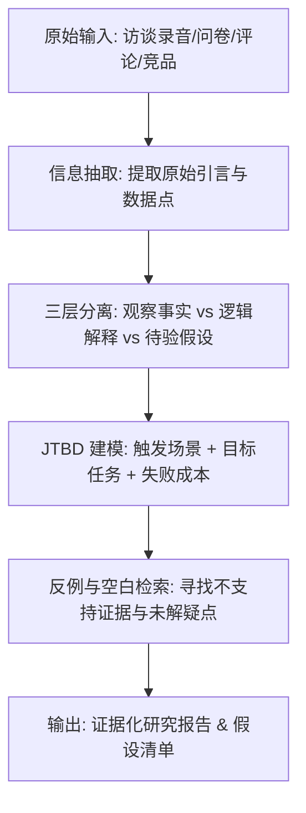

# Evidence Researcher Skill (证据化用户与市场研究)

> **定位**：在进入产品设计与系统编码之前，严谨验证“谁在什么场景下为什么需要什么结果”，杜绝用模型自嗨代替真实用户证据。
> **核心原则**：不伪造用户引用，不把合成数据当市场验证，不把“感兴趣”当成“愿意付费”，不把竞品存在当成需求成立。

---

## 1. 触发时机 (Trigger Condition)

当出现以下情况时，激活并执行本 Skill：
1. 梳理用户画像、用户真实使用场景与动机分析时；
2. 分析用户访谈记录、问卷数据、客服工单或社区反馈时；
3. 进行竞品功能拆解、定价分析、优劣势比对与替代方案调研时；
4. 审查 PRD 中是否存在“无证据支撑的伪需求或主观臆断”时。

---

## 2. 证据收集与分类工作流 (Workflow)



### 步骤 1：三层分离机制 (Three-Tier Separation)
对收集到的每一条信息，必须严格区分为三层：
1. **观察事实 (Observation / Fact)**：用户字面原话、具体行为数据、确凿公开记录（必须附带来源 ID 或文件名）；
2. **逻辑解释 (Interpretation)**：基于事实做出的专业推断与归因分析；
3. **待验假设 (Hypothesis)**：由解释衍生出的产品机会或商业假设（必须标记 `HYPOTHESIS` 并设计验证方式）。

### 步骤 2：JTBD（Job-To-Be-Done）模型结构化提取
每个需求点必须使用 JTBD 语法进行定义：
- **触发场景 (When...)**：在什么特定情境或情绪触发点下；
- **核心渴望 (I want to...)**：用户希望完成什么具体任务，而不是想要什么功能按钮；
- **期望结果 (So I can...)**：获得什么情绪价值、时间节省或实际收益；
- **当前替代方案 (Current Alternatives)**：用户现在用什么（如：微信备忘录、竞品 App、纸质笔记本、问朋友）；
- **切换阻力与失败成本 (Switching Friction & Cost of Failure)**：如果当前方案失败，用户面临什么后果。

### 步骤 3：反例与不支持证据检索 (Counter-Evidence Audit)
对每个看似成立的机会点，必须主动寻找反面证据：
- 有哪些用户明确表示“不需要”、“不会用”或“不愿意为此付费”？
- 用户是否在访谈中表达了喜欢，但在实际行为中并没有持续使用替代方案？
- 竞品为什么没有做这个功能？（技术限制、商业模式不通、还是属于伪需求？）

---

## 3. 证据化研究输出模板 (Output Template)

```markdown
# 证据化用户与市场研究报告

## 1. 调研概况
- 调研目标：
- 证据来源清单：[录音文件/问卷数据/公开链接及抓取日期]
- 样本量与覆盖人群：

## 2. 核心用户任务 (JTBD) 矩阵

| 任务 ID | 触发场景 (When) | 核心任务 (Job) | 期望收益 (Outcome) | 当前替代方案 | 替代方案痛点 |
|---|---|---|---|---|---|
| J1 | 刚领养小狗出现异常行为 | 快速确认是否严重 | 消除焦虑、明确处置步骤 | 百度搜索/微信群求助 | 信息混杂、真假难辨、回复慢 |

## 3. 事实、解释与假设对照表

| 编号 | 原始证据摘录 (Fact) [Source ID] | 业务解释 (Interpretation) | 待验证假设 (Hypothesis) | 验证计划 (Next Test) |
|---|---|---|---|---|
| H1 | “问卷超过15道题我就想关掉” [Interview-03] | 用户对长问卷有强烈流失倾向 | 将问卷拆为分段互动可提升完成率 30% | A/B 测试完成率对比 |

## 4. 反例与不支持证据 (Counter-Evidence & Blindspots)
- 明确反例 1：...
- 明确反例 2：...
- 当前未知与研究空白 (Research Gaps)：...

## 5. AI 能力匹配度评估
- **适合交给 AI 的部分**：如文本理解、个性化情感语调生成、复杂问卷结果聚合；
- **坚决不应交给 AI 的部分**：如医疗诊断确诊、用药剂量推荐、用户隐私事实裁决。
```

---

## 4. 红线守则 (Guards & Hard Boundaries)

- [ ] **严禁伪造引用**：禁止捏造用户原话、问卷百分比或虚构访谈对象；
- [ ] **禁止合成数据充当市场事实**：模型生成的 Synthetic Persona 仅用于测试问卷逻辑，严禁作为真实市场需求证据；
- [ ] **合规与隐私隔离**：涉及用户真实姓名、联系方式、敏感个人信息的内容，必须在入库前完成脱敏处理；
- [ ] **边界标注**：所有未经直接验证的推论，必须标注为 `INFERRED` 或 `HYPOTHESIS`，不得直接升级为 `VERIFIED`。
