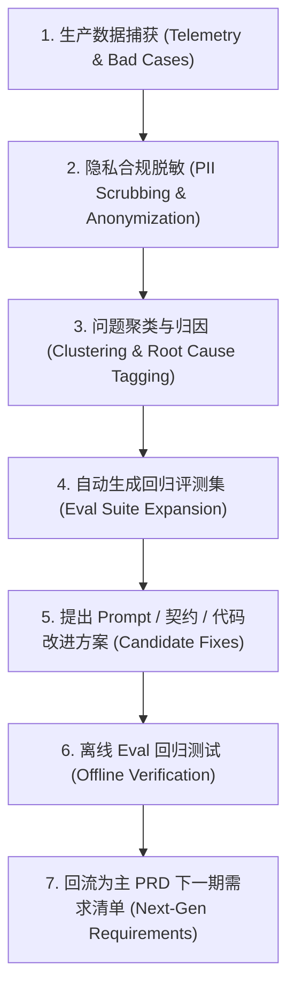

# Feedback Flywheel Skill (数据飞轮与持续迭代回流)

> **定位**：让每一次用户使用与线上失败都成为系统进化的养分，形成“数据 -> 评测用例 -> 模型/Prompt 调优 -> 产品升级”的持续自增强飞轮。
> **核心原则**：上线不是终点，而是数据飞轮的起点。用户反馈必须结构化沉淀，严禁将未脱敏的用户隐私用于模型调试。

---

## 1. 触发时机 (Trigger Condition)

当出现以下情况时，激活并执行本 Skill：
1. 收集到真实用户的显式反馈（如点赞/点踩、修改 AI 生成内容、客服投诉）；
2. 捕获到线上真实运行产生的 Bad Cases（如生成质量不佳、用户立即重新生成的样本）；
3. 进行周期性产品迭代规划，需要将线上数据转化为下一阶段 PRD 需求与架构优化目标时；
4. 自动化生成针对性回归评测集用例（Regression Eval Cases）时。

---

## 2. 数据飞轮闭环工作流 (The Flywheel Loop)



---

## 3. 生产反馈转化标准模板 (Feedback-to-Eval Spec)

```markdown
# 生产反馈沉淀与飞轮改进单

- **批次编号**：`FLYWHEEL-20260814-BATCH1`
- **数据来源**：线上用户点踩（Thumbs Down）与主动重新生成样本
- **有效样本量**：35 条

### 1. 问题聚类与频率分析
| 类别 | 占比 | 典型用户表现 | 根本原因 |
|---|---|---|---|
| 宠物特质标签过于笼统 | 60% | “感觉每只狗测出来都差不多” | Prompt 缺乏针对不同犬种细分维度的约束 |
| 问卷中途流失 | 25% | 用户在第 12 题离开 | 问卷单屏题量过载，缺乏即时反馈动效 |
| 结果加载偶发等待超时 | 15% | 等待超过 8 秒后刷新页面 | 未配置流式 SSE 输出，全量返回等待感强 |

### 2. 自动化产出资产
1. **新增回归评测用例**：
   - 提取 10 条经过脱敏的真实边缘犬种输入，补充至 `tests/evals/dataset.jsonl`；
2. **Prompt 调优建议 (PROPOSED)**：
   - 在 System Prompt 中增加针对 15 种高频犬种性格差异的 Few-Shot 说明；
3. **下期产品需求回流 (Input to Phase 1 PRD Backlog)**：
   - 需求 1：升级生成体验为流式打字机效果（SSE），降低用户感知延迟；
   - 需求 2：问卷重构为轻量分步卡片流（Stepped Interactive Cards）。
```

---

## 4. 红线守则 (Guards & Hard Boundaries)

- [ ] **严禁未经脱敏使用用户数据**：所有回流至评测集或用于 Prompt 优化的真实数据，必须严格脱敏处理（剔除人名、电话、地址、私密照片等）；
- [ ] **严禁将相关性直接当作因果性**：不得仅凭少量点踩盲目修改核心逻辑，必须结合统计显著性与离线评测验证；
- [ ] **严禁绕过主 PRD 事实源**：飞轮提炼出的新需求必须按正规流程经过技术负责人确认并记录到 `process.md`，禁止私自加需求。
