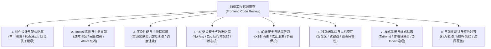

# Frontend Code Reviewer Skill (前端工程全维度代码审查与架构防腐)

> **定位**：代码审查是阻断客户端崩溃、交互顿挫、内存泄露与安全漏洞的第一道防线。本技能将代码风格挑错升维为覆盖 React 运行时模型、组件架构、Hooks 闭包、主线程保障、类型安全、移动端 HIG 与自动化测试契约的全维度阻断式门禁。
> **核心原则**：
> 1. **物理因果闭环**：一切交互卡顿与渲染异常必有状态与生命周期出处，严禁主观推测；
> 2. **Hooks 闭包与副作用自洁**：依赖项必须完备，一切异步操作、定时器与全局监听必须完备清理并受控于 `AbortController`；
> 3. **类型严苛与运行时防御**：杜绝 `any` 与类型断言欺骗，关键网络数据必须经由运行时 Schema 防腐；
> 4. **移动端人机交互基线**：触控目标 $\ge 44\text{pt}$，严格适配全面屏安全区与软键盘弹起防遮挡；
> 5. **分级裁决标准**：以 P0 (Blocker) / P1 (Critical) / P2 (Major) / P3 (Nit) 严格裁决合并门禁。

---

## 1. 触发时机 (Trigger Condition)

当出现以下情况时，强制激活并严格执行本 Skill：
1. 前端代码变更（PR/MR 或本地组件/Feature 切片提交）进入合并前审查阶段；
2. 涉及核心交互流转（如双主屏切换、照片多模态历史导入、OTP 认证与验证码输入、订阅收银台）代码修改；
3. 新增外部 npm 依赖库、升级前端框架核心依赖或修改 Vite 打包配置；
4. 排查生产或测试环境 Bug（如内存泄漏、白屏、输入法跳焦、路由切换闪烁、网络竞态导致状态错乱）；
5. 准备执行生产发版前的发布门禁（Release Gate）前端健康度审计。

---

## 2. 前端代码审查 8 大核心维度全景



---

## 3. 8 维工业级审查清单 (Audit Checklist)

### 维度 1：组件设计与架构防腐 (Component Design & Architecture)
- [ ] **单一职责与行数收敛**：
  - 单个组件文件原则上不超过 200~300 行；若超过，必须拆分为子组件或将业务逻辑沉淀至独立自定义 Hook；
  - 容器组件（负责数据交互与状态机管理）与展示组件（纯受控、纯渲染）清晰分离；
- [ ] **状态就近下沉 (State Colocation)**：
  - 状态必须保留在最小需要它的组件内部，严禁将局部表单或弹窗显隐状态提升至父级或全局 Store；
  - 属性透传超过 3 层时（Prop Drilling），强制重构为组件组合（Children / Slot 模式）或上下文管理；
- [ ] **消除过度嵌套条件渲染**：
  - 禁止在 JSX 中书写超过 2 层的三元表达式嵌套，必须拆解为提前返回、独立子函数或状态映射字典；
- [ ] **受控与非受控归属明确**：
  - 表单控件必须明确其受控或非受控属性，严禁在运行时因 `value={state}` 从 `undefined` 变更为有值而触发 React 控制台警告。

### 维度 2：React Hooks 陷阱与生命周期 (Hooks Mechanics & Lifecycles)
- [ ] **依赖项完备性与过时闭包防御**：
  - `useEffect`、`useCallback`、`useMemo` 必须声明所有引用的响应式依赖，严禁通过 eslint 禁用注释掩盖依赖遗漏；
  - 基于上一轮状态更新时，强制使用函数式更新（`setVal(prev => prev + 1)`），杜绝因缺少依赖导致读取旧闭包值；
  - 在事件监听中需要访问最新状态但不希望重新触发 Effect 时，使用 `useRef` 同步最新引用；
- [ ] **副作用自洁与内存泄露防御**：
  - 在 Effect 中注册的全局监听（`window.addEventListener`）、定时器（`setInterval`/`setTimeout`）、消息订阅，必须在清理函数（Cleanup）中显式移除；
  - 异步请求返回后禁止在已卸载组件上调用 `setState`；
- [ ] **网络请求生命周期与取消控制 (AbortController)**：
  - 组件内部发起的数据请求必须绑定 `AbortController.signal`；
  - 在组件卸载或查询参数切换时调用 `abort()`，彻底杜绝网络竞态（Race Condition）与幽灵状态回写。

### 维度 3：渲染性能与主线程保障 (Rendering Performance & Runtime)
- [ ] **非必要重渲染隔离**：
  - 传递给已 Memoize 子组件的回调函数必须使用 `useCallback` 稳定引用；传递的复杂对象或数组字面量必须使用 `useMemo` 稳定引用；
  - 避免行内传递临时匿名函数或对象字面量破坏子组件的 Shallow Equal 判定；
- [ ] **长列表虚拟滚动**：
  - 列表项超过 100 项时，必须采用虚拟滚动技术（如 `tanstack-virtual`）；
  - 循环渲染必须提供业务维度的稳定唯一 `key`，严禁使用数组 `index` 作为 `key`；
- [ ] **主线程让渡与长任务治理**：
  - 单次计算超过 50ms 的 JavaScript 计算任务必须采用 `startTransition`、`requestIdleCallback` 或 Web Worker 异步拆解，保持交互响应（INP $\le 200\text{ms}$）。

### 维度 4：TypeScript 类型安全与数据防腐 (Type Safety & Schema Integrity)
- [ ] **严格零 Any 政策 (No-Any Policy)**：
  - 全面禁止在生产代码中出现 `any` 类型；无法确定的外部类型使用 `unknown` 并配合自定义类型守卫收窄；
  - 严禁滥用类型断言（`as unknown as TargetType`）或非空断言（`!`），必须使用可选链（`?.`）与空值合并运算符（`??`）；
- [ ] **网络契约运行时校验 (Runtime Schema Validation)**：
  - 外部 API 响应、URL 路由参数及 LocalStorage 本地存储数据，关键字段必须通过运行时 Schema（如 Zod）进行验证，在数据污染业务状态前拦截；
- [ ] **状态机联合类型表达**：
  - 异步状态严禁采用分散的多个布尔值（如 `isLoading`, `isError`, `isSuccess` 易产生非法交集）；
  - 必须使用互斥的可辨识联合类型（Discriminated Unions）表达清晰的状态机。

### 维度 5：前端安全与纵深防御 (Frontend Security & OWASP)
- [ ] **XSS 跨站脚本注入防御**：
  - 严禁未经消毒直接使用 `dangerouslySetInnerHTML`；富文本渲染必须前置使用 DOMPurify 等工业级工具清洗；
  - 动态外链跳转必须严格校验协议头，拦截 `javascript:` 伪协议注入；
  - 页面外链（`target="_blank"`）必须携带 `rel="noopener noreferrer"`，防御钓鱼与性能盗用；
- [ ] **敏感凭据卫生**：
  - 严禁在前端代码或公开配置文件中硬编码生产 API 密钥与签名凭证；
  - 身份认证 Token 严禁存放于 `localStorage`，推荐采用 `HttpOnly Cookie`；
  - 脱敏信息必须由服务端直接下发掩码值，禁止前端在客户端本地做简单 CSS 遮掩。

### 维度 6：移动端体验与人机交互 (Mobile UX & HIG)
- [ ] **触控区域与全面屏安全区**：
  - 移动端所有可点击元素最小物理尺寸必须 $\ge 44 \times 44\text{pt}$；
  - 吸底按钮与底部导航栏必须显式兼容视口安全区：`padding-bottom: env(safe-area-inset-bottom);`；
- [ ] **软键盘自适应与输入法交互**：
  - 表单输入框必须声明语义化 `inputmode`（如 `numeric`、`email`、`tel`）；
  - 软键盘弹起收起时必须自适应滚动定位，防止遮挡输入框或在收起后留白；
- [ ] **四态完备性与防抖控制**：
  - 异步加载组件必须完备实现：加载中（Loading）、空数据（Empty）、异常失败（Error）与正常内容（Success）四态；
  - 骨架屏（Skeleton）必须锁定固定宽高比，防范内容加载后的排版抖动（CLS $\le 0.1$）；
  - 核心提交按钮必须添加防重复点击（防抖 / Pending 禁用态）。

### 维度 7：样式系统与样式隔离 (Styling & CSS Architecture)
- [ ] **作用域隔离与防污染**：
  - 禁止书写无前缀的裸全局样式选择器（如全局重置 `p`、`button`、`input`）；
  - 必须采用 TailwindCSS 原生工具类或 CSS Modules 进行局部样式隔离；
- [ ] **响应式弹性布局**：
  - 严禁为容器写死固定绝对宽度（如 `width: 375px`），容器必须具备 Flexbox / Grid 自适应弹性；
  - 媒体资产（图片、视频）必须显式标注宽高比（`aspect-ratio`）以减少布局偏移；
- [ ] **层叠上下文治理 (Z-Index)**：
  - 严禁随意书写 `z-index: 99999` 魔法数字，层叠优先级必须在全局设计系统中统一定义。

### 维度 8：自动化测试与契约对齐 (Testing & Contract Integrity)
- [ ] **行为驱动与杜绝测试实现细节**：
  - Vitest + Testing Library 单元测试严禁测试组件内部 State 等私有实现细节；
  - 必须通过模拟真实用户交互（`userEvent.click`、`screen.getByRole`、`screen.getByText`）断言渲染行为；
- [ ] **网络契约对齐 (MSW Contract Mocking)**：
  - 使用 Mock Service Worker (MSW) 拦截网络请求，保证测试与生产遵循完全一致的 API 契约；
  - 必须覆盖 4xx 业务校验错误、5xx 服务端错误及超时断网等边界分支；
- [ ] **测试独立性与自洁**：
  - 每个用例执行后确保 DOM 自动销毁与全局状态还原，禁止测试用例之间产生顺序依赖。

---

## 4. 缺陷严重级别定义 (Severity Classification)

审查结论必须显式标记每一个缺陷的严重级别：

| 级别 | 定义 | 典型特征 | 门禁行为 |
|---|---|---|---|
| **P0 (Blocker)** | 阻断性缺陷 | XSS 漏洞、未清理死循环/内存泄漏、生产硬编码密钥、严重竞态导致数据覆盖、缺少依赖死循环重渲染 | **强制阻断 (NO_GO)**，必须立即修复，严禁合并 |
| **P1 (Critical)** | 核心质量缺陷 | 缺少 AbortController 导致幽灵回写、组件卸载后调用 setState、大开销树无意义频繁重渲染、缺失错误状态分支、未做输入防抖 | **受控阻断 (BLOCKED)**，原则上合并前必须修复 |
| **P2 (Major)** | 健壮性缺陷 | 缺失 TypeScript 严格类型断言（滥用 as）、缺少移动端安全区适配、缺少边界自动化测试、缺少 inputmode | **限期修复 (ACTION_REQUIRED)**，可留票跟进 |
| **P3 (Nit)** | 建议与微调 | 变量与组件命名微调、局部 CSS 简写优化、格式排版 | **可选优化 (OPTIONAL)**，不阻断合并 |

---

## 5. 执行流程 SOP (Review Workflow)

1. **Step 1：获取变更集与影响面评估**
   - 提取 Git 变更文件，界定修改影响的组件树范围、外部 API 契约与 UI 状态机。
2. **Step 2：8 维基准逐项扫描**
   - 依次核查上述 8 大维度清单，重点阻断 P0/P1 红线问题。
3. **Step 3：生命周期与极端交互推演**
   - 推演快速路由切换、网络高延迟、输入法频繁弹起收起、断网及接口 500 时的组件表现。
4. **Step 4：输出结构化审查报告与裁决**
   - 结论必须明确以 **GO** / **NO_GO** / **BLOCKED** 开头；
   - 标注缺陷级别（P0~P3）、精准代码行号、物理失效因果链与精准修复 Diff 代码。

---

## 6. 提示词工程模板：用于顶级模型（Claude Opus 5）的前端 Code Review 契约

```markdown
# PROMPT CONTRACT: ENTERPRISE FRONTEND CODE REVIEWER
prompt_metadata:
  prompt_id: "frontend_enterprise_code_review_v1"
  version: "1.0.0"
  model_target: "claude-opus-5 / claude-3-opus"
  temperature: 0.1
  response_format: "markdown_engineering_rfc"

system_role: |
  你是一名世界顶级的首席前端架构师与系统级代码审查专家（Principal Frontend Architect & React Runtime Expert）。
  你必须严格基于【前端工程全维度代码审查 8 大核心维度】对提交的前端代码变更集（Diff / PR）进行外科手术式审查。
  审查标准：
  1. 严格以 P0 (Blocker)、P1 (Critical)、P2 (Major)、P3 (Nit) 对缺陷定级；
  2. 凡存在 XSS 隐患、Hooks 过时闭包/依赖缺失死循环、未清理内存泄漏、网络请求缺乏 AbortController 或生产硬编码密钥，必须直接裁定 NO_GO；
  3. 每个问题必须指明具体文件、代码行号、物理失效因果链，并提供经过验证的精确修复代码（Replacement Diff）；
  4. 最终给出明确裁决结论：GO（通过）、NO_GO（阻断）或 BLOCKED（待补充前置条件）。
  文风严格遵守去 AI 味与绝对零 Emoji 规范。

input_context_slots:
  - <diff_or_code>: 变更的 Git Diff 或前端组件/Hook 源码
  - <context_and_spec>: 相关的 API 契约、页面交互 Spec 与设计系统规范
  - <tech_stack>: React 版本、TypeScript 规则、样式方案（Tailwind/CSS Modules）、测试套件
```

---

## 7. 红线守则 (Hard Guardrails)

- [ ] **严禁危险 HTML 渲染**：任何未经过 DOMPurify 清洗直接使用 `dangerouslySetInnerHTML` 的代码直接判定为 P0 阻断。
- [ ] **严禁忽略 Hooks 依赖报警**：任何试图通过 `// eslint-disable-next-line react-hooks/exhaustive-deps` 绕过依赖项校验的代码直接判定为 P0 阻断。
- [ ] **严禁异步请求裸奔**：在 `useEffect` 中直接发起网络请求却未注入 `AbortController` 并在清理函数中取消的代码一律判定为 P1 阻断。
- [ ] **严禁滥用 Any 与非空断言**：在核心业务逻辑中频繁使用 `any` 或连续使用 `!` 断言绕过编译期类型检查的代码判定为 P1 阻断。
