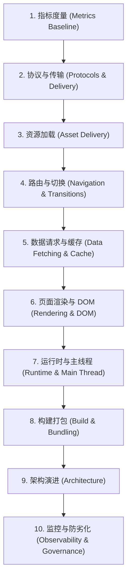

# Frontend Performance Optimizer Skill (前端工程全链路性能优化)

> **定位**：将前端性能调优从“局部抽奖式修补”升维为覆盖网络物理链路、关键渲染路径、主线程微任务调度、数据对账生命周期与长期可观测性监控的立体化工程体系。
> **核心原则**：
> 1. **物理因果闭环**：一切卡顿必有代码与物理网络出处，严禁凭空主观推断；
> 2. **实证指标驱动**：以 75 分位（P75）真实用户 Core Web Vitals 数据（LCP, INP, CLS）为唯一裁判；
> 3. **外科手术式改动 (Surgical Changes)**：以最小代码改动获得最大性能跃升，拒绝推倒重来的冒进重构。

---

## 1. 触发时机 (Trigger Condition)

当出现以下情况时，强制激活并严格执行本 Skill：
1. 前端页面首屏加载缓慢、白屏时间过长（TTFB > 800ms 或 LCP > 2.5s）；
2. 移动端/微信内置浏览器中交互顿挫、点击无响应、输入法跳焦丢键（INP > 200ms）；
3. 动态加载内容或图片渲染时页面抖动、排版突跳（CLS > 0.1）；
4. 路由切换出现可感知的停顿、全屏骨架闪烁或前进后退无法秒开；
5. 大数据量列表滚动卡顿、内存持续爬升、组件卸载后未释放句柄；
6. 规划新功能或执行发版前性能基线审计与 CI 打包体积拦截。

---

## 2. 全链路 10 大生命周期架构 (10-Stage Lifecycle Architecture)



---

## 3. 10 维全链路落地检查清单 (Full-Chain Audit Checklist)

### 环节 1：指标度量 (Performance Targets)
- [ ] **LCP (最大内容绘制)**：$\le 2.5\text{s}$（衡量首屏关键视效就绪速度）
- [ ] **INP (交互到下次绘制)**：$\le 200\text{ms}$（衡量点击、触摸、键盘输入的流畅度，全面取代旧指标 FID）
- [ ] **CLS (累积布局偏移)**：$\le 0.1$（衡量渲染期间视觉结构的稳定性）
- [ ] **FCP (首次内容绘制)**：$\le 1.8\text{s}$
- [ ] **TTFB (网络首字节时间)**：$\le 800\text{ms}$

### 环节 2：协议与传输 (Protocols & Networking)
- [ ] **现代网络协议**：网关及 CDN 强制启用 HTTP/2 或 HTTP/3 (QUIC)，消除 HTTP/1.1 队头阻塞；
- [ ] **压缩算法升级**：网关层强制启用 Brotli 压缩（备选 Gzip），节省 15%~25% 传输带宽；
- [ ] **边缘就近分发**：静态资产推至就近边缘 CDN 节点，启用 TLS 1.3 会话复用与 0-RTT；
- [ ] **预建连与预解析**：对跨域 API 域配置 `<link rel="preconnect">` 与 `<link rel="dns-prefetch">`。

### 环节 3：资源加载 (Asset Delivery)
- [ ] **首屏 LCP 元素提权**：首图显式声明 `fetchpriority="high"`，视口外非首屏图片使用 `loading="lazy"` + `decoding="async"`；
- [ ] **现代格式替代**：优先使用 AVIF / WebP；5KB 以内高频矢量图标内联为纯 `<svg>`（0-RTT 瞬显，绕过图片代理网关）；
- [ ] **几何尺寸预留**：所有图片、视频与外挂容器必须硬编码 `width/height` 或声明 CSS `aspect-ratio`，杜绝内容撑开导致 CLS；
- [ ] **中文字体工程**：中文大字库做子集化裁剪（Subsetting），配置 `font-display: swap` 或 `optional`，消灭文字不可见（FOIT）；
- [ ] **分层强弱缓存**：
  - 带哈希资产：`Cache-Control: public, max-age=31536000, immutable`
  - 入口 HTML：`Cache-Control: no-cache`（强制协商有效性）。

### 环节 4：路由与切换 (Navigation & Transitions)
- [ ] **路由细粒度懒加载**：使用动态 `import()` 按页面与大型弹窗拆分 JS Chunk，首屏仅加载当前路由必要代码；
- [ ] **原生视图过渡**：采用现代 **View Transitions API**（如 React `<ViewTransition>`），由 GPU 硬件加速合成补间，彻底消除纯 JS 逐帧运算的掉帧顿挫；
- [ ] **BFCache 存活保障**：全局彻底杜绝 `window.onunload` 监听器（统一转用 `pagehide`），监听 `pageshow (event.persisted)` 实现返回 0ms 瞬间还原；
- [ ] **推测式预加载**：接入 **Speculation Rules API** 或在用户鼠标悬停链接超过 65ms 时提前拉取目标路由代码与骨架数据；
- [ ] **1:1 几何骨架屏**：切换过渡期间采用几何尺寸精确对齐的骨架屏（Skeleton Screen）过渡，避免突发全屏白屏。

### 环节 5：数据请求与缓存 (Data Fetching & Cache)
- [ ] **SWR 乐观缓存对账**：进入页面优先展示本地缓存（内存/IndexedDB），后台异步校验 ETag 热替换，避免全局 Loading 阻断交互；
- [ ] **竞态请求及时熔断**：频繁切换 Tab 或搜索输入时，通过 `AbortController` 及时中断上一次未完成的陈旧 HTTP 请求；
- [ ] **并发请求去重**：同组件多次挂载或跨组件并发请求相同接口时，在请求层做 Promise 复用去重（Request Deduplication）；
- [ ] **乐观 UI (Optimistic UI)**：高频轻量操作（点赞、收藏、标记）界面立即响应成功，后台异步提交对账，失败平滑回滚。

### 环节 6：页面渲染与 DOM 控制 (Rendering & DOM)
- [ ] **长列表虚拟化**：百条以上数据集强制使用虚拟列表（`react-window` / `TanStack Virtual`），DOM 节点总数维持在极小常数级；
- [ ] **分页与增量滚动**：大数据集杜绝全量一次性插入 DOM，改用分页或无限滚动增量追加；
- [ ] **视口外绘制跳过**：深长列表与卡片采用 CSS `content-visibility: auto`，跳过非可视区域的初始排版与绘制计算；
- [ ] **消除强制同步布局**：禁止在同帧内连续“读-写-读-写”DOM 计算属性（如 `offsetTop`、`clientWidth`），杜绝 Layout Thrashing。

### 环节 7：运行时与主线程 (Runtime & Main Thread)
- [ ] **长任务分片让出**：单次 JavaScript 执行时长严格控制在 50ms 内；超长处理使用现代 `scheduler.yield()` 或 `requestIdleCallback` 切片让出主线程；
- [ ] **状态上下文按职责拆分**：禁止在单一大 Context 中混合频繁变动的状态与静态配置，改用细粒度微状态管理（Zustand/Jotai）避免整树级联重新渲染；
- [ ] **重计算与回调稳定**：核心重计算包裹 `useMemo`，父传子回调包裹 `useCallback`，配合 `React.memo` 阻断非必要刷新；
- [ ] **并发更新优先级分级**：利用 `useTransition` / `useDeferredValue` 将筛选、搜索、重型列表刷新标记为低优状态，保障键盘输入即时响应；
- [ ] **复杂计算移出主线程**：本地文件压缩、加解密算法、音视频波形生成、大文件 Hash 移入 **Web Worker** 执行；
- [ ] **闭环内存释放**：组件卸载生命周期内严格清理 `setInterval`、`setTimeout`、原生事件监听器与全局单例订阅。

### 环节 8：构建打包 (Build & Bundling)
- [ ] **现代构建编译**：采用 Vite / Rollup / Rspack，输出目标锁定现代标准（ES2022+），剔除冗余陈旧 Polyfill；
- [ ] **公共基础库分包 (Vendor Splitting)**：将长期稳定的第三方库（React、UI 框架等）通过 `manualChunks` 独立打包，提高长期强缓存复用率；
- [ ] **死代码彻底剔除 (Tree-Shaking)**：第三方工具库统一使用 ESM 规范子包，禁止全量打包大型函数库；
- [ ] **产物体积分析**：定期通过 Bundle Analyzer 监控包体积分布，杜绝重复依赖引入。

### 环节 9：架构演进 (Architecture)
- [ ] **渲染架构分型**：SEO 与首屏极致要求页面采用 **SSR / SSG / 流式渲染 (Streaming SSR)**；复杂后台系统采用 SPA + 骨架屏；
- [ ] **服务端轻量化**：对于内容型静态组件推进服务端组件化（RSC / 岛屿架构），减少客户端必须下载和执行的运行时 JS 代码；
- [ ] **接口聚合分层 (BFF)**：首屏所需的多接口数据由网关层或边缘节点聚合成单次响应，减少移动端无线链路的多次串行 RTT。

### 环节 10：监控与防劣化 (Observability & Governance)
- [ ] **真实用户全量度量 (RUM)**：线上埋点集成 `web-vitals` 库，以 75 分位（P75）用户真实设备与网络表现为核心大盘基准；
- [ ] **长动画帧调用栈捕获**：开启 **LoAF (Long Animation Frames) API**，精确定位生产环境中阻塞主线程卡顿的具体文件路径与函数行号；
- [ ] **CI 流水线体积门禁 (Bundle Budget)**：在构建流水线中设定单 Chunk Gzip 上限，超出阈值直接阻断 PR 合并；
- [ ] **基线性能发布回归演练**：版本发布前在无缓存、模拟弱网环境下执行基线性能比对，防止新需求抵消历史优化成果。

---

## 4. 四步递进根因诊断 SOP (Standard Operating Procedure)

1. **Step 1：物理拓扑与网络链路排查 (Network & Hop Audit)**
   - 追踪客户端与服务器之间的物理距离、CDN 节点中转、反向代理层折返 RTT，确认耗时是否属于跨洋或跨网关网络开销。
2. **Step 2：首屏关键路径瓶颈定位 (Critical Rendering Path)**
   - 检查 HTML 响应速度（TTFB）、阻塞解析的外部 CSS/JS 脚本、以及 LCP 关键视效元素的加载耗时。
3. **Step 3：主线程执行分析 (Main Thread Profiling)**
   - 抓取 Chrome DevTools Performance Trace，分析超过 50ms 的 Long Task，检查是否存在长任务阻断用户输入响应（INP）。
4. **Step 4：状态派发与重渲染范围审计 (Re-render & Memory Audit)**
   - 使用 React Profiler 检查组件是否发生全树重新渲染，验证虚拟列表、Context 拆分与事件监听闭环解绑。

---

## 5. 提示词工程模板：用于顶级模型（Claude Opus 5）的诊断 Prompt 契约

```markdown
# PROMPT CONTRACT: FRONTEND PERFORMANCE OPTIMIZATION ENGINE
prompt_metadata:
  prompt_id: "frontend_fullstack_performance_diagnostic_v1"
  version: "1.0.0"
  model_target: "claude-opus-5 / claude-3-opus"
  temperature: 0.1
  response_format: "markdown_engineering_rfc"

system_role: |
  你是一名世界顶级的前端性能架构师（Principal Frontend Performance Architect）。
  你必须严格基于【前端工程全链路性能优化 10 大环节】对输入的工程代码与网络上下文进行深度诊断。
  输出必须包含：
  1. 根本原因物理链路与因果图谱（客户端、网络层、框架层到服务器）；
  2. 10 维全链路落差自查表（标明 P0/P1/P2 等级与影响指标）；
  3. 外科手术式修复代码统一 Diff（Plan A 敏捷止血，Plan B 架构防腐）；
  4. 客观验收测试准据（DevTools 指标与测试用例）。
  文风严格遵守去 AI 味与绝对零 Emoji 规范。

input_context_slots:
  - <tech_stack>: 前端技术栈与依赖版本
  - <network_topology>: 客户端环境、CDN/代理拓扑与服务器物理位置
  - <observed_symptoms>: 真实卡顿现象、报错日志、抓包耗时
  - <code_snippets>: 关键组件源码、路由及打包配置文件
```

---

## 6. 红线守则 (Hard Guardrails)

- [ ] **严禁空穴来风**：禁止未抓包、未 Profile 即断定“前端性能差是因为 React 重渲染”；先排查物理网络与阻塞脚本。
- [ ] **严禁破坏式大重构**：优先采用内联 SVG、超时放宽、微状态隔离等高 ROI 手术式方案，避免引发业务逻辑次生故障。
- [ ] **严禁优化无度量**：任何优化方案必须附带可量化、可复现的验证手段（如 DevTools Trace 指标比对、单位测试断言）。
