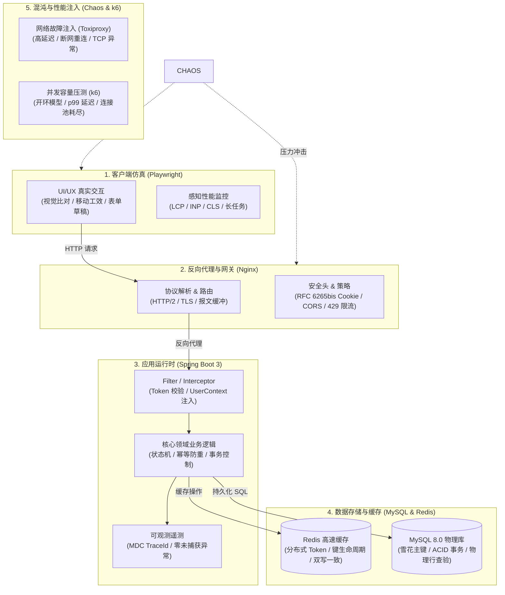

# Fullstack QA Architect Skill (全栈测试架构师与全链路生产模拟联调)

> **定位**：测试绝非简单的 API 接口调用或局部 UI 冒烟，而是构建与生产拓扑 100% 物理镜像的高保真检验体系。本技能以“四维物理同构（用户视图、网络契约、应用运行时、底层存储）”为唯一裁判基准，对每一次变更执行全链路穿透式联调与防腐门禁。
> **核心原则**：
> 1. **拒绝接口自证 (No Self-Proving APIs)**：绝不通过调用只读接口来证明写入成功，必须穿透到底层 MySQL/Redis 进行物理核验；
> 2. **伪绿欺骗零容忍 (Zero False Green Tolerance)**：前端视图绿灯但后端日志存在未捕获异常、慢查询或资源泄露，一律判定为阻断性缺陷；
> 3. **人机工效与真实拟真 (True Real-User Ergonomics)**：模拟真实输入节拍、视口适配、网络抖动与会话中断现场保护；
> 4. **环境物理归零 (Hermetic Environment)**：单次测试必须自给自足，测试前后数据库与缓存必须物理归零，零脏数据泄漏；
> 5. **确定性时序控制 (Deterministic Synchronization)**：绝对禁绝固定 sleep，一律采用事件驱动与网络响应因果等待。

---

## 1. 触发时机 (Trigger Condition)

当出现以下任一场景时，强制激活并严格执行本 Skill：
1. 新增或修改系统核心业务接口，进入端到端全链路验收阶段；
2. 涉及用户认证鉴权、分布式会话流转、支付核销、额度扣减等核心状态机变更；
3. 修改接入层 Nginx 配置、CORS 策略、安全 Cookie 属性或网关限流超时规则；
4. 前后端联调出现“前端报错静默吞掉”或“偶发性状态倒流”等隐蔽缺陷；
5. 系统准备执行发布前性能容量基线摸高与混沌韧性验证。

---

## 2. 全链路联调拓扑全景 (Full-Stack Topology)



---

## 3. 6 维工业级测试架构清单 (Architecture Checklist)

### 维度 1：UI/UX 真实用户行为仿真与感知质量 (Client & Ergonomics)
- [ ] **视觉回归与亚像素保真**：
  - 核心界面比对基准快照，动态数据与头像执行遮罩处理，差异像素率必须控制在 0.1% 以内；
  - 检查深色/浅色模式切换、不同 DPR（Device Pixel Ratio 1x/2x/3x）下边框渲染无断裂；
- [ ] **人机工效与真实操作拟真**：
  - 移动端视口（iPhone 15 Pro, Pixel 7）与安全区（Safe Area Insets）物理留白合规；
  - 触摸热区最小不低于 44x44pt，按钮防误触与反馈高亮状态准确；
  - 真实输入仿真：调用 `page.type(selector, text, { delay: 50 })` 产生连续按键事件，验证输入防抖与自动格式化；
- [ ] **会话失效原位保护 (In-Situ Re-Auth)**：
  - 模拟用户在复杂表单填写中途 Session 过期（主动失效 Redis Token 或 Mock 401）；
  - 验证表单内容通过本地防抖草稿（`safeStorage`）完整保留；
  - 拦截 401 后原地唤起轻量登录抽屉，登录完成后抽屉自动收起并无缝原路提交，严禁整页重刷或丢失输入。

### 维度 2：Nginx 接入网关与网络契约合规 (Gateway & Transport)
- [ ] **Cookie 工业级规范 (RFC 6265bis)**：
  - 验证鉴权 Cookie 必须包含 `__Host-` 前缀（如 `__Host-vivibon_session`）；
  - 强制包含 `Path=/`、`Secure`、`HttpOnly` 与 `SameSite=Lax`（或 `Strict`），禁止暴露给客户端 JavaScript 读取；
- [ ] **HTTP 语义与头部透传**：
  - 验证前端传入的 `X-Trace-Id` 成功由 Nginx 透传至后端，并在响应头中原样携带返回；
  - CORS 跨域配置：预检请求 `OPTIONS` 必须返回 `204 No Content`，严禁在生产开启 `Access-Control-Allow-Origin: *` 与 `Allow-Credentials: true` 的冲突组合；
- [ ] **网关韧性与报文控制**：
  - 验证超大文件上传超出 `client_max_body_size` 时网关正确截断并返回 413；
  - 注入 Nginx 上游超时（`proxy_read_timeout`），断言网关返回标准化 504 响应，前端展示友好的“网络连接超时”重试视图。

### 维度 3：后端运行时、上下文隔离与遥测审计 (Backend Runtime & Logs)
- [ ] **线程上下文物理清空**：
  - 验证每次请求进入由拦截器解析 Token 并初始化 `UserContext.set(userId)`；
  - 验证无论请求正常返回还是抛出异常，`afterCompletion` 必须强制触发 `UserContext.clear()`，防止线程池复用串号；
- [ ] **后端日志零静默异常门禁**：
  - 联调期间全量检索后端控制台日志，严禁出现任何未经处理的堆栈报错（`NullPointerException`, `IllegalStateException`, `SQLSyntaxErrorException`）；
  - 严禁业务失败时以 HTTP 200 状态码伪装成功；
- [ ] **状态机流转守卫**：
  - 严格校验非法状态转移（如由 `COMPLETED` 倒流为 `PENDING`），必须被领域状态机拦截并返回符合 RFC 9457 规范的错误结构体。

### 维度 4：物理存储持久化与缓存一致性 (Database & Cache Ground-Truth)
- [ ] **MySQL 物理行直连核验**：
  - 执行原生 SQL 直接查验目标数据行（雪花主键格式、业务字段、UTC 时间戳、创建与更新时间）；
  - 验证软删除逻辑：逻辑删除后直接查询物理表，确认 `is_deleted = 1`，同时验证正常业务查询对已删除行完全隔离；
- [ ] **Redis 状态与生命周期核验**：
  - 查验 Redis 键名是否严格符合项目命名空间；
  - 核查 Value 序列化格式为可读 JSON，严禁出现二进制乱码前缀；
  - 验证精确 TTL 倒计时；验证用户主动注销或 Token 刷新时，旧 Token 在 Redis 中物理销毁；
- [ ] **测试数据沙箱归零 (Hermetic Teardown)**：
  - 测试用例必须在 `beforeAll` 与 `afterAll` 显式执行清理脚本，彻底删除测试产生的测试账号、伴宠档案及关联流水，保持环境零污染。

### 维度 5：突发场景、网络混乱与并发碰撞 (Chaos & Edge Cases)
- [ ] **高频并发双击提交 (Double-Submit Race)**：
  - 模拟客户端在 10ms 间隔内同时触发两次创建/支付请求；
  - 验证分布式锁或数据库唯一键生效，确保仅成功处理一笔，第二笔请求被拦截并返回友好提示，严禁数据重复落库；
- [ ] **网络异常突发阻断**：
  - 模拟请求飞行途中的网络断开（`page.route(..., route => route.abort('failed'))`）；
  - 验证前端乐观更新（Optimistic UI）能准确回滚并给出明确重试动作；
- [ ] **乐观锁碰撞对抗**：
  - 模拟两端同时更新同一实体，验证后到达的请求能正确捕获 409 Conflict 冲突并提供最新数据合并引导。

### 维度 6：容量负载、长尾延迟与资源饱和 (Stress & Performance)
- [ ] **开环负载压测 (Open Workload Model)**：
  - 使用 k6 按预定到达率（Arrival Rate）加压，覆盖基准并发、尖峰冲击（Spike Test）与浸泡压测（Soak Test）；
- [ ] **延迟长尾与分位数达标**：
  - 核心读接口：p95 < 50ms, p99 < 150ms；核心写接口：p95 < 100ms, p99 < 300ms；错误率必须小于 0.001%；
- [ ] **资源瓶颈诊断**：
  - 监控 HikariCP 连接池指标，排查长事务导致的连接池借出耗尽；
  - 观察 Java 21 虚拟线程在压测下的线程排队与载体线程状态，排除 `synchronized` 钉死。

---

## 4. 全链路联调测试代码规范示范 (Playwright Blueprint)

```typescript
import { test, expect } from '@playwright/test';
import mysql from 'mysql2/promise';
import Redis from 'ioredis';

test.describe('全链路生产模拟联调：用户核心业务流闭环', () => {
  let dbConnection: mysql.Connection;
  let redisClient: Redis;
  const testPhone = '13800008888';
  let createdUserId: string;

  test.beforeAll(async () => {
    // 1. 初始化直连物理资源客户端
    dbConnection = await mysql.createConnection({
      host: '127.0.0.1', port: 3306, user: 'root', password: 'password', database: 'vivibon'
    });
    redisClient = new Redis({ host: '127.0.0.1', port: 6379 });
    
    // 2. 环境物理归零：清理历史脏数据
    await cleanTestData();
  });

  test.afterAll(async () => {
    // 3. 执行完毕强制归零，防止污染测试库
    await cleanTestData();
    await dbConnection.end();
    await redisClient.quit();
  });

  async function cleanTestData() {
    await dbConnection.execute('DELETE FROM tb_user WHERE phone = ?', [testPhone]);
    const keys = await redisClient.keys('auth:token:*');
    if (keys.length > 0) await redisClient.del(...keys);
  }

  test('端到端全链路四维一致性闭环测试', async ({ page }) => {
    // 步骤 1：监听浏览器控制台与网络静默错误
    const consoleErrors: string[] = [];
    page.on('console', msg => { if (msg.type() === 'error') consoleErrors.push(msg.text()); });

    // 步骤 2：前端发起交互，确定性因果等待
    await page.goto('http://127.0.0.1:5173/login');
    await page.fill('input[name="phone"]', testPhone);
    
    // 预设拦截验证码发送，断言 Nginx 协议与安全头
    const [sendCodeResponse] = await Promise.all([
      page.waitForResponse(res => res.url().includes('/api/v1/auth/sms/code') && res.status() === 200),
      page.click('button#btn-send-code')
    ]);
    expect(sendCodeResponse.headers()['x-trace-id']).toBeDefined();

    // 步骤 3：直接从 Redis 提取验证码进行高保真实录
    const codeKey = `auth:sms:${testPhone}`;
    const code = await redisClient.get(codeKey);
    expect(code).toBeTruthy();

    // 步骤 4：填入验证码并提交登录
    await page.fill('input[name="code"]', code!);
    const [loginResponse] = await Promise.all([
      page.waitForResponse(res => res.url().includes('/api/v1/auth/login') && res.status() === 200),
      page.click('button#btn-submit-login')
    ]);

    // 步骤 5：断言 RFC 6265bis 安全 Cookie 契约
    const setCookie = loginResponse.headers()['set-cookie'] || '';
    expect(setCookie).toContain('__Host-vivibon_session=');
    expect(setCookie).toContain('Path=/');
    expect(setCookie).toContain('Secure');
    expect(setCookie).toContain('HttpOnly');
    expect(setCookie).toContain('SameSite=Lax');

    // 步骤 6：直连 MySQL 查验目标物理行数据真实性
    const [rows]: [any[], any] = await dbConnection.execute(
      'SELECT id, phone, status, created_at FROM tb_user WHERE phone = ? LIMIT 1',
      [testPhone]
    );
    expect(rows.length).toBe(1);
    createdUserId = rows[0].id;
    expect(rows[0].status).toBe('ACTIVE');

    // 步骤 7：查验 Redis 分布式会话与 TTL
    const sessionKey = `auth:session:${createdUserId}`;
    const ttl = await redisClient.ttl(sessionKey);
    expect(ttl).toBeGreaterThan(0);
    expect(ttl).toBeLessThanOrEqual(7 * 24 * 3600);

    // 步骤 8：断言无客户端静默报错
    expect(consoleErrors).toHaveLength(0);
  });
});
```

---

## 5. 一票否决硬红线门禁 (Pass / Reject Gate)

凡执行全链路测试，必须同时通过以下**五个一票否决指标**方可签发：
1. **客户端保真**：UI 视图真实可见且符合 Apple HIG 连续曲线与无抖动渲染，控制台零静默捕获报错；
2. **网关契约镜像**：HTTP 状态码精确对应，`Set-Cookie` 属性严格符合 RFC 6265bis 规范；
3. **物理落盘可验**：MySQL 通过原生 SQL 查询到符合雪花 ID 与时间戳的物理记录，业务状态转移合法；
4. **缓存生命周期吻合**：Redis 缓存键名、序列化结构与 TTL 倒计时物理存在，登出或注销后物理清除；
5. **环境物理归零**：测试套件执行完毕后环境零污染，脏数据清理率 100%。

**触发以下任一情况立即打回（Hard Blocker）**：
- 后端控制台出现任何未被全局拦截器捕获处理的 500 异常堆栈；
- 测试用例使用 `waitForTimeout` 盲等时序而非因果事件监听；
- 仅断言前端视图绿灯，缺少底层 MySQL / Redis 物理验证（伪持久化）。
