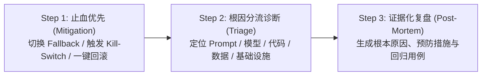

# Incident Diagnostician Skill (生产事故响应、诊断与复盘)

> **定位**：线上发生故障时的“急诊专家”与“复盘审计员”。先止血、再排查、后复盘，绝不在无证据下盲目修改生产。
> **核心原则**：线上故障恢复第一，排查根因第二。所有线上诊断基于脱敏日志，禁止在生产直接热更未经测试的代码。

---

## 1. 触发时机 (Trigger Condition)

当出现以下情况时，激活并执行本 Skill：
1. 监控报警触发（如错误率突增 > 1%、P95 延迟突增 > 10s、模型配额耗尽）；
2. 收到用户大量集中投诉（如“卡在生成中无法完成”、“生成的报告文不对题”）；
3. AI Provider 突发宕机、限流（429 Too Many Requests）或模型输出漂移时；
4. 故障恢复后，需要编写标准 SRE Post-Mortem 复盘报告时。

---

## 2. 事故响应三步法 (The 3-Step Incident Flow)



### 根因五层分流排查表 (5-Layer Root Cause Triage)
| 根因层级 | 典型症状 | 诊断排查路径 | 推荐止血手段 |
|---|---|---|---|
| **1. 模型 Provider 层** | 429 限流、503 服务不可用、推理极慢 | 检查外部状态页与 API 错误码 | 自动热切换备用模型 Provider 或降级模板 |
| **2. Prompt / 策略层** | 格式解析失败率飙升、拒答率异常增加 | 检查最新 Prompt 版本与上下文变动 | 回滚 Prompt 版本至上一稳定 Git Tag |
| **3. 业务代码层** | 500 内部服务错误、状态机非法流转 | 检查应用服务 Error Stack Trace | 执行代码版本回滚（Git Revert / Deploy Rollback） |
| **4. 领域数据层** | 某个特殊字符或脏数据导致解析崩溃 | 检查触发异常的入参 Payload | 增加前置参数拦截与数据清洗规则 |
| **5. 基础设施层** | Redis 内存溢出、数据库连接池耗尽 | 检查 CPU、内存、网络与连接数指标 | 扩容实例资源或重启只读副本 |

---

## 3. 标准 SRE 事故复盘报告模板 (Post-Mortem Template)

```markdown
# 生产故障复盘报告 (Incident Post-Mortem)

- **事故编号**：`INC-20260814-01`
- **故障等级**：`P1 / P2 / P3`
- **事故起止时间**：2026-08-14 20:15 ~ 20:38 (持续 23 分钟)
- **故障指挥人**：`[Tech Lead Name]`
- **受影响范围**：约 8% 的在线问卷用户遇到生成超时

### 1. 故障影响与时序线 (Timeline)
- `20:15`：上游模型 Provider 发生局部网络抖动，P95 延迟从 2.5s 飙升至 12s；
- `20:18`：监控告警触发，错误率达到 3.5%；
- `20:21`：技术负责人确认，手动触发 Kill-Switch 切换至 Deterministic Template 兜底；
- `20:25`：用户端报错完全恢复，前端展示兜底报告；
- `20:38`：上游 Provider 恢复正常，关闭 Kill-Switch 恢复模型生成。

### 2. 根本原因 (Root Cause)
由于后端 HTTP 客户端未设置严格的 `timeout`（当时为默认 30s），在上游服务变慢时大量连接被挂起，耗尽了前端 Node.js 的连接池，导致正常请求也被阻塞。

### 3. 预防与改进措施 (Action Items)
| 改进项 | 类型 | 负责人 | 截止日期 | 关联 PR / Issue |
|---|---|---|---|---|
| 为所有模型请求设置 6s 硬超时并立即触发 Fallback | 代码修复 | Tech Lead | 2026-08-15 | PR #12 |
| 在 CI 中补充模型高延迟下的超时模拟集成测试 | 测试增强 | Tech Lead | 2026-08-15 | PR #13 |
```

---

## 4. 红线守则 (Guards & Hard Boundaries)

- [ ] **严禁线上盲调**：严禁在未定位根因或未备份前直接在生产数据库手动执行 `UPDATE/DELETE`；
- [ ] **必须保留故障证据**：严禁清理报错样本或日志，所有异常 Payload 必须加密沉淀至 Bad Case 库供后续分析；
- [ ] **必须补充回归测试**：任何线上事故修复完成后，必须向测试集补充至少 1 个可复现该故障的自动化测试用例。
