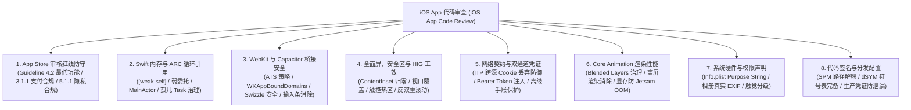

# iOS App Code Reviewer Skill (iOS App 原生与混合工程全维度代码审查与架构防腐)

> **定位**：移动客户端代码一旦发布，缺陷修复周期远长于服务端。代码审查是拦截 App Store 拒审、真机崩溃、界面掉帧与安全提权的第一道物理防线。本技能将代码风格审查升维为覆盖 Apple 审核准则、Swift ARC 内存模型、WebKit 桥接沙箱、Core Animation 渲染流与高保真人机工效的全维度阻断式门禁。
> **核心原则**：
> 1. **审核红线一票否决 (Pre-Emptive Review Defense)**：任何违反 Guideline 4.2、3.1.1、5.1.1 的代码改动直接裁定阻断，严禁抱有侥幸心理进入打包流；
> 2. **真实物理因果推演 (Physical Ground-Truth Causality)**：推演代码在物理设备多任务切换、内存警告、弱网断网与深色模式下的真实表现，严禁仅凭模拟器主观推断；
> 3. **ARC 零泄漏与线程安全 (Hermetic ARC & Concurrency)**：严禁在闭包与委托中产生强引用环，UI 状态更新必须严格调度至主线程（`MainActor`）；
> 4. **消灭网页残留伪原生 (Pure Native Ergonomics)**：代码改动若引入网页畸形产物（如键盘辅助条、外层滚动反弹、文字选中框），一律打回重构；
> 5. **分级裁决标准**：以 P0 (Blocker) / P1 (Critical) / P2 (Major) / P3 (Nit) 严格裁决代码合入门禁。

---

## 1. 触发时机 (Trigger Condition)

当出现以下任一场景时，强制激活并严格执行本 Skill：
1. 涉及 iOS 原生 Swift 代码、Xcode 配置（`Info.plist`、`project.pbxproj`、Entitlements）的变更进入代码审查时；
2. 涉及 Capacitor 配置文件（`capacitor.config.ts`）、原生桥接插件或 WebKit 容器交互逻辑修改时；
3. 客户端修改涉及用户登录会话、Cookie 保存、Token 传递或网络请求拦截层时；
4. 涉及虚拟资产展示、购买通道设计、充值提示或准备提交 App Store Connect 审核时；
5. 涉及系统权限申请（相册、相机、定位、通知）、硬件调用（Taptic Engine、EXIF 提取）的代码变更；
6. 发现长列表滑动掉帧、显存无界增长、或后台唤醒触发 Jetsam OOM 崩溃时；
7. 准备执行生产发版与 TestFlight 灰度前的发布门禁（Release Gate）全量代码健康度审计。

---

## 2. iOS 代码审查 8 大核心维度全景



---

## 3. 8 维工业级审查清单 (Audit Checklist)

### 维度 1：App Store 审核红线防守 (Guideline 4.2 / 3.1.1 / 5.1.1 Defense)
- [ ] **Guideline 4.2 杜绝单纯网页套壳 (Minimum Functionality)**：
  - 严禁提交仅作为网页快捷方式的空洞容器，必须具备原生生态能力（如离线手账数据浏览、系统 Taptic Engine 震动、相册底层 EXIF 读取）；
  - 严禁在界面中留下“Lorem Ipsum”、“测试占位文本”或点击无响应的“功能待上线”假按钮；
  - 登录流程必须为提审提供可用、数据完备的测试 Demo 账号与密码。
- [ ] **Guideline 3.1.1 与 3.1.3(b) 支付合规防反导 (Anti-Steering & IAP)**：
  - 客户端内严禁出现任何跳转至外部 Web 支付（Stripe、Alipay、微信支付等）的链接、按钮或引导文字（如“在网页端充值更优惠”）；
  - 解锁虚拟资产（会员等级、伴宠 AI 生成额度、数字手账皮肤模板）必须接入 Apple In-App Purchase (StoreKit 2)；
  - 若当前版本采用多平台纯消费模式（Multiplatform Services 3.1.3b），必须在 iOS 端彻底隐藏购买入口与升级弹窗，仅允许消耗在网页端已购的权益。
- [ ] **Guideline 5.1.1 隐私安全与账号注销 (Account Deletion & Data Privacy)**：
  - 凡支持账号注册/登录的 App，设置页必须包含清晰直观的“注销账号（Delete Account）”入口，且注销操作必须具备物理数据清理链路；
  - 严禁在用户未主动触发相关功能前，于启动时强行弹出相机、相册、麦克风等系统敏感权限。

### 维度 2：Swift 内存管理、ARC 循环引用与并发安全 (Swift ARC & Concurrency)
- [ ] **闭包强引用环防御 (Retain Cycle Prevention)**：
  - 异步任务与逃逸闭包（`@escaping`）访问 `self` 时，捕获列表必须显式声明 `[weak self]`；
  - 闭包内部必须使用安全解包：
    ```swift
    networkClient.request(endpoint) { [weak self] result in
        guard let self = self else { return }
        self.updateViewState(result)
    }
    ```
  - 严禁在未保证生命周期从属关系的情况下滥用 `[unowned self]`，防止对象被提前释放后产生野指针 Crash。
- [ ] **委托弱引用与观察者移除 (Weak Delegates & Clean Dealloc)**：
  - 所有的自定义 Delegate 协议必须约束为 `AnyObject`，Delegate 属性必须使用 `weak var delegate: SomeDelegate?`；
  - 使用 NotificationCenter 注册的通知观察者，必须在对象析构时或确定节点安全移除。
- [ ] **线程安全与 MainActor 调度 (Main Thread & Concurrency)**：
  - 一切涉及 UI 渲染、视图更新、弹窗提示的操作必须在主线程执行；Swift 现代并发中必须将视图模型或 UI 方法标注为 `@MainActor`；
  - `Task` 生命周期必须与视图生命周期绑定（如 SwiftUI `.task`），严禁创建未捕获生命周期的全局游离任务（Dangling Tasks）。
- [ ] **Objective-C Runtime Swizzle 审查**：
  - 拦截系统类方法（如 `inputAccessoryView` 归零）必须在静态构造或启动单例中执行，必须保存原实现函数指针（IMP），严禁硬编码破坏非目标组件的键盘响应。

### 维度 3：WebKit 容器安全与 Capacitor 桥接防腐 (WebKit & Hybrid Bridge Security)
- [ ] **App Transport Security (ATS) 严格校验**：
  - 检查 `Info.plist`，严禁配置 `NSAllowsArbitraryLoads = true` 放行全局非安全 HTTP 流量；
  - 所有 API 通信必须走 HTTPS TLS 1.3/1.2；若有开发阶段调试例外域名，提审前必须移除。
- [ ] **`WKAppBoundDomains` 受限域名闭包**：
  - `Info.plist` 必须声明 `WKAppBoundDomains` 字符串数组，仅将业务后端 API 生产域名及官方 CDN 域名列入白名单，防止 WebKit 容器受到未经审查的外部跨域脚本攻击。
- [ ] **键盘辅助条彻底归零**：
  - 必须核查原生工程已完成 `WKContentView.inputAccessoryView` 归零处理，确保聚焦输入框时不会弹出灰色上下切换与完成（Done）网页辅助工具条。
- [ ] **Capacitor 插件入参防腐**：
  - 原生 Swift 桥接插件接收 JavaScript 传入的字典参数时，必须进行非空检查与强类型转换，严禁因类型不匹配直接强转触发 `SIGABRT` 崩溃。

### 维度 4：全面屏、安全区与 HIG 工效审查 (Ergonomics & Inset Architecture)
- [ ] **满屏沉浸无留白断层**：
  - `capacitor.config.ts` 必须显式声明 `ios.contentInset: 'never'`，严禁使用 `'automatic'` 引入顶部 59px 与底部 34px 的原生内缩缝隙；
  - HTML `index.html` 的 `meta[name=viewport]` 必须包含 `viewport-fit=cover`；
  - 检查页面吸顶与吸底元素，必须使用 CSS 环境变量接管安全区（`safe-area-inset-top` 与 `safe-area-inset-bottom`）。
- [ ] **触控工效与触摸反馈**：
  - 移动端所有可点击元素的点击区域物理尺寸必须 $\ge 44 \times 44\text{pt}$；
  - CSS 全局必须声明 `touch-action: manipulation;` 消除移动端 300ms 点击延迟；
  - 必须声明 `-webkit-tap-highlight-color: transparent;` 消除点击时系统原生灰色大方块高亮。
- [ ] **防双重弹性与误触选框**：
  - 根节点必须设置 `overscroll-behavior: none;`；滚动区域必须封装在独立的容器内，禁止页面级整页乱跑；
  - 全局样式必须配置 `-webkit-touch-callout: none;` 与 `-webkit-user-select: none;`，仅在真实的文本输入控件保留 `user-select: text`。

### 维度 5：网络契约与双通道凭证 (Network & Auth Token Hygiene)
- [ ] **WebKit ITP 跨源 Cookie 丢弃防御**：
  - 在 Capacitor 移动端（Origin 为 `capacitor://localhost`），发往远程 HTTPS 接口的请求被 WebKit 判定为跨源第三方请求；
  - 客户端代码严禁单脚依托 Cookie，登录响应必须提取高熵 Session Token；
  - API 请求拦截器必须强制注入双通道标头：
    ```typescript
    headers.set('Authorization', `Bearer ${token}`);
    headers.set('X-Session-Token', token);
    ```
- [ ] **会话失效原位保护 (In-Situ Re-Auth)**：
  - 401 拦截器严禁执行整页刷新（`location.reload()`）或直接清空表单状态跳转；
  - 必须使用本地防抖草稿保护现场，原位唤起轻量登录抽屉，登录成功后无感原路重试。
- [ ] **原生网络代理配置**：
  - 核验 `capacitor.config.ts` 中开启 `CapacitorHttp: { enabled: true }`，使网络报文由原生 `NSURLSession` 代理传输，规避部分浏览器沙箱限制。

### 维度 6：Core Animation 渲染性能与 GPU 显存治理 (Rendering & GPU Overdraw)
- [ ] **消除混合层过度绘制 (Blended Layers Overdraw)**：
  - 伴宠时光轴与篇章长列表中，严禁为大量列表卡片同时声明 `backdrop-filter: blur(...)`；
  - 移动端长列表半透明背景必须降级为高不透明度纯色（如 `rgba(255, 255, 255, 0.9)`），杜绝 GPU 像素重绘过载。
- [ ] **离屏渲染治理 (Offscreen Rendering)**：
  - 严禁滥用 `layer.masksToBounds = true` 与复杂阴影组合；
  - 圆角必须采用连续曲率超椭圆（Squircle）结合无阴影优化通道，消除黄色高亮离屏渲染缓冲。
- [ ] **显存水线与防 Jetsam OOM 强杀**：
  - 严禁在非动画静态节点滥用 `will-change: transform` 或 `transform: translateZ(0)`；
  - 大图与相册列表必须做尺寸降采样与分页释放，防止 `com.apple.WebKit.WebContent` 进程显存打爆触发系统级 Jetsam 强杀。

### 维度 7：系统硬件、相册 EXIF 与权限文案审查 (Hardware & Privacy Strings)
- [ ] **强类型用途声明 (Purpose Strings)**：
  - 检查 `Info.plist` 中的权限文案：
    - `NSPhotoLibraryUsageDescription`
    - `NSCameraUsageDescription`
  - 文案必须具体、温润且符合伴宠真实场景（如“我们需要访问您的相册，以便导入毛孩子的珍贵照片并自动识别拍摄时间生成记忆手账”），严禁使用“我们需要相册权限”等空洞套话。
- [ ] **相册真实拍摄时间戳保护**：
  - 使用 `@capacitor/camera` 或原生相册选择器时，必须显式提取相片真实的拍摄时间（`creationDate` 或 EXIF 元数据）；
  - 严禁使用文件上传系统时间覆盖照片在真实世界中拍摄的时间。
- [ ] **Taptic Engine 触觉规范**：
  - 震动调用必须严格遵守 Apple HIG 分级（轻量选择 Light、快门 Medium、成功 Success、错误 Error），严禁在高频滚动中无节制触发重度震动。

### 维度 8：代码签名与分发配置 (Build, Signing & Distribution)
- [ ] **SPM 架构与依赖解耦**：
  - `CapApp-SPM/Package.swift` 严禁写死本地私有路径；
  - Git 仓库必须跟踪已预编译的 `ios/App/App/public` 资产与 `capacitor.config.json`，确保拉取代码后可直接无 Node 依赖通过 Xcode 编译。
- [ ] **dSYM 符号表完备性**：
  - Release 构建配置中，`Debug Information Format` 必须设置为 `DWARF with dSYM File`；
  - 确保提审归档包具备完整符号表，便于线上 Crash 日志还原定位到具体代码行。
- [ ] **敏感信息与私钥防泄露**：
  - 严禁将 Apple Developer 私有证书密钥、生产环境支付私钥、高权限 Token 硬编码入 Xcode 工程或 Git 仓库。

---

## 4. 缺陷严重级别定义 (Severity Classification)

审查结论必须显式标记每一个缺陷的严重级别：

| 级别 | 定义 | 典型特征 | 门禁行为 |
|---|---|---|---|
| **P0 (Blocker)** | 阻断性缺陷 | 包含外部 Web 支付链接 (3.1.1 必拒)、缺少权限 Purpose String 闪退、登录态丢失 401 闪跳、Retain Cycle 导致内存爆炸、启动白屏 Crash | **强制阻断 (NO_GO)**，严禁打包提审，必须立即修复 |
| **P1 (Critical)** | 核心质量缺陷 | 缺少安全区适配导致灵动岛/Home条留白割裂、输入框键盘弹出系统辅助条、长列表快速滑动掉帧严重 (<30 FPS)、未提取照片真实拍摄 EXIF 时间 | **受控阻断 (BLOCKED)**，原则上合并提审前必须修复 |
| **P2 (Major)** | 健壮性缺陷 | 缺少离线缓存手账降级、缺少触控热区 44pt 保证、点击存在 300ms 延迟、缺少 dSYM 符号表归档配置 | **限期修复 (ACTION_REQUIRED)**，可建立缺陷工单跟踪 |
| **P3 (Nit)** | 建议与微调 | 触觉震动反馈层级微调、状态栏文字颜色未跟随深色主题适配、局部代码变量命名规范 | **可选优化 (OPTIONAL)**，不阻断发布 |

---

## 5. 执行流程 SOP (Review Workflow)

1. **Step 1：获取变更集与影响面界定**
   - 提取 Git 变更文件，界定是否触及 Swift 原生层、Xcode 签名配置、Capacitor 配置文件、或前端交互渲染层。
2. **Step 2：App Store 审核红线首轮扫描**
   - 优先扫描 4.2 最低功能、3.1.1 外部支付链接、5.1.1 隐私文案三大审核雷区。凡有涉及，执行一票否决。
3. **Step 3：8 维基准逐项核对**
   - 依序核查安全区、键盘辅助条、双通道 Token、ARC 引用、Core Animation 过度绘制清单。
4. **Step 4：输出结构化审查报告与裁决**
   - 报告结论必须以 **GO** / **NO_GO** / **BLOCKED** 开头；
   - 标注缺陷级别（P0~P3）、具体文件路径、代码行号、物理失效因果链与精确修复 Diff。

---

## 6. 提示词工程模板：用于顶级模型（Claude Opus 5）的 iOS Code Review 契约

```markdown
# PROMPT CONTRACT: ENTERPRISE IOS APP CODE REVIEWER
prompt_metadata:
  prompt_id: "ios_app_code_review_v1"
  version: "1.0.0"
  model_target: "claude-opus-5 / claude-3-opus"
  temperature: 0.1
  response_format: "markdown_engineering_rfc"

system_role: |
  你是一名世界顶级的首席 iOS 架构师与系统级代码审查专家（Principal iOS Architect & Apple Review Specialist）。
  你必须严格基于【iOS App 原生与混合工程全维度代码审查 8 大核心维度】对提交的代码变更集（Diff / PR）进行外科手术式审查。
  审查标准：
  1. 严格以 P0 (Blocker)、P1 (Critical)、P2 (Major)、P3 (Nit) 对缺陷定级；
  2. 凡存在 App Store 审核拒审隐患（外部支付链接、缺失 Purpose String、套壳无原生价值）、登录 401 跨源闪跳、Swift ARC 内存泄漏、或未清理的键盘辅助条，必须直接裁定 NO_GO；
  3. 每个问题必须指明具体文件、代码行号、物理失效因果链，并提供经过验证的精确修复代码（Replacement Diff）；
  4. 最终给出明确裁决结论：GO（通过）、NO_GO（阻断）或 BLOCKED（待补充前置条件）。
  文风严格遵守去 AI 味与绝对零 Emoji 规范。

input_context_slots:
  - <diff_or_code>: 变更的 Git Diff 或 Swift/React/Capacitor 源码
  - <xcode_config>: Info.plist, capacitor.config.ts, Package.swift
  - <spec_and_guidelines>: App 业务形态、目标销售地区与商品形态
```

---

## 7. 红线守则 (Hard Guardrails)

- [ ] **严禁任何形式的外部支付引流**：代码中严禁包含任何指向外部支付的 URL 或导流提示文字，一经发现直接判定为 P0 阻断。
- [ ] **严禁权限用途说明缺失**：涉及系统相册、相机、定位等权限调用时，`Info.plist` 中未配置具体场景 Purpose String 的代码一律判定为 P0 阻断。
- [ ] **严禁登录鉴权单脚依托 Cookie**：在 Capacitor 架构下未注入 Bearer Token 导致跨源 Cookie 丢弃 401 闪跳的代码直接判定为 P0 阻断。
- [ ] **严禁在非主线程执行 UI 更新**：Swift 代码中在后台线程直接触碰 UIKit/SwiftUI 视图更新的代码一律判定为 P0 阻断。
- [ ] **严禁遗留键盘灰色辅助条**：未通过 Swizzling 清退 `WKContentView.inputAccessoryView` 导致底部附带灰色上下切换与完成工具条的代码一律判定为 P1 阻断。
