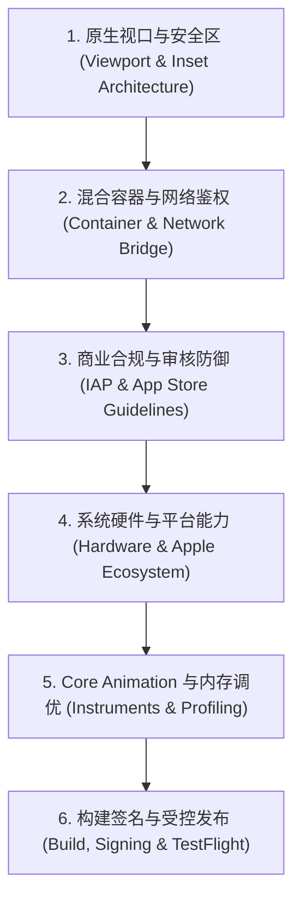

# iOS App Engineer Skill (iOS App 原生与混合工程架构师)

> **定位**：拒绝脆弱浅层的“套壳打包”，构建具备极致原生手感、坚固网络鉴权通道、100% 击穿 App Store 审核准则、并通过 Xcode Instruments 严苛度量的顶级 iOS 应用工程体系。
> **核心原则**：
> 1. **物理一致性 (Physical Ground-Truth)**：一切界面与网络行为必须在真实 iPhone 物理设备与 Xcode 编译环境中通过客观验证，严禁仅凭 Web 浏览器经验推导原生行为；
> 2. **反过度网页化 (Anti-Webby Interfaces)**：消灭一切浏览器附带的畸形产物（如键盘灰条辅助栏、双重滚动反弹、文字长按选框、触摸延迟），重塑纯净的 Apple HIG 原生触感；
> 3. **合规审查前置 (Pre-Emptive Review Defense)**：在第一行代码编写前，对齐 Guideline 4.2、3.1.1 与 5.1.1 审核红线，杜绝商业模式与功能完整性暴雷；
> 4. **实测指标定胜负 (Metrics-Driven Profiling)**：以 Core Animation 60/120 FPS 与 WebKit 内存水线（防 Jetsam OOM 强杀）作为唯一验收裁决标准。

---

## 1. 触发时机 (Trigger Condition)

当出现以下任一场景时，强制激活并严格执行本 Skill：
1. 启动、重构或升级以 Capacitor / WKWebView / 原生 Swift 支撑的 iOS 移动客户端工程时；
2. 页面在 iPhone 异形屏（灵动岛 Dynamic Island、刘海屏、底部 Home Indicator）出现留白割裂、遮挡或双重反弹时；
3. 处理 iOS WebKit 跨源 Cookie 丢失、会话失效（401）闪跳、或需打通原生网络层时；
4. 客户端涉及虚拟资产购买、订阅通道设计、准备提交 App Store Connect 审核或面临审核拒审（Guideline 4.2 / 3.1.1 / 5.1.1）时；
5. 调用系统硬件（相册多选及 EXIF 元数据提取、相机权限、Taptic Engine 触觉震动、推送通知 APNs、Universal Links）时；
6. 使用 Xcode Instruments 抓取真机滚动掉帧、图层过度混合（Blended Layers Overdraw）、显存飙升或内存泄漏时；
7. 配置 Xcode SPM 依赖、自动化代码签名、Archive 归档及 TestFlight 灰度发布时。

---

## 2. 全链路 6 大生命周期架构 (6-Stage iOS Engineering Lifecycle)



---

## 3. 6 维工业级落地全景规约与门禁检查清单 (Full-Chain Audit Checklist)

### 环节 1：原生视口、安全区与沉浸排版 (Viewport & Safe Area Compliance)

1. **满屏沉浸式无缝铺底 (Full-Bleed Inset Zeroing)**：
   - [ ] **Capacitor 滚动内缩归零**：`capacitor.config.ts` 强制声明 `ios.contentInset: 'never'`，严禁使用 `'automatic'`，彻底消除系统原生 `UIScrollView` 在顶部（59px）和底部（34px）强加的空白间距；
   - [ ] **Viewport 覆盖声明**：HTML `meta[name=viewport]` 强制声明 `viewport-fit=cover`，促使 WebKit 视图直接铺至玻璃盖板的最边缘；
   - [ ] **CSS 环境变量接管**：顶部固定栏使用 `padding-top: env(safe-area-inset-top)`，底栏使用 `padding-bottom: env(safe-area-inset-bottom)`；
   - [ ] **物理背景同构**：`ios.backgroundColor` 与 CSS `body { background-color }` 保持物理十六进制值绝对一致，杜绝冷启动与切屏过渡时的色块跳跃。
2. **消灭 Web 残留产物 (Anti-Webby Ergonomics)**：
   - [ ] **彻底清退键盘辅助条 (`UIInputAccessoryView`)**：在 `AppDelegate.swift` 中通过 Objective-C Runtime Swizzling 将 `WKContentView.inputAccessoryView` 归零为 `nil`，消除聚焦输入框时底部附带的灰色上下切换与完成（Done）工具条；
   - [ ] **全局禁用浏览器长按菜单与文字选中**：
     ```css
     html, body {
       -webkit-touch-callout: none;
       -webkit-user-select: none;
       user-select: none;
       -webkit-tap-highlight-color: transparent;
       touch-action: manipulation;
     }
     input, textarea {
       -webkit-user-select: text;
       user-select: text;
     }
     ```
   - [ ] **根除下拉白底露底与双重弹性**：根节点强制声明 `overscroll-behavior: none;`，页面滚动必须局限在明确受控的 `.scroll-container` 容器内（配备 `-webkit-overflow-scrolling: touch;`）。

---

### 环节 2：混合容器与网络鉴权架构 (Container & Network Bridge)

1. **跨域 Cookie 物理隔离认知与双通道鉴权**：
   - [ ] **WKWebView ITP 铁律**：从 `capacitor://localhost` 发往远程 API（如 `https://api.yourdomain.com`）属于跨源请求；WebKit 严苛的 ITP 策略会导致 `SameSite=Lax` 的 `__Host-` Cookie 在随后的异步 fetch 中被丢弃；
   - [ ] **双通道 Bearer Token 穿透**：移动端鉴权严禁单脚依托 Cookie，登录响应体中必须回传高熵 Session Token，由客户端持久化；在 API 请求拦截器中强制注入：
     ```typescript
     headers.set('Authorization', `Bearer ${token}`);
     headers.set('X-Session-Token', token);
     ```
   - [ ] **服务端短路对账**：服务端网关或拦截器必须支持优先解析 `Authorization: Bearer`，在 Cookie 丢失时实现无感平移认证。
2. **Capacitor 原生网络管道代理**：
   - [ ] **开启 CapacitorHttp**：在 `capacitor.config.ts` 的 `plugins` 中开启 `CapacitorHttp: { enabled: true }` 与 `CapacitorCookies: { enabled: true }`，使底层网络请求交由原生 `NSURLSession` 接管；
   - [ ] **声明受限域名绑定 (`WKAppBoundDomains`)**：在 `Info.plist` 中声明 `WKAppBoundDomains` 数组，加入服务 API 主域名与 CDN 域名，确保受信任通信链路畅通。

---

### 环节 3：商业合规与审核防御 (IAP & App Store Guidelines)

1. **Guideline 4.2 最低功能要求 (Minimum Functionality) 防御**：
   - [ ] **离线手账与状态保留**：必须具备弱网/断网离线缓存机制（如本地 IndexedDB / SQLite / 本地持久化相册缓存），断网状态下仍能浏览已有伴宠记录，严禁出现浏览器原生断网白屏；
   - [ ] **原生生态深度集成**：必须在审核说明中显式指出不可在 Safari 网页运行的原生特性（如 Taptic Engine 物理震动、系统底层相册 EXIF 读取、系统后台推送）。
2. **Guideline 3.1.1 与 3.1.3(b) 支付与订阅合规**：
   - [ ] **严禁外部支付跳转 (No External Links / Steering)**：iOS 客户端内严禁出现任何跳转 Stripe、PayPal、网页版充值或标榜“网页充值更优惠”的文字与超链接；
   - [ ] **数字资产强制 StoreKit (Apple IAP)**：App 内直接解锁的会员等级、AI 生成额度、数字手账模板，必须接入 Apple In-App Purchase（通过 StoreKit 2 或 RevenueCat）；
   - [ ] **多平台服务纯消费准则 (Multiplatform Services 3.1.3b)**：若当前版本暂未完成 IAP 研发，必须隐藏 App 内的购买入口与订阅升级抽屉，仅允许展示“通过网页已购买的权益账户登录消费”，规避支付审核红线。
3. **Guideline 5.1.1 隐私合规与权限文案**：
   - [ ] **强类型用途声明**：`Info.plist` 中涉及的所有权限（`NSPhotoLibraryUsageDescription`, `NSCameraUsageDescription` 等）必须使用温润、具体、符合伴宠情感场景的文案（严禁填写“我们需要相册权限”等空洞套话）；
   - [ ] **极简数据摄取**：严禁在未发生业务动作前主动弹窗索取定位、通讯录等无关敏感权限。

---

### 环节 4：系统硬件与平台深度集成 (Platform & Hardware Integration)

1. **相册导入与 EXIF 真实时间戳**：
   - [ ] **现代 Gallery API 规范**：使用 `@capacitor/camera` 的 `Camera.chooseFromGallery({ limit: N, includeMetadata: true })`，严禁使用已弃用的老旧 API；
   - [ ] **EXIF 拍摄时间保护**：提取 `photo.metadata.creationDate`（ISO 8601 字符串），以物理拍摄日期为伴宠时间线定轴，严禁使用文件上传系统时间覆盖真实相片记忆时间。
2. **Taptic Engine 物理触觉分级**：
   - [ ] **触觉层级对应**：
     - 选择/微滚动：`Haptics.impact({ style: ImpactStyle.Light })`
     - 快门按下/卡片生成：`Haptics.impact({ style: ImpactStyle.Medium })`
     - 导入成功/篇章封存：`Haptics.notification({ type: NotificationType.Success })`
     - 校验报错/删除拦截：`Haptics.notification({ type: NotificationType.Error })`
3. **Associated Domains 与 Universal Links**：
   - [ ] **AASA 配置文件部署**：`apple-app-site-association` 必须部署在 `https://yourdomain.com/.well-known/apple-app-site-association`，格式为纯 JSON，无扩展名，且服务端禁止设置强缓存；
   - [ ] **Xcode Entitlements 绑定**：在 Xcode Signing & Capabilities 中声明 `applinks:yourdomain.com`；
   - [ ] **Capacitor 深度路由拦截**：通过 `@capacitor/app` 监听 `appUrlOpen` 事件，平滑导流进入目标页面，禁止页面重载刷白。

---

### 环节 5：Core Animation、内存管理与 Xcode Instruments 调优 (Performance & Profiling)

1. **60 FPS / 120 FPS 流体帧率保障**：
   - [ ] **消除 GPU 复合层过载 (Composite Overdraw)**：严格限制 `backdrop-filter: blur(...)` 的滥用；在长列表中严禁为大量卡片同时配置大半径模糊，移动端 WKWebView 必须降级为高不透明度纯色（如 `rgba(255, 255, 255, 0.88)`）；
   - [ ] **谨慎提升独立纹理层**：严禁在非动画元素上滥用 `will-change` 或 `transform: translateZ(0)`，防止创建过多离屏缓冲区（Offscreen Buffers）打爆显存。
2. **Xcode Instruments 性能诊断规范**：
   - [ ] **Core Animation 模板剖析**：
     - 勾选 **Color Blended Layers**：排查大面积红色重绘区域；
     - 勾选 **Color Offscreen-Rendered Yellow**：排查不必要的离屏渲染通道；
   - [ ] **Allocations & Leaks 内存监控**：重点观察 `com.apple.WebKit.WebContent` 进程与 `IOSurface` 显存占用，持续滑动长列表 5 分钟，内存曲线上限必须平稳收敛，杜绝触发 iOS 系统级 Jetsam (OOM) 杀进程。

---

### 环节 6：构建、签名与 TestFlight 受控发布 (Build & Distribution)

1. **Swift Package Manager (SPM) 架构治理**：
   - [ ] **解耦 Node 本地路径依赖**：确保 `CapApp-SPM/Package.swift` 不强行绑定本地 `../../../../node_modules` 相对路径，保障 Mac 端无需配置复杂 Node 代理即可直接打开 Xcode 编译；
   - [ ] **静态资源预打包闭环**：Git 仓库托管已编译同步的 `ios/App/App/public` 资产与 `capacitor.config.json`，实现无 Node 环境下的零门槛原生构建。
2. **代码签名与发布流水线**：
   - [ ] **本地开发**：启用 `Automatically manage signing`，绑定 Personal Team 免费调试；
   - [ ] **正式分发**：配置 Apple Developer 团队付费证书与 Distribution Provisioning Profile，完成 `xcodebuild -archivePath` 归档与符号表生成（dSYM 上传，便于线上 Crash 堆栈符号化还原）；
   - [ ] **TestFlight 门禁**：通过 App Store Connect 导出内部 TestFlight 测试版本，至少在 2 种不同尺寸机型（如 iPhone 15/16 标准版与 Pro 灵动岛机型）上完成全量闭环人机实测。

---

## 4. 常见生产事故与阻断级缺陷 (P0~P3 Defect Catalog)

- **P0 致命阻断 (Release Blocker)**：
  1. 登录成功后下一请求触发 401 闪跳回登录页（跨源 Cookie 丢失且未注入 Bearer Token）；
  2. 包含指向外部 Stripe 支付网页的超链接或引导文字（触发 Guideline 3.1.1 审核秒拒）；
  3. `Info.plist` 缺少使用的隐私权限 Purpose String（App 启动或点击相册直接闪退 Crash）；
  4. 启动页白屏超过 1 秒或主屏幕加载抛出未捕获的 JavaScript 顶层异常。
- **P1 严重缺陷 (Critical Defect)**：
  1. `ios.contentInset` 设置为 `'automatic'`，导致顶部灵动岛与底部 Home 条被白色或灰色边框物理割裂；
  2. 邮箱输入框聚焦时弹出系统灰色上下切换与完成（Done）网页辅助工具条，严重破坏原生手感；
  3. 篇章列表快速滑动时帧率骤降至 30 FPS 以下（过度使用 `backdrop-filter` 导致 GPU 节流）；
  4. 相册批量导入图片丢失 EXIF 拍摄时间，导致时间线错乱。
- **P2 普通缺陷 (Major Defect)**：
  1. 软键盘弹起时页面布局被非预期顶起形变或遮挡操作按钮；
  2. 页面在断网状态下显示网络报错红页而非温润的离线手账卡片；
  3. 点击按钮存在 300ms 触摸延迟（未声明 `touch-action: manipulation`）。
- **P3 轻微优化 (Minor Tweak)**：
  1. 缺少 Taptic Engine 微震动反馈；
  2. 状态栏文字在深色背景下未反转为白色（未声明 `status-bar-style`）。

---

## 5. 准出与签发门禁 (Definition of Pass)

必须同时满足以下**五个一票否决指标**，方可签发 iOS 端生产发布：
1. **真机冷启动秒开**：真实 iPhone 物理设备冷启动至第一帧可交互界面耗时 $\le 1.0\text{s}$；
2. **满屏沉浸无留白**：灵动岛与底部 Home Indicator 区域背景 100% 物理铺满，零异常内缩；
3. **会话持久化跨进程保活**：用户登录后强杀 App 进程重新启动，登录态保持有效，网络接口请求 100% 携带合法凭证；
4. **审核红线零风险**：全工程零外部支付外跳，权限用途说明完整精准，具备离线可用降级；
5. **Core Animation 绿灯**：长列表快速滑动 Instruments 监测平均帧率 $\ge 58\text{FPS}$，无 Jetsam 内存溢出报警。
