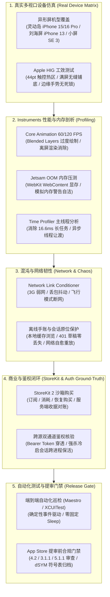

# iOS App QA Architect Skill (iOS App 测试架构师与全链路真机模拟质量工程)

> **定位**：iOS 测试绝不仅是点击几个界面或在 Mac 模拟器跑通冒烟，而是构建与 iPhone 物理设备 100% 物理镜像的高保真检验体系。本技能以“真机渲染物理保真、Instruments 指标量化定胜负、零伪绿欺骗、零 Jetsam 强杀、100% 击穿 App Store 提审门禁”为唯一裁判基准，对每一个发布切片执行全链路穿透式联调与一票否决裁决。
> **核心原则**：
> 1. **真机物理实测胜于模拟器 (Real Device Ground-Truth)**：模拟器使用 Mac 的 CPU/Metal/RAM，无法暴露真实的 GPU 填充率、触控屏幕热区与热节流（Thermal Throttling）；发布前必须在真实 iPhone 物理设备通过验收；
> 2. **伪绿欺骗零容忍 (Zero False Green Tolerance)**：客户端表面界面正常，但 Xcode 控制台存在 JavaScript 顶层异常、WebKit 跨源 Cookie 丢失 401 重试、或原生后台线程警告，一律判定为阻断性缺陷；
> 3. **消灭固定盲等时序 (Deterministic Synchronization)**：自动化脚本严禁使用 `sleep`，一律使用确定性 UI 状态与网络响应事件因果等待；
> 4. **弱网与断网离线自愈 (Graceful Offline Degradation)**：断网绝不展示系统白屏，本地离线手账与状态保护机制必须自愈闭环；
> 5. **一票否决硬门禁 (Hard Pass/Reject Gates)**：以物理帧率、内存水线、审核红线、跨进程保活为准出基准。

---

## 1. 触发时机 (Trigger Condition)

当出现以下任一场景时，强制激活并严格执行本 Skill：
1. iOS 原生工程（Swift/Capacitor）进入全链路联调验收与端到端测试阶段；
2. 涉及核心业务状态机（如登录认证、双通道 Token 校验、照片 EXIF 解析与时光轴导入、手账封存）的质量验收；
3. 修改 Capacitor 视口配置、安全区适配、键盘辅助条 Swizzling 等人机交互核心层；
4. 出现真机快速滑动卡顿、内存水线飙升、或后台切前台偶发性 Crash（疑似 Jetsam OOM）；
5. 涉及 In-App Purchase (StoreKit 2) 购买流转、沙盒对账或支付合规验证；
6. 准备归档 Archive、上传 TestFlight 并执行 App Store 提审前的最终发布门禁（Release Gate）裁决。

---

## 2. 全链路测试架构全景 (iOS Testing Architecture)



---

## 3. 6 维工业级测试架构清单 (Architecture Checklist)

### 维度 1：真实设备多视口仿真矩阵 (Real Device Multi-Viewport Matrix)
- [ ] **多形态异形屏真机实测覆盖**：
  - 必须至少覆盖三大典型屏幕硬件：
    - **灵动岛形态 (Dynamic Island)**：iPhone 14 Pro / 15 / 16 系列，实测顶部安全区内缩（`safe-area-inset-top`），验证全屏背景完全铺满灵动岛周围，绝无异常切断线；
    - **刘海屏形态 (Notch Screen)**：iPhone 11 / 12 / 13 / 14 标准版，验证顶部左右两侧时间与电量图标对比度正常；
    - **经典小屏实体键 (Home Button)**：iPhone SE 2/3，验证在无 Home Bar 的经典屏幕下底部布局不产生冗余高度抬升。
- [ ] **键盘弹起与工效交互实测**：
  - 聚焦表单输入框，断言系统键盘弹起时页面内容平滑滚动，目标输入框始终位于键盘上方可见区域；
  - 实测键盘顶部绝无灰色上下切换与完成（Done）网页辅助条（`inputAccessoryView` 必须为 `nil`）；
  - 软键盘收起后，页面底部必须自适应复原，绝不留白。
- [ ] **Apple HIG 触控工效实测**：
  - 真实手指触摸交互，断言可点击组件有效热区 $\ge 44 \times 44\text{pt}$；
  - 快速点击无 300ms 延迟；点击态高亮与回弹响应自然；
  - 滑动边缘返回手势（Interactive Pop Gesture）在页面任意状态下不产生卡死与视图撕裂。

### 维度 2：Core Animation 渲染性能与 Xcode Instruments 深度剖析 (Rendering & Profiling)
- [ ] **Core Animation 帧率度量**：
  - 连接真实 iPhone 物理设备，启动 Xcode Instruments 的 **Core Animation** 模板；
  - 在伴宠时光轴、篇章列表快速飞掠滑动时，FPS 曲线必须保持平直：
    - 60Hz 物理屏幕：平均帧率 $\ge 58\text{FPS}$，无连续 2 帧以上丢帧（Jank）；
    - 120Hz ProMotion 屏幕（iPhone Pro 系列）：平均帧率 $\ge 115\text{FPS}$。
- [ ] **图层过度绘制排查 (Color Blended Layers)**：
  - 在 Instruments 中勾选 **Color Blended Layers**：
  - 检查伴宠卡片与时光轴背景，深红色（GPU Pixel Blending 过度混合）区域面积在全屏占比不得超过 20%；
  - 背景与卡片层必须优先使用不透明色或预乘 Alpha 纹理，消除 GPU 混合开销。
- [ ] **离屏渲染排查 (Color Offscreen-Rendered Yellow)**：
  - 勾选 **Color Offscreen-Rendered Yellow**：
  - 检查页面圆角卡片、阴影与浮层，严禁出现大面积黄色高亮；
  - 验证阴影路径（`shadowPath`）或同心连续超椭圆（Squircle）优化生效，避免触发额外的离屏绘制通道。
- [ ] **主线程长任务捕获 (Time Profiler)**：
  - 运行 Time Profiler 模板，核实主线程单次事件处理时间 $\le 16.6\text{ms}$；
  - 批量图片解码、EXIF 元数据提取与网络数据序列化必须调度至后台全局线程或异步队列，严禁卡顿主线程。

### 3. 维度 3：Jetsam OOM 极限压测与内存水线监控 (Jetsam OOM & Memory Stress)
- [ ] **连续极限相册导入压测**：
  - 模拟用户从相册中单次连续批量选择 50 张高清实拍照片（单张照片 $8\text{MB}\sim 15\text{MB}$）；
  - 监控 `com.apple.WebKit.WebContent` 进程与宿主 App 进程物理内存：
    - 原生相册选择器返回数据必须采用流式或逐张处理；
    - 内存峰值不得突破设备安全水线（iPhone 标准版单进程警戒线通常为 500MB~800MB），严禁触发系统级 Jetsam OOM 强杀。
- [ ] **长列表持续滑动浸泡压测 (Soak Test)**：
  - 自动化脚本持续向下滚动浏览手账相册 10 分钟；
  - 使用 Instruments Allocations 工具监测，内存增长曲线必须在图片离屏卸载后出现平稳阶梯收敛，杜绝持续单调递增的内存泄露。
- [ ] **系统内存警告 (Simulate Memory Warning) 韧性测试**：
  - 在 Xcode Debug 菜单触发 **Simulate Memory Warning**；
  - 断言 App 能正确捕获通知并释放内存中缓存的解码纹理，App 保持可交互，绝无闪退。

### 维度 4：弱网混沌注入与离线手账可用性 (Chaos & Offline Resilience)
- [ ] **Network Link Conditioner 弱网全真模拟**：
  - 开启 iPhone 开发者设置中的 Network Link Conditioner：
    - **Very Bad Network (RTT 1000ms, 丢包率 10%)**：发起伴宠生成或图片上传，断言界面展示高品质骨架屏与等待动效，无排版跳跃（CLS $\le 0.1$），超时后给出明确重试动作；
    - **100% Packet Loss / 飞行模式 (Dead Zone)**：断网状态下启动 App 或在浏览中突发断网，断言禁止展示 Safari/WebKit 原生“网页无法打开”的错误白屏；
- [ ] **离线手账可用性与现场自愈**：
  - 断网状态下，用户已生成封存的伴宠手账相册必须依赖本地持久化（IndexedDB / 本地文件缓存）正常温润阅读展示；
  - 模拟会话 401 过期中断：验证表单输入草稿原位锁定保留（`safeStorage`），原位轻量登录后无感重放提交，零数据丢失。

### 维度 5：StoreKit IAP 沙盒对账与跨源双通道鉴权核验 (StoreKit & Auth Ground-Truth)
- [ ] **StoreKit 2 沙盒购买全链路对账**：
  - 使用 App Store Connect Sandbox 测试账号登录真机：
  - 执行数字资产（额度、会员）购买：断言支付收据（JWS Transaction）成功回传服务端；
  - 服务端与 Apple Root 证书完成收据校验（Receipt Verification），MySQL 记录订单落盘且状态为 `PAID`，Redis 用户权益额度即时到账；
  - **恢复购买 (Restore Purchases)**：在另一台测试设备登录同账号，点击“恢复购买”，断言已购权益无缝找回。
- [ ] **跨源会话保活与冷启动穿透核验**：
  - 验证登录请求返回的 Session Token 成功持久化，后续网络请求 100% 携带 `Authorization: Bearer <token>`；
  - **强杀冷启测试**：在登录态下强杀 App 进程（双击上滑清除），重新启动 App：断言首屏直接渲染已登录主界面，绝不出现 401 闪跳回登录页的恶性 Bug。

### 维度 6：自动化回归套件与 TestFlight 发布门禁 (Automation & Release Gates)
- [ ] **端到端自动化巡检套件 (Maestro / XCUITest)**：
  - 编写端到端自动化脚本覆盖核心业务流（登录 -> 浏览时光轴 -> 相册导入 -> 伴宠手账生成 -> 账号注销）；
  - 测试用例必须使用确定性状态等待，严禁固定 `sleep`。
- [ ] **归档构建与 dSYM 符号表完备性**：
  - 检查 Xcode Archive 产物，确保包含主工程及所有依赖模块的 dSYM 符号表；
  - 本地运行 `dwarfdump --uuid` 验证符号表 UUID 与二进制可执行文件匹配，保障线上崩溃堆栈可还原。
- [ ] **App Store 提审合规清单自动化前置核验**：
  - **Guideline 4.2**：检查全工程无未实现的占位功能与“Lorem Ipsum”文本；
  - **Guideline 3.1.1**：全工程全文检索 `stripe.com`、`alipay.com` 等关键词，确保 iOS 客户端包体零外部支付链接；
  - **Guideline 5.1.1**：检查 `Info.plist` 权限文案具备具体业务场景；设置页具备物理“注销账号”链路。

---

## 4. 自动化回归测试蓝图规范 (Maestro E2E Blueprint)

```yaml
# flows/ios_smoke_regression.yaml
appId: com.vivibon.ai
---
- launchApp:
    clearState: false

# 步骤 1：冷启动登录态保活与安全区沉浸核验
- assertVisible:
    id: "home-timeline-container"
- assertVisible:
    id: "nav-tab-companion"

# 步骤 2：验证无网页辅助条与沉浸铺底
- tapOn:
    id: "btn-quick-note"
- tapOn:
    id: "input-memory-text"
- inputText: "今天毛孩子非常活泼，奔跑在阳光草地上"
# 断言无键盘辅助条且输入成功
- assertNotVisible:
    text: "Done"

# 步骤 3：模拟相册导入与手绘手账生成
- tapOn:
    id: "btn-import-photos"
# 确定性因果等待生成结果，严禁使用盲等 sleep
- extendedWaitUntil:
    visible:
      id: "scrapbook-card-preview"
    timeout: 30000

# 步骤 4：验证物理触觉与手账封存
- tapOn:
    id: "btn-archive-memory"
- assertVisible:
    text: "篇章已温润封存"

# 步骤 5：强杀进程与冷启持久化验证
- stopApp
- launchApp
- assertVisible:
    id: "home-timeline-container"
- assertNotVisible:
    id: "login-auth-drawer"
```

---

## 5. 一票否决硬红线门禁 (Pass / Reject Gate)

凡执行 iOS 端发布验收，必须同时满足以下**五个一票否决指标**方可签发 TestFlight / 生产发布：
1. **真机满屏零留白**：在灵动岛（iPhone 15/16 Pro）与底部 Home Indicator 区域背景 100% 满屏沉浸，零异常空白内缩（`contentInset: 'never'`）；
2. **Core Animation 绿灯**：真实物理机快速滑动时光轴长列表，平均帧率 $\ge 58\text{FPS}$，无长任务阻塞主线程（Time Profiler 报告无 >16.6ms 调用）；
3. **Jetsam OOM 零报警**：批量导入 50 张高清图片与长列表持续滑动 10 分钟，显存平稳收敛，触发系统内存警告后无 Crash；
4. **会话持久化与零 401 闪跳**：登录后强杀 App 冷启直接进入主屏；在 WebKit Cookie 跨源丢弃场景下，Bearer Token 双通道请求 100% 成功；
5. **App Store 提审红线零残留**：全工程零外部第三方支付链接，权限 Purpose Strings 完备温润，离线弱网具备本地手账降级可用性。

**触发以下任一情况立即打回（Hard Blocker）**：
- 真实 iPhone 真机冷启动时间超过 1.5 秒或出现启动白屏；
- 输入框弹出系统键盘时底部附带灰色上下切换与完成（Done）网页辅助条；
- 测试用例使用硬编码 `sleep` 盲等时序；
- 断网状态下直接显示 WebKit 浏览器原生网络报错页面；
- Xcode Archive 归档产物缺失 dSYM 符号表。
