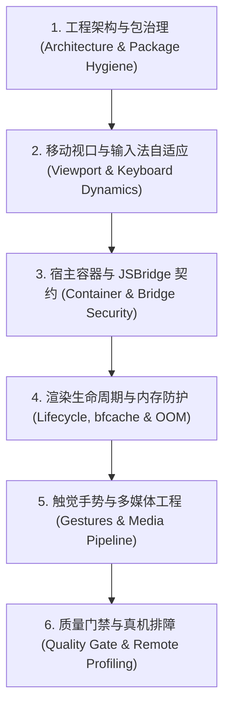

# Mobile Web Engineer Skill (移动端 H5 工程架构与高精交付技能)

> **定位**：拒绝拼凑式的玩具页面开发，面向真实生产拓扑与异构宿主环境（iOS WebKit、Android Blink、WeChat WebView、Capacitor 原生混合容器），构建具备确定性依赖、物理级视口适配、异步幂等 Bridge 契约、毫秒级响应手感与零 OOM 崩溃的高韧性移动端 Web 工程体系。
> 
> **核心原则**：
> 1. **物理真实性 (Physical Ground-Truth)**：一切视口、键盘弹起、手势回弹与生命周期行为必须在真实移动设备与目标宿主容器内客观验证，严禁仅凭 PC 浏览器模拟器判定交付结果；
> 2. **零布局塌陷 (Zero-Layout Collapse)**：通过动态视口单位与 Visual Viewport API 彻底消灭移动端地址栏伸缩导致的 100vh 塌陷与虚拟键盘遮挡错位；
> 3. **容器契约防御 (Container Defense)**：对 JSBridge 与宿主 SDK 建立强类型校验、异步 Promise 封装、超时熔断与纯 Web 兜底降级四道防线；
> 4. **内存水线红线 (Strict Memory Watermark)**：以 WebKit Jetsam 机制与 DOM 节点回收为基准，杜绝内存泄漏、图层爆炸与偶发性进程白屏重启。

---

## 1. 触发时机 (Trigger Condition)

当出现以下任一场景时，强制激活并严格执行本 Skill：
1. 启动、重构或升级面向移动端触屏设备（iOS Safari、Android Chrome、微信/飞书/企业微信内嵌 WebView、Capacitor 容器）的 H5 前端工程时；
2. 页面在移动端出现视口塌陷、地址栏伸缩引发跳动、软键盘弹起遮挡输入框或收起后页面空白不回落时；
3. 处理异形屏（刘海屏、灵动岛、打孔屏、底部 Home Bar）适配，或出现双重橡皮筋弹性滚动穿透时；
4. 页面需要集成原生容器能力、封装 JSBridge、对接微信 JSSDK、配置自定义分享或处理多环境降级时；
5. 处理移动端音视频自动播放限制、Back-Forward Cache (bfcache) 状态失效或页面切后台数据断流时；
6. 诊断移动端首屏加载过慢（LCP 超标）、长任务阻塞主线程（INP 掉帧）、或低端机上因 DOM 过载导致的 WebKit OOM 崩溃时；
7. 建立移动端专属工程化规范（pnpm 严格依赖锁定、ESLint 移动端规则、真机远程调试流水线）时。

---

## 2. 全链路 6 大工程生命周期体系 (6-Stage Engineering Lifecycle)



---

## 3. 六维工业级落地全景规约与门禁检查清单 (Full-Chain Audit Checklist)

### 维度 1：工程架构与包治理 (Architecture & Package Hygiene)

1. **依赖锁定与防幽灵依赖 [SOURCE-BACKED]**：
   - [ ] **统一包管理器**：强制采用 `pnpm` 作为全库包管理器。利用其软链接拓扑根除幽灵依赖（Phantom Dependencies），在根目录 `package.json` 显式锁定 `packageManager`；
   - [ ] **CI 确定性安装**：持续集成与打包构建命令必须使用 `pnpm install --frozen-lockfile`，杜绝任何依赖静默升级与版本漂移；
   - [ ] **依赖范围收敛**：构建插件、代码检查工具严格写入 `devDependencies`，核心运行时库写入 `dependencies`；
   - [ ] **CVE 漏洞常态审计**：门禁集成 `pnpm audit --audit-level=high`，对深层依赖漏洞通过 `pnpm.overrides` 实施物理锁版修补。
2. **代码组织与分层单向流动 [SOURCE-BACKED]**：
   - [ ] **Feature-Sliced Design 拓扑**：严格遵循 `app -> pages -> widgets -> features -> entities -> shared` 六层单向依赖原则；
   - [ ] **状态物理解耦**：服务端接口数据依托 React Query / TanStack Query 进行带缓存的异步治理，禁止与客户端轻量交互状态（Zustand / Jotai）混写在单个大型全局 Store 中；
   - [ ] **严格类型契约**：TypeScript 启用全部严格规则（`strict: true`, `noImplicitAny: true`），DTO 与 Bridge 参数必须通过类型收窄或 Zod Schema 运行时校验。

### 维度 2：移动视口与输入法自适应 (Viewport & Keyboard Dynamics)

1. **基础视口与动态高度处理 [SOURCE-BACKED]**：
   - [ ] **标准化 Viewport 声明**：
     ```html
     <meta name="viewport" content="width=device-width, initial-scale=1.0, maximum-scale=1.0, user-scalable=no, viewport-fit=cover">
     ```
   - [ ] **告别 100vh 塌陷**：满屏高宽禁止使用 `100vh`，统一采用现代 CSS 动态视口单位 `100dvh`，并配置 `100vh` 回退兜底：
     ```css
     .viewport-fullscreen {
       height: 100vh;
       height: 100dvh;
       min-height: 100vh;
       min-height: 100dvh;
     }
     ```
2. **异形屏全面屏物理避让 [SOURCE-BACKED]**：
   - [ ] **安全区域计算**：顶部避让刘海/灵动岛，底部避让 Home Indicator，统一通过 `env(safe-area-inset-*)` 变量注入：
     ```css
     .header-bar {
       padding-top: max(12px, env(safe-area-inset-top));
     }
     .footer-action-bar {
       padding-bottom: max(16px, env(safe-area-inset-bottom));
     }
     ```
3. **虚拟软键盘弹起与错位治理 [SOURCE-BACKED]**：
   - [ ] **Visual Viewport 动态计算**：表单固定操作区禁止滥用单纯的 `position: fixed; bottom: 0`；通过监听 `window.visualViewport` 对象的 `resize` 与 `scroll` 事件，动态抵消软键盘占据的真实像素高度：
     ```typescript
     export function setupKeyboardOffset(element: HTMLElement): () => void {
       const updateOffset = () => {
         const vv = window.visualViewport;
         if (!vv) return;
         const offset = window.innerHeight - vv.height - vv.offsetTop;
         element.style.transform = `translateY(-${Math.max(0, offset)}px)`;
       };
       window.visualViewport?.addEventListener("resize", updateOffset);
       window.visualViewport?.addEventListener("scroll", updateOffset);
       return () => {
         window.visualViewport?.removeEventListener("resize", updateOffset);
         window.visualViewport?.removeEventListener("scroll", updateOffset);
       };
     }
     ```
   - [ ] **iOS 失去焦点页面复位**：针对 iOS Safari 软键盘收起后页面停留于推起位置不回落的问题，在所有 `input` / `textarea` 的 `blur` 事件中执行一次平滑微调：`window.scrollTo(0, Math.max(0, document.body.clientHeight - 1))`。

### 维度 3：宿主容器与 JSBridge 契约 (Container & Bridge Security)

1. **统一 Bridge 适配层设计 [DECIDED]**：
   - [ ] **抹平运行环境差异**：抽象统一的 Bridge 门面（Facade），内部识别 iOS WKWebView (`window.webkit.messageHandlers`)、Android WebView (`window.AndroidBridge`)、微信 (`WeixinJSBridge`) 与纯 Web 浏览器环境；
   - [ ] **异步 Promise 包装与超时熔断**：每个调用生成唯一的 `callbackId`，必须包裹超时竞态定时器（默认 5000ms），防止原生未响应引发前端主线程悬挂；
   - [ ] **纯 Web 兜底降级**：当探测到运行于普通浏览器且原生方法不存在时，执行预设的降级逻辑（如原生分享降级为展示引导复制蒙层，原生相册降级为 `<input type="file">`）。
2. **微信 (WeChat) 容器特化规约 [SOURCE-BACKED]**：
   - [ ] **JSSDK 注入时序**：微信签名验证依赖当前 URL（去除 hash），必须在 SPA 路由切换时（特别是在 iOS 微信历史 URL 不变更特征下）正确计算并调用 `wx.config`；
   - [ ] **下拉黑底灰底穿透治理**：禁止在 `body` 上发生全屏橡皮筋滚动穿透，关键容器声明 `overscroll-behavior: contain` 与局部内滚。
3. **容器安全基线 [SOURCE-BACKED]**：
   - [ ] **生产调试阻断**：严禁在生产构建中开启 Android `WebView.setWebContentsDebuggingEnabled(true)` 或 iOS `isInspectable = true`；
   - [ ] **敏感凭证防窃听**：禁止通过 JSBridge 明文传输长效鉴权 Token 或由前端 `localStorage` 裸露存储；敏感接口必须依托具备 `__Host-` 前缀、`HttpOnly`、`Secure`、`SameSite=Lax` 属性的 Cookie 传输。

### 维度 4：渲染生命周期与内存防护 (Lifecycle, bfcache & OOM)

1. **Back-Forward Cache (bfcache) 状态自愈 [SOURCE-BACKED]**：
   - [ ] **往返缓存监听**：移动端浏览器用户回退操作极易触发 bfcache，此时前端并不会重新加载文档。必须显式监听 `pageshow` 事件：
     ```typescript
     window.addEventListener("pageshow", (event) => {
       if (event.persisted) {
         // 从 bfcache 唤醒，强制刷新用户会话状态与核心领域数据
         queryClient.invalidateQueries();
       }
     });
     ```
   - [ ] **消除阻止 bfcache 的因素**：禁止在页面中使用 `window.onbeforeunload` 监听器（该监听会导致现代移动浏览器直接禁用 bfcache）。
2. **WebKit 内存防护与防止 Jetsam 强杀 [SOURCE-BACKED]**：
   - [ ] **虚拟长列表渲染**：超过 50 个复杂条目的列表（商品流、手账瀑布流、历史记录）必须实施虚拟滚动，DOM 节点常驻数量严格控制在 100 个以内；
   - [ ] **图层合成爆炸防护**：严禁对大面积无意义元素滥用 `will-change: transform` 或 `transform: translateZ(0)`，防止显存与合成图层溢出；
   - [ ] **对象解绑与资源回收**：组件卸载生命周期内，必须彻底清理大型 Canvas 上下文、清空未完成的 fetch 请求控制器（`AbortController`）、注销全局事件与计时器。

### 维度 5：触觉手势与多媒体工程 (Gestures & Media Pipeline)

1. **触摸响应与手势标准化 [SOURCE-BACKED]**：
   - [ ] **消除 300ms 延迟**：全局交互元素显式声明 CSS 规则：
     ```css
     button, a, input, select, textarea, [role="button"] {
       touch-action: manipulation;
     }
     ```
   - [ ] **滚动被动监听 (Passive Listeners)**：所有绑定到 `scroll`、`touchmove`、`touchstart` 的非阻断性监听器，必须传入 `{ passive: true }`，保证主线程与合成器线程并行工作，消除滚动掉帧。
2. **移动端音视频播放受限突破 [SOURCE-BACKED]**：
   - [ ] **内联播放配置**：所有 `<video>` 标签必须声明 `playsinline` 与 `webkit-playsinline`，防止 iOS Safari 强行进入原生全屏播放模式；
   - [ ] **自动播放降级链**：静音自动播放优先（`muted autoplay`）；如需有声播放，必须在用户第一次真实触摸交互（`touchstart` / `click`）中唤醒并恢复 `AudioContext.resume()`。

### 维度 6：质量门禁与真机排障 (Quality Gate & Remote Profiling)

1. **性能门禁达标准据 (Core Web Vitals) [SOURCE-BACKED]**：
   - [ ] **LCP <= 2.5s**：首屏最大内容必须通过 CDN 预热、WebP/AVIF 格式化压缩与 `<link rel="preload">` 加速；
   - [ ] **INP <= 200ms**：移动端 CPU 算力受限，所有大于 50ms 的长任务必须通过 `scheduler.postTask()`、`requestIdleCallback()` 或 Web Worker 移出主线程；
   - [ ] **CLS <= 0.1**：图片、插画、卡片必须显式声明宽高比（`aspect-ratio: 16 / 9`），杜绝异步图片加载引起的页面剧烈跳动。
2. **真机全链路排障工具链 [DECIDED]**：
   - [ ] **iOS 真机排查**：通过 Mac Safari 开发者菜单 -> 选中物理 iPhone -> Web Inspector 剖析内存图谱与网络流水线；
   - [ ] **Android 真机排查**：通过 Chrome `chrome://inspect` 挂载物理设备调试 WebView；
   - [ ] **移动端内嵌调试面板**：在非生产环境（开发/测试环境）集成 `vConsole` 或 `Eruda`，以便在微信或 App 壳内直接抓取 Console、Network 与 Storage 日志。

---

## 4. 交付一票否决红线 (Hard Blockers / Definition of Done)

凡触发以下任一情况，视为工程缺陷，一票否决，禁止发布：
1. **视口塌陷**：移动端地址栏收起展开时，页面发生视觉断层或双重滚动条；
2. **输入框被遮挡**：在 iOS 或 Android 真机上聚焦输入框时，键盘遮挡输入区域且无法滑动查看；
3. **依赖漂移**：构建未执行 `--frozen-lockfile`，或存在未授权的幽灵依赖引入；
4. **内存击穿**：长列表页面在 iPhone 真实设备反复滑动 3 分钟发生白屏崩溃重启；
5. **安全凭证裸露**：将长效鉴权凭证直接写入 `localStorage` 且未配置防护策略。

