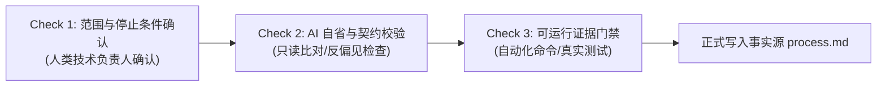

# Project Governance & Baseline Skill (项目事实与治理基线)

> **定位**：在任何调研、设计、编码或部署前，建立并维护项目事实源、权限边界、证据语法和阶段门禁。
> **核心原则**：AI 生成候选，人类定义目标，系统建立约束，证据验证结果，团队承担责任。

---

## 1. 触发时机 (Trigger Condition)

当出现以下情况时，激活并执行本 Skill：
1. 每次任务开始时，初始化或校准项目当前事实状态与活动边界；
2. 发现文档冲突、版本分叉、未定义 Owner 或证据缺失时；
3. 需要更新权威事实源 `process.md`，执行阶段交接或任务 Closeout 时；
4. 涉及架构、存储、支付、权限、高风险数据或不可逆操作的决策边界时。

---

## 2. 证据语法与标签规范 (Evidence Grammar)

所有分析、文档记录与对话结论必须显式标记以下 8 类证据标签之一，严禁含糊其辞：

| 证据标签 | 定义与判定依据 | 适用场景示例 |
|---|---|---|
| `VERIFIED` | 当前代码、可复现测试、运行日志或第一手操作直接证实 | 运行 `npm test` 通过、本地服务验证成功 |
| `SOURCE-BACKED` | 来自已定位的官方规范、一手调研材料或主 PRD 明确条款 | 引用了用户访谈录音、引用了苹果官网 API 文档 |
| `INFERRED` | 基于已有事实进行的合理逻辑推导，但尚未被直接运行/测试验证 | “根据当前 Schema 结构，推断需要增加外键索引” |
| `HYPOTHESIS` | 待验证的用户、业务、技术或模型效果假设 | “假设 70% 的用户愿意在第 3 步完成宠物问卷” |
| `PROPOSED` | AI 或协作者提出的候选方案，尚未获得技术负责人批准 | “建议采用 SQLite 作为本地轻量存储” |
| `DECIDED` | 已由技术负责人（人类 Owner）正式批准并写入权威事实源 | 技术负责人确认：“本期仅支持单宠物档案” |
| `BLOCKED` | 缺少必要证据、外部依赖、权限授权或技术负责人裁决 | 缺少 OpenAI API Key、缺少支付网关接入审批 |
| `NOT-TESTED` | 设计或代码已存在，但尚未有真实环境运行/测试证据 | 新增的兜底组件尚未编写集成测试 |

---

## 3. Solo-OPC 治理与 3 道检查线

在单人全栈 / Solo-OPC 模式下，不引入冗长审批流，但必须执行 3 道确定性检查线：



1. **Check 1（范围与停机条件）**：确认本任务的目标、非目标（Non-goals）、可逆性及停止条件；
2. **Check 2（AI 辅助自检）**：检查是否越界修改非当前阶段文件，是否引入未经批准的依赖或外部副作用；
3. **Check 3（可运行证据）**：必须输出实际执行的命令与返回结果，未验证项如实标记为 `NOT-TESTED` 或 `BLOCKED`。

---

## 4. 权限与自动化分级 (Authority Matrix)

| 等级 | 典型操作 | AI 权限边界 | 人工确认要求 |
|---|---|---|---|
| **L0** | 文档整理、格式规范、信息提取、只读代码阅读 | **可自动执行**，保留日志 | 无需中断 |
| **L1** | 编写单元测试、本地代码重构、生成 Fake/Mock | **可自动执行**，必须通过本地测试门禁 | 结果纳入 Closeout 汇报 |
| **L2** | 修改 API 契约、变更依赖、修改构建配置 | **受控执行**，提出方案并验证 | 需技术负责人确认方案 |
| **L3** | 数据库迁移、权限策略、删除数据、引入支付/外部服务 | **AI 仅可生成方案与回滚脚本** | **强制中断，严禁自主执行** |
| **L4** | 生产环境发布、不可逆数据清除、公开法律/医疗内容 | **禁止 AI 单独操作** | **必须由人类技术负责人亲自操作** |

---

## 5. 事实源（process.md）维护标准

每次任务结束（Closeout）前，必须遵循以下标准结构同步更新 `process.md`：

```markdown
# [项目名称] 项目当前状态

> 最近更新：YYYY-MM-DD
> 状态：[CURRENT_STAGE_STATUS]
> 本文件是当前执行状态的唯一事实源。

## 1. 当前定位与活动面
- 当前所处阶段及核心目标
- 允许范围与明确禁止范围

## 2. 权威文档清单 (Canonical Index)
- 列出当前阶段有效的主 PRD、问卷基线、控制规则文件

## 3. 状态与证据记录 (Status & Evidence)
- VERIFIED: [已验证事实]
- HYPOTHESIS / PROPOSED: [待验证假设与方案]
- BLOCKED: [当前阻断项]
- NOT-TESTED: [未测试项]

## 4. 实际命令与结果 (Commands & Outputs)
- 记录本次操作执行的具体命令与实际输出

## 5. 风险与回滚路径 (Risks & Rollback)
- 列出已知风险及一键回滚的具体方法

## 6. 待技术负责人确认 (Pending Decisions)
- 列出需要人类裁决的具体决策点

## 7. 唯一下一步 (Next Action)
- 明确且唯一的下一步动作
```

---

## 6. 阶段退出门禁 (Exit Gate Checklist)

在宣布阶段完成前，必须核对：
- [ ] 当前事实源 `process.md` 唯一、可定位且格式完整；
- [ ] 不存在未决的文档冲突或未受控的阶段越界行为；
- [ ] 所有结论已标注标准证据标签（无虚假 VERIFIED）；
- [ ] 关键架构、业务与安全边界均有明确决策记录。
