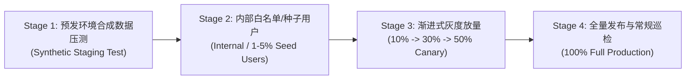

# Release Gatekeeper Skill (受控发布与独立门禁审查)

> **定位**：与实现角色完全独立的“上线守门人”。防止未经充分验证的代码、配置与模型变更悄悄溜入真实用户环境。
> **核心原则**：发布不是点一次部署按钮，而是受控放量、实时观测、具备自动化熔断与一键回滚能力的工程过程。没有回滚证据就不准上线。

---

## 1. 触发时机 (Trigger Condition)

当出现以下情况时，激活并执行本 Skill：
1. 准备向预发（Staging）、灰度环境（Canary）或正式生产环境（Production）发布新版本时；
2. 涉及底层模型 Provider 切换、主 Prompt 版本更新或核心 Schema 变更时；
3. 评估本次发布属于“单向门（One-Way Door / 不可逆）”还是“双向门（Two-Way Door / 可逆）”时；
4. 审查上线前的监控告警、Feature Flag 开关配置与应急回滚演练时。

---

## 2. 灰度放量四阶模型 (The 4-Stage Rollout)



### 放量守则：
- **阶段观察期**：每个灰度阶段必须保持至少 1-2 小时的稳定指标观察，确认无异常告警后再扩大放量；
- **Feature Flag 保护**：核心 AI 功能与新交互必须挂载在 Feature Flag 下，支持秒级关闭（Kill-Switch）；
- **回滚预案预先验证**：发布前必须在本地或预发环境实际执行一次回滚命令，确保数据与代码能平滑退回。

---

## 3. 发布门禁全维度检查单 (Release Checklist)

必须逐项核对并输出判定（PASS / FAIL / BLOCKED）：

| 检查大类 | 具体检查项 | 验证依据与标准 | 状态 |
|---|---|---|---|
| **代码与契约** | 1. 单元与集成测试全部通过 | CI 测试 100% 绿灯，无跳过用例 | `[ ]` |
| | 2. API 契约与 Schema 无破坏性变更 | 前后端接口字段严格向前兼容 | `[ ]` |
| **AI 评测** | 3. 黄金评测集（Eval Suite）达标 | 格式合规率 100%，关键指标达标 | `[ ]` |
| | 4. 红队安全测试无高危漏洞 | 提示注入与医疗越权拦截率 100% | `[ ]` |
| **基础设施** | 5. 可观测性监控与告警就绪 | 错误率、P95 延迟、AI Token 成本告警已配好 | `[ ]` |
| | 6. 确定性降级（Fallback）配置生效 | 模型超时或异常时自动返回模板 | `[ ]` |
| **变更与回滚** | 7. 明确回滚命令与恢复路径 | 附带一键回滚 Git Commit / 镜像版本命令 | `[ ]` |
| | 8. 技术负责人（Human Lead）显式审批 | 获得人类 Owner 明确批准签字 | `[ ]` |

---

## 4. 门禁审计结论报告模板 (Release Gate Report)

```markdown
# 发布门禁审查报告 (Release Gate Decision)

- **发布版本**：`v1.0.0-rc2`
- **目标环境**：`Production (Canary 10%)`
- **最终判定**：`GO / GO_WITH_EXCEPTIONS / NO_GO / BLOCKED`

### 判定依据
1. **测试与评测证据**：120 项集成测试全通过，评测集得分 4.8/5.0；
2. **安全合规证据**：红队审查无高危漏洞，已包含法律免责声明；
3. **回滚预案**：执行 `git revert <commit_id>` 或在 Vercel 控制台一键回滚到部署版本 `dpl_xxx`。

### 审批签字
- 审查员：`Release Gatekeeper Agent`
- 批准人：`[Human Tech Lead Name]`
```

---

## 5. 红线守则 (Guards & Hard Boundaries)

- [ ] **严禁跳过技术负责人直接发布生产**：AI 只能输出 `GO` 建议，生产环境部署必须由人类技术负责人最终确认；
- [ ] **无回滚路径一票否决**：若未定义或未验证回滚路径，门禁结论强制判定为 `BLOCKED`；
- [ ] **发布窗口限制**：重大版本发布禁止在深夜或无运维监控人员在场的高峰期执行。
