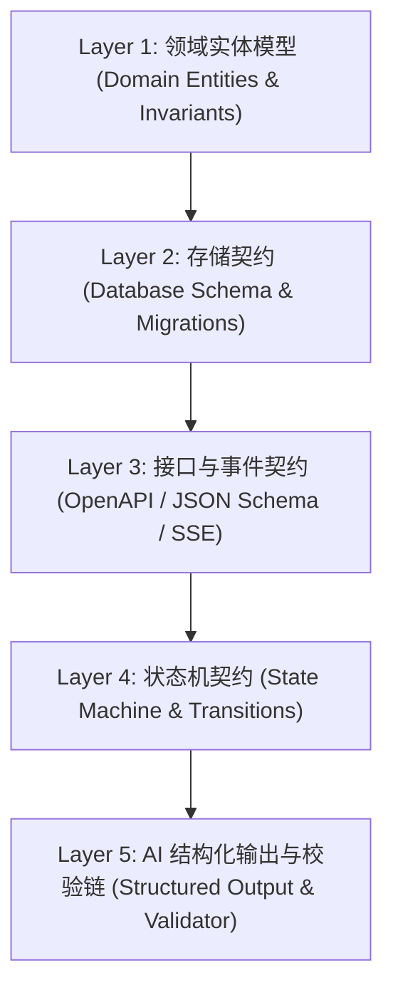

# Schema Architect Skill (领域模型与系统契约设计)

> **定位**：在编写任何实现代码前，把产品合同转化为严谨、无二义性、前后端与 AI 均可严密遵循的系统契约。
> **核心原则**：契约先于实现。确定性系统是事实的唯一拥有者，模型响应必须通过严格的 Schema 与语义校验才能持久化。

---

## 1. 触发时机 (Trigger Condition)

当出现以下情况时，激活并执行本 Skill：
1. 产品需求合同（PRD）完成收敛，需要定义领域模型与数据表结构时；
2. 定义或重构 RESTful API、Server-Sent Events (SSE)、RPC 或异步事件契约时；
3. 设计状态机（State Machine）、生命周期流转规则及非法状态拦截时；
4. 约束 LLM 结构化输出（Structured Outputs / JSON Schema）与数据校验链路时。

---

## 2. 契约设计五层模型 (The 5-Layer Contract)



### Layer 1: 领域实体与事实所有权
- **明确事实归属**：区分“用户提交的事实（Domain Fact）”、“系统计算的状态（System State）”与“AI 推理派生的资产（Inferred Asset）”；
- **防腐层（ACL）设计**：外部输入与 AI 生成内容必须经过防腐层转换，禁止污染核心领域实体。

### Layer 2: 存储契约（Database Schema）
- 遵循单一职责与显式外键约束；
- 每个实体必须包含审计基类字段：`id` (UUIDv4/ULID), `created_at`, `updated_at`, `version` (乐观锁版本号), `is_deleted` (软删除标记)。

### Layer 3: API & 事件契约（OpenAPI 3.1 / JSON Schema）
- 严格声明 `required` 字段、字段类型、字符串格式（`uuid`, `date-time`, `uri` 等）与枚举值（`enum`）；
- 禁止使用自由格式的 `any` 或无约束的通用 JSON 字典。

### Layer 4: 状态机契约（Finite State Machine）
- 明确定义状态枚举（如：`DRAFT -> SUBMITTED -> GENERATING -> COMPLETED / FAILED -> ARCHIVED`）；
- 显式声明合法流转矩阵（Allowed Transitions），任何非法流转在领域层直接抛出 `InvalidStateTransitionException`。

### Layer 5: AI 结构化输出校验链
```text
LLM Raw Output
→ JSON 解析器
→ JSON Schema 校验（字段与类型）
→ 业务语义校验（枚举/数值区间）
→ 引用与证据校验（Evidence ID 必须存在）
→ 幂等与版本写入
```

---

## 3. 标准契约工件模板 (Contract Artifact Templates)

### A. 状态机契约模板 (State Transition Matrix)
```yaml
state_machine:
  entity: PetAssessment
  initial_state: DRAFT
  states:
    - DRAFT: "用户填写问卷中"
    - SUBMITTED: "已提交，等待排队生成"
    - GENERATING: "模型推理与报告构建中"
    - COMPLETED: "生成成功，已发布"
    - FAILED: "生成失败，已进入降级流程"
  transitions:
    - from: DRAFT
      to: [SUBMITTED]
      trigger: SUBMIT_ANSWERS
    - from: SUBMITTED
      to: [GENERATING, FAILED]
      trigger: START_GENERATION
    - from: GENERATING
      to: [COMPLETED, FAILED]
      trigger: COMPLETE_GENERATION
```

### B. OpenAPI / JSON Schema 契约模板
```json
{
  "$schema": "https://json-schema.org/draft/2020-12/schema",
  "title": "PetPersonalityProfileCandidate",
  "type": "object",
  "required": ["archetype", "confidence_score", "key_traits", "evidence_ids"],
  "properties": {
    "archetype": {
      "type": "string",
      "enum": ["EXPLORER", "GUARDIAN", "COMPANION", "SCHOLAR", "SHADOW"]
    },
    "confidence_score": {
      "type": "number",
      "minimum": 0.0,
      "maximum": 1.0
    },
    "key_traits": {
      "type": "array",
      "items": { "type": "string", "maxLength": 50 },
      "minItems": 1,
      "maxItems": 5
    },
    "evidence_ids": {
      "type": "array",
      "items": { "type": "string", "pattern": "^[A-Za-z0-9_-]{1,32}$" },
      "minItems": 1
    }
  },
  "additionalProperties": false
}
```

---

## 4. 红线守则 (Guards & Hard Boundaries)

- [ ] **严禁动态无约束字段**：禁止在 API 响应中使用未定义子字段的万能对象（如 `data: {}`）；
- [ ] **严禁跳过版本控制**：所有契约修改必须附带版本变更记录（语义化版本，如 `v1.1.0`）；
- [ ] **向后兼容性**：在生产可用前可调整，但一经发布，废弃字段需遵循严格的弃用声明（Deprecated），禁止直接硬删除破坏客户端。
