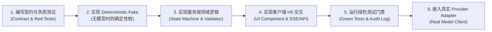

# Vertical Slice Builder Skill (TDD 驱动纵向切片交付)

> **定位**：拒绝“铺开写整个前端/后端/数据库”的横向大爆炸模式，通过最小端到端闭环（Vertical Slice）快速交付高质量、可运行、可自测的代码。
> **核心原则**：测试先行，切片贯通。在接入真实 AI Provider 之前，必须先有 Deterministic Fake 保证断网自测与 CI 稳定通过。

---

## 1. 触发时机 (Trigger Condition)

当出现以下情况时，激活并执行本 Skill：
1. 需求合同与系统契约完成定义，开始进入代码实现阶段；
2. 构建一个新的端到端功能切片（如：问卷提交 -> 结果生成 -> 结果卡片展示）；
3. 编写 Deterministic Fake（确定性测试桩）与集成测试用例；
4. 进行业务代码重构、异常边界修复与测试覆盖率提升时。

> **⚠️ 强制前置阅读 (Mandatory Pre-reading)**：
> 在动笔写任何业务逻辑前，必须使用 `view_file` 读取 `versions/v1.0/docs/07_milestone_v1_retrospective/架构拆解库/` 下对应的模块参考文档（如 `01-Identity-Auth-SuperTokens拆解.md`）。严禁无视踩坑预警凭空写代码。

---

## 2. 纵向切片交付流水线 (Execution Pipeline)



### 步骤 1：测试与 Fixture 先行（Red Phase）
- 按照 JSON Schema 与状态机契约编写端到端集成测试；
- 覆盖 6 大场景：正常输入、边界空值、非法 Schema、模型超时、权限越权、重复提交（幂等）。

### 步骤 2：构建 Deterministic Fake（确定性测试桩）
- 实现与真实 AI Provider 相同的 Port/Interface，返回预设的合法/非法测试数据；
- 确保在无网络、无 API Key、无计费的环境下，本地开发者与 CI 也能 100% 稳定运行全量集成测试。

### 步骤 3：实现端到端纵向贯通
- 前端（H5 页面/组件） -> 接口适配器 -> 业务防腐校验 -> 状态机持久化 -> 结构化日志。

---

## 3. 切片代码与测试规范 (Slice Engineering Standard)

### A. 端口与 Fake 实现范例 (TypeScript 示例)
```typescript
// 1. 定义统一模型端口
export interface ModelProviderPort {
  generateAssessment(input: AssessmentInput): Promise<AssessmentCandidate>;
}

// 2. 实现确定性测试桩 (Deterministic Fake)
export class FakeModelProvider implements ModelProviderPort {
  async generateAssessment(input: AssessmentInput): Promise<AssessmentCandidate> {
    if (input.petType === 'trigger_timeout') {
      await new Promise((resolve) => setTimeout(resolve, 5000));
      throw new Error('MODEL_TIMEOUT');
    }
    return {
      archetype: 'EXPLORER',
      confidenceScore: 0.95,
      keyTraits: ['活泼', '探索欲强'],
      evidenceIds: ['q1', 'q2']
    };
  }
}
```

### B. 集成测试断言要求
```typescript
describe('Pet Assessment Vertical Slice Test', () => {
  it('should complete end-to-end assessment and save valid state', async () => {
    // 1. Submit answers
    // 2. Validate state transition to GENERATING -> COMPLETED
    // 3. Assert DB record exists and schema matches exactly
  });

  it('should smoothly fallback to default template on model failure', async () => {
    // 1. Mock model failure
    // 2. Assert fallback response returned without 500 crash
  });
});
```

---

## 4. 红线守则 (Guards & Hard Boundaries)

- [ ] **严禁无测试提交代码**：新增任何功能切片必须伴随自动化测试，严禁仅通过“在浏览器点一下”判定通过；
- [ ] **严禁破坏单向依赖**：领域层绝不能反向依赖外部 Web 框架或具体的 LLM SDK；
- [ ] **严禁私自引入未批准依赖**：新增第三方 npm/pip 包必须经过技术负责人审批并在 Closeout 中显式报备。
