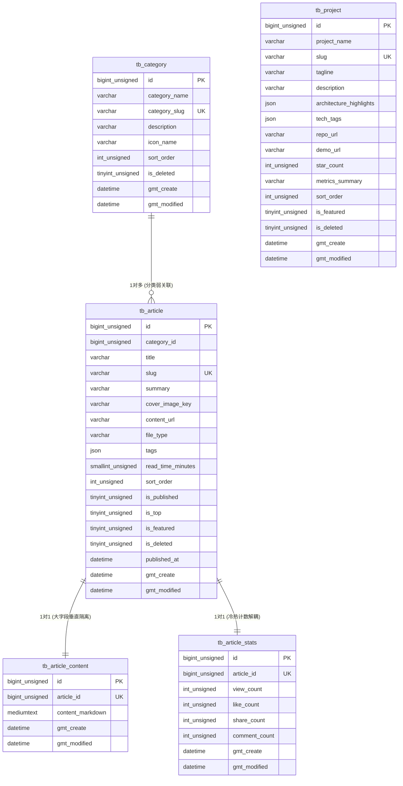

# roubao 全栈技术博客 - MySQL 数据库表设计规范文档

> **文档版本**: V1.1.0（精益与高性能平衡演进版）  
> **制定日期**: 2026-11-13  
> **架构技术栈**: Nginx + Java 21 (虚拟线程) + Spring Boot 3 + MySQL 8.x + Redis 7.x  
> **规范依据**: 《阿里巴巴 Java 开发手册（终极版 1.3.0）》第五部分 MySQL 数据库规约、OOP 规约与工程规约  
> **设计哲学**: **坚守核心性能优化、斩断初期过度设计、100%恪守阿里强制规范**  
> **DDL 脚本路径**: [V1__init_roubao_schema.sql](file:///d:/Java/roubao/docs/sql/V1__init_roubao_schema.sql) | [V2__seed_initial_data.sql](file:///d:/Java/roubao/docs/sql/V2__seed_initial_data.sql)

---

## 一、 架构裁决：坚守性能与拒绝过度设计的边界

在初期架构设计中，必须精确区分**“为了未来性能必须做的架构解耦”**与**“徒增复杂度的无意义过度设计”**：

| 设计维度 | 具体实现方案 | 判定类型 | 架构决策依据 |
| :--- | :--- | :--- | :--- |
| **分类表独立 (`tb_category`)** | 独立物理表，`tb_article` 存 `category_id` | **【核心保留】** | 分类具备独立的 Slug、Icon、排序权重与描述，是顶层导航与聚合的正式领域实体。 |
| **冷热计数拆分 (`tb_article_stats`)** | 独立计数表，1:1 与文章关联 | **【核心保留 - 性能优化】** | **消灭行级排他互斥锁争用**。阅读与点赞高频写入不会阻塞 `tb_article` 静态元数据的读请求与 Buffer Pool 缓存。 |
| **超长正文垂直拆分 (`tb_article_content`)** | 正文 Markdown (`mediumtext`) 独立为扩展表 | **【核心保留 - 性能优化】** | **保护 InnoDB Buffer Pool 与消除行溢出**。严格遵守阿里规约第 8 条，列表分页查询单页行密度提升 10 倍以上。 |
| **对象存储 Key 存储 (`cover_image_key`)** | 仅存 Object Key 相对路径，不存完整绝对 URL | **【核心规范 - 最佳实践】** | 规避域名/CDN/Bucket 变更导致的全库 SQL 批量修改，接口响应时由 DTO 动态拼接 CDN 前缀。 |
| **标签多对多中间表 (`tb_article_tag` + `tb_tag`)** | 砍掉 2 张表，合入 `tb_article.tags JSON` | **【坚决移除 - 斩断过度设计】** | 阿里规约严禁超过 3 表 JOIN。技术博客标签天然适合无序数组，MySQL 8.x 原生 JSON 数组直接免去 2 次连表或嵌套查询。 |
| **数据库流水日志表 (`tb_view_log`)** | 彻底移除 MySQL 记录，交由 Redis 24h 集合完成 | **【坚决移除 - 斩断过度设计】** | MySQL 是事务型数据库，不是日志引擎。高频写入流水只会急剧膨胀磁盘与 binlog。防刷去重交由 Redis `SADD` 内存操作即可。 |

---

## 二、 规范基准与阿里 MySQL 规约对照表

| 手册板块 | 规约条目 | 级别 | 规约核心要求 | 本项目具体落地实现方案 |
| :--- | :--- | :--- | :--- | :--- |
| **建表规约** | 第 1 条 | **【强制】** | 是与否概念字段使用 `is_xxx` 命名，类型为 `unsigned tinyint` (1/0) | 表中 `is_published`, `is_top`, `is_featured`, `is_deleted` 均为 `tinyint unsigned NOT NULL DEFAULT 0` |
| **建表规约** | 第 2 条 | **【强制】** | 表名、字段名全小写字母或数字，禁止数字开头，禁止保留字 | 全部库表与列名采用下划线蛇形小写命名（如 `tb_article`, `read_time_minutes`），避开保留字 |
| **建表规约** | 第 3 条 | **【强制】** | 表名不使用复数名词 | 采用单数业务名词加前缀：`tb_article`, `tb_category`, `tb_project`，无复数 |
| **建表规约** | 第 4 条 | **【强制】** | 禁用 MySQL 官方保留字 | 排序字段命名为 `sort_order`（禁止用 `order`），描述字段命名为 `description`（禁止用 `desc`） |
| **建表规约** | 第 5 条 | **【强制】** | 主键名为 `pk_字段名`，唯一索引为 `uk_字段名`，普通索引为 `idx_字段名` | 索引全部按此命名：主键 `PRIMARY`（隐式 pk_id），唯一索引 `uk_slug`, `uk_article_id`，普通索引 `idx_published_at` |
| **建表规约** | 第 6 条 | **【强制】** | 小数类型为 `decimal`，禁止使用 `float` 和 `double` | 计数与排序列统一为整型（`int unsigned`, `bigint unsigned`），若有浮点严格使用 `decimal` |
| **建表规约** | 第 8 条 | **【强制】** | `varchar` 长度不超过 5000，超过的独立分表定义为 `text` | **大字段垂直剥离**：将长篇 Markdown 正文独立为 `tb_article_content` 表（`mediumtext`），主表 `tb_article` 保持紧凑轻量 |
| **建表规约** | 第 9 条 | **【强制】** | 表必备三字段：`id`, `gmt_create`, `gmt_modified` | 全表必须包含：`id bigint unsigned AUTO_INCREMENT`, `gmt_create datetime DEFAULT CURRENT_TIMESTAMP`, `gmt_modified datetime DEFAULT CURRENT_TIMESTAMP ON UPDATE CURRENT_TIMESTAMP` |
| **建表规约** | 第 10 条 | **【推荐】** | 表命名加上“业务名称_表的作用” | 采用 `tb_{业务实体}` 统一前缀：`tb_category`, `tb_article`, `tb_article_content`, `tb_article_stats`, `tb_project` |
| **建表规约** | 第 14 条 | **【推荐】** | 单表行数超 500 万或超 2GB 才分库分表 | 拒绝无意义的水平切分，专注单机 InnoDB 深度优化 |
| **索引规约** | 第 1 条 | **【强制】** | 业务上具有唯一特性的字段必须建成唯一索引（`uk_`） | `tb_article.slug`、`tb_project.slug`、`tb_category.category_slug` 均建有 `uk_slug`，防止脏数据 |
| **索引规约** | 第 2 条 | **【强制】** | 超过三个表禁止 join，需要 join 字段类型必须绝对一致 | 列表查询仅关联 `tb_article` 与 `tb_article_stats`（1 次 JOIN），远低于 3 表限制 |
| **索引规约** | 第 4 条 | **【强制】** | 页面搜索严禁左模糊或全模糊 | 数据库只做等值或前缀检索，复杂全文模糊匹配交由搜索引擎或应用层索引完成 |
| **索引规约** | 第 5/9 条 | **【推荐】** | 组合索引遵循最左匹配原则，区分度最高的在最左边，等号条件前置 | 如 `idx_category_published_top` (`category_id`, `is_published`, `is_top`, `sort_order`) 满足复合过滤与排序 |
| **SQL规约** | 第 1 条 | **【强制】** | 不要使用 `count(列名)` 或 `count(常量)` 替代 `count(*)` | 数据分页统计行数统一使用 `count(*)`（SQL92 标准） |
| **SQL规约** | 第 6 条 | **【强制】** | 不得使用外键与级联，一切外键概念必须在应用层解决 | **数据库层面彻底禁止使用 FOREIGN KEY 约束**，通过 Spring Boot 业务逻辑与短事务保障一致性 |
| **SQL规约** | 第 7 条 | **【强制】** | 禁止使用存储过程 | 所有数据逻辑与计算全部编写在 Java 应用服务层 |
| **ORM映射** | 第 1 条 | **【强制】** | 表查询一律不要使用 `*` 作为查询字段列表 | MyBatis / DAO 查询明确声明字段列，禁止 `SELECT *` |
| **ORM映射** | 第 2 条 | **【强制】** | POJO 类的布尔属性不能加 `is`，而数据库字段必须加 `is_` | 数据库字段 `is_published` 对应 DO 属性 `Boolean published`，通过 resultMap 显式映射 |
| **OOP规约** | 第 8/9 条 | **【强制】** | POJO 类属性必须使用包装数据类型，不要设定任何属性默认值 | DO 实体类属性统一使用 `Long`, `Integer`, `Boolean`, `LocalDateTime`，禁止基础数据类型与硬编码初始化 |

---

## 三、 系统实体关系拓扑（ER 模型）



---

## 四、 数据库物理表结构详细设计（完整数据字典）

### 1. 文章分类字典表 (`tb_category`)

- **业务定位**: 维护文章技术领域的顶层分类（后端架构、前端工程、性能调优、系统架构）。
- **DDL 字段设计**:

| 字段名称 | 物理数据类型 | Java 对应类型 | 允许为空 | 默认值 | 约束 / 索引 | 业务含义与注释 |
| :--- | :--- | :--- | :--- | :--- | :--- | :--- |
| `id` | `bigint unsigned` | `Long` | **否** | 自增 | `PRIMARY KEY` | 分类主键自增 ID |
| `category_name`| `varchar(64)` | `String` | **否** | `''` | 无 | 分类中文显示名称（如：后端架构） |
| `category_slug`| `varchar(64)` | `String` | **否** | `''` | `uk_category_slug` | 分类英文路由标识（如：backend） |
| `description` | `varchar(255)` | `String` | **否** | `''` | 无 | 分类定位与受众描述 |
| `icon_name` | `varchar(64)` | `String` | **否** | `''` | 无 | 前端 Lucide 图标标识名称 |
| `sort_order` | `int unsigned` | `Integer` | **否** | `0` | `idx_sort_order` | 排序优先级（数值越大排序越靠前） |
| `is_deleted` | `tinyint unsigned`| `Boolean` | **否** | `0` | 无 | 逻辑删除标记：0-正常，1-已删除 |
| `gmt_create` | `datetime` | `LocalDateTime` | **否** | `CURRENT_TIMESTAMP` | 无 | 记录物理创建时间 |
| `gmt_modified` | `datetime` | `LocalDateTime` | **否** | `CURRENT_TIMESTAMP ON UPDATE` | 无 | 记录最后修改时间 |

- **索引配置**:
  - `PRIMARY KEY (id)`: 聚簇索引。
  - `UNIQUE KEY uk_category_slug (category_slug)`: 确保 URL 路由 slug 严格全局唯一。
  - `KEY idx_sort_order (sort_order)`: 支撑后台与前端导航栏按权重排序。

---

### 2. 文章核心元数据表 (`tb_article`)

- **业务定位**: 系统核心业务表，记录文章轻量基础属性、SEO 路径、标签列表与排序权重。
- **DDL 字段设计**:

| 字段名称 | 物理数据类型 | Java 对应类型 | 允许为空 | 默认值 | 约束 / 索引 | 业务含义与注释 |
| :--- | :--- | :--- | :--- | :--- | :--- | :--- |
| `id` | `bigint unsigned` | `Long` | **否** | 自增 | `PRIMARY KEY` | 文章主键自增 ID |
| `category_id` | `bigint unsigned` | `Long` | **否** | `0` | 复合索引列 | 关联分类 ID（对应 `tb_category.id`） |
| `title` | `varchar(128)` | `String` | **否** | `''` | 无 | 文章主标题 |
| `slug` | `varchar(128)` | `String` | **否** | `''` | `uk_slug` | 文章唯一路由 Slug（URL 路径标识） |
| `summary` | `varchar(500)` | `String` | **否** | `''` | 无 | 导读摘要，用于卡片陈列与 Meta SEO |
| `cover_image_key`| `varchar(255)` | `String` | **否** | `''` | 无 | **对象存储相对Key**（API动态拼CDN） |
| `content_url` | `varchar(255)` | `String` | **否** | `''` | 无 | 静态 Markdown 文件 CDN/OSS 外部下载地址 |
| `file_type` | `varchar(16)` | `String` | **否** | `'md'` | 无 | 文章原稿类型：`md` 或 `pdf` |
| `tags` | `json` | `List<String>` | 是 | `NULL` | 无 | **技术标签数组**（如 `["Java 21", "Redis"]`） |
| `read_time_minutes`| `smallint unsigned` | `Integer` | **否** | `1` | 无 | 预估阅读耗时（分钟） |
| `sort_order` | `int unsigned` | `Integer` | **否** | `0` | 复合索引列 | 手动干预置顶排序权重 |
| `is_published` | `tinyint unsigned`| `Boolean` | **否** | `0` | 复合索引列 | 状态：0-草稿，1-正式公开发布 |
| `is_top` | `tinyint unsigned`| `Boolean` | **否** | `0` | 复合索引列 | 是否置顶：0-否，1-置顶展示 |
| `is_featured` | `tinyint unsigned`| `Boolean` | **否** | `0` | 无 | 是否精选推荐：0-否，1-精选 |
| `is_deleted` | `tinyint unsigned`| `Boolean` | **否** | `0` | 无 | 逻辑删除标记：0-正常，1-已删除 |
| `published_at` | `datetime` | `LocalDateTime` | 是 | `NULL` | `idx_published_at` | 正式公开发布时间戳 |
| `gmt_create` | `datetime` | `LocalDateTime` | **否** | `CURRENT_TIMESTAMP` | `idx_gmt_create` | 记录入库时间 |
| `gmt_modified` | `datetime` | `LocalDateTime` | **否** | `CURRENT_TIMESTAMP ON UPDATE` | 无 | 记录更新时间 |

- **索引配置**:
  - `PRIMARY KEY (id)`: 聚簇索引。
  - `UNIQUE KEY uk_slug (slug)`: 确保 `/blog/{slug}` 路径唯一命中。
  - `KEY idx_category_published_top (category_id, is_published, is_top, sort_order)`: **高频列表覆盖复合索引**。
  - `KEY idx_published_at (published_at)`: 支撑时间线倒序查询。
  - `KEY idx_gmt_create (gmt_create)`: 支撑后台按创建时间分页检索。

---

### 3. 文章长正文扩展表 (`tb_article_content`) - 【大字段垂直拆分】

- **业务定位**: 承载超长 Markdown 富文本源码，将几万字节的大文本从主表中彻底隔离出去。
- **性能收益**:
  - 传统宽表在分页查询（`LIMIT 0, 10`）时，即便使用了索引，如果需要回表提取行数据，每页 10 行可能会占用数十个 16KB 数据页。
  - 垂直拆分后，`tb_article` 单行仅约 800 字节，一个 16KB 数据页可紧凑容纳近 20 条完整记录，InnoDB Buffer Pool 缓存命中率成倍飙升。
- **DDL 字段设计**:

| 字段名称 | 物理数据类型 | Java 对应类型 | 允许为空 | 默认值 | 约束 / 索引 | 业务含义与注释 |
| :--- | :--- | :--- | :--- | :--- | :--- | :--- |
| `id` | `bigint unsigned` | `Long` | **否** | 自增 | `PRIMARY KEY` | 扩展表自增主键 ID |
| `article_id` | `bigint unsigned` | `Long` | **否** | 无 | `uk_article_id` | 文章 ID（对应 `tb_article.id`，1:1 强绑定） |
| `content_markdown`| `mediumtext` | `String` | **否** | 无 | 无 | Markdown 完整源码（最大支持 16MB） |
| `gmt_create` | `datetime` | `LocalDateTime` | **否** | `CURRENT_TIMESTAMP` | 无 | 创建时间 |
| `gmt_modified` | `datetime` | `LocalDateTime` | **否** | `CURRENT_TIMESTAMP ON UPDATE` | 无 | 更新时间 |

- **索引配置**:
  - `PRIMARY KEY (id)`: 聚簇索引。
  - `UNIQUE KEY uk_article_id (article_id)`: 保证一篇文章仅有一条对应的长正文记录。

---

### 4. 文章高频统计指标表 (`tb_article_stats`) - 【冷热计数解耦】

- **业务定位**: 独立存储高频突发写操作（阅读量、点赞数、分享数、评论数），消除行级互斥锁争用。
- **性能收益**:
  - 用户每次打开文章触发浏览量自增时，只需更新 `tb_article_stats` 表的一行，不会给 `tb_article` 的元数据行加排他 X 锁。
  - 前台高并发访问下，主表上的任何后台修改（如改标题、改标签）与前台计数写入完全互不影响。
- **DDL 字段设计**:

| 字段名称 | 物理数据类型 | Java 对应类型 | 允许为空 | 默认值 | 约束 / 索引 | 业务含义与注释 |
| :--- | :--- | :--- | :--- | :--- | :--- | :--- |
| `id` | `bigint unsigned` | `Long` | **否** | 自增 | `PRIMARY KEY` | 统计自增主键 ID |
| `article_id` | `bigint unsigned` | `Long` | **否** | 无 | `uk_article_id` | 文章 ID（对应 `tb_article.id`，1:1 映射） |
| `view_count` | `int unsigned` | `Long` / `Integer` | **否** | `0` | `idx_view_count` | 累计阅读浏览总量 |
| `like_count` | `int unsigned` | `Long` / `Integer` | **否** | `0` | 无 | 累计点赞总量 |
| `share_count` | `int unsigned` | `Long` / `Integer` | **否** | `0` | 无 | 累计分享总量 |
| `comment_count`| `int unsigned` | `Long` / `Integer` | **否** | `0` | 无 | 累计评论互动总量 |
| `gmt_create` | `datetime` | `LocalDateTime` | **否** | `CURRENT_TIMESTAMP` | 无 | 创建时间 |
| `gmt_modified` | `datetime` | `LocalDateTime` | **否** | `CURRENT_TIMESTAMP ON UPDATE` | 无 | 更新时间 |

- **索引配置**:
  - `PRIMARY KEY (id)`: 聚簇索引。
  - `UNIQUE KEY uk_article_id (article_id)`: 快速根据文章 ID 检索或批量回写计数。
  - `KEY idx_view_count (view_count)`: 支持全站“热门文章排行”（Top Views）的高性能索引扫描。

---

### 5. 开源与实战项目展厅表 (`tb_project`)

- **业务定位**: 记录开源项目、架构演示案例与实战工程。
- **DDL 字段设计**:

| 字段名称 | 物理数据类型 | Java 对应类型 | 允许为空 | 默认值 | 约束 / 索引 | 业务含义与注释 |
| :--- | :--- | :--- | :--- | :--- | :--- | :--- |
| `id` | `bigint unsigned` | `Long` | **否** | 自增 | `PRIMARY KEY` | 项目自增主键 ID |
| `project_name` | `varchar(64)` | `String` | **否** | `''` | 无 | 项目名称（如：Roubao Gateway） |
| `slug` | `varchar(64)` | `String` | **否** | `''` | `uk_slug` | 项目 URL 标识（如：roubao-gateway） |
| `tagline` | `varchar(128)` | `String` | **否** | `''` | 无 | 项目一句话亮点标语 |
| `description` | `varchar(1000)` | `String` | **否** | `''` | 无 | 项目背景与架构长描述 |
| `architecture_highlights` | `json` | `List<String>` | 是 | `NULL` | 无 | 核心架构亮点列表（JSON 数组） |
| `tech_tags` | `json` | `List<String>` | 是 | `NULL` | 无 | 关键技术栈标签列表（JSON 数组） |
| `repo_url` | `varchar(255)` | `String` | **否** | `''` | 无 | GitHub/Gitee 仓库源码地址 |
| `demo_url` | `varchar(255)` | `String` | **否** | `''` | 无 | 在线演示 Demo 或文档地址 |
| `star_count` | `int unsigned` | `Integer` | **否** | `0` | 无 | GitHub Star 统计数 |
| `metrics_summary` | `varchar(128)` | `String` | **否** | `''` | 无 | 关键压测指标（如：38K QPS / P99 4.2ms） |
| `sort_order` | `int unsigned` | `Integer` | **否** | `0` | 复合索引列 | 排序权重（数值越大越靠前） |
| `is_featured` | `tinyint unsigned`| `Boolean` | **否** | `0` | 复合索引列 | 首页精选推荐标记：0-否，1-是 |
| `is_deleted` | `tinyint unsigned`| `Boolean` | **否** | `0` | 无 | 逻辑删除标记：0-正常，1-已删除 |
| `gmt_create` | `datetime` | `LocalDateTime` | **否** | `CURRENT_TIMESTAMP` | 无 | 记录创建时间 |
| `gmt_modified` | `datetime` | `LocalDateTime` | **否** | `CURRENT_TIMESTAMP ON UPDATE` | 无 | 记录更新时间 |

- **索引配置**:
  - `PRIMARY KEY (id)`: 聚簇索引。
  - `UNIQUE KEY uk_slug (slug)`: 保证项目路由标识唯一。
  - `KEY idx_featured_sort` (`is_featured`, `sort_order`): 满足首页精选项目高效拉取。

---

## 五、 Java 实体（DO）与 ORM 映射规约

遵照阿里规约：
1. DO 属性统一采用包装类型，严禁基础类型。
2. 布尔属性去除 `is` 前缀（`Boolean published`, `Boolean top`）。
3. DO 类中严禁给属性赋默认值。

### 示例: `ArticleDO.java`

```java
package com.roubao.blog.infrastructure.dao.entity;

import com.baomidou.mybatisplus.annotation.IdType;
import com.baomidou.mybatisplus.annotation.TableField;
import com.baomidou.mybatisplus.annotation.TableId;
import com.baomidou.mybatisplus.annotation.TableLogic;
import com.baomidou.mybatisplus.annotation.TableName;
import com.baomidou.mybatisplus.extension.handlers.JacksonTypeHandler;
import lombok.Getter;
import lombok.Setter;
import lombok.ToString;

import java.io.Serial;
import java.io.Serializable;
import java.time.LocalDateTime;
import java.util.List;

@Getter
@Setter
@ToString
@TableName(value = "tb_article", autoResultMap = true)
public class ArticleDO implements Serializable {

    @Serial
    private static final long serialVersionUID = 1L;

    @TableId(value = "id", type = IdType.AUTO)
    private Long id;

    @TableField("category_id")
    private Long categoryId;

    @TableField("title")
    private String title;

    @TableField("slug")
    private String slug;

    @TableField("summary")
    private String summary;

    /**
     * 封面在对象存储中的相对 Key
     */
    @TableField("cover_image_key")
    private String coverImageKey;

    @TableField("content_url")
    private String contentUrl;

    @TableField("file_type")
    private String fileType;

    /**
     * 技术标签列表（通过 MyBatis-Plus 原生 JacksonTypeHandler 直接映射为 List<String>）
     */
    @TableField(value = "tags", typeHandler = JacksonTypeHandler.class)
    private List<String> tags;

    @TableField("read_time_minutes")
    private Integer readTimeMinutes;

    @TableField("sort_order")
    private Integer sortOrder;

    @TableField("is_published")
    private Boolean published;

    @TableField("is_top")
    private Boolean top;

    @TableField("is_featured")
    private Boolean featured;

    @TableLogic
    @TableField("is_deleted")
    private Boolean deleted;

    @TableField("published_at")
    private LocalDateTime publishedAt;

    @TableField("gmt_create")
    private LocalDateTime gmtCreate;

    @TableField("gmt_modified")
    private LocalDateTime gmtModified;
}
```

---

## 六、 核心 SQL 访问模式（严格控制在 1 次 JOIN 内）

### 1. 文章列表展示（带分类、置顶排序与浏览计数）
```sql
SELECT 
    a.id, a.category_id, a.title, a.slug, a.summary, 
    a.cover_image_key, a.tags, a.read_time_minutes, a.is_top, a.published_at,
    IFNULL(s.view_count, 0) AS view_count,
    IFNULL(s.like_count, 0) AS like_count
FROM tb_article a
LEFT JOIN tb_article_stats s ON a.id = s.article_id
WHERE a.category_id = #{categoryId}
  AND a.is_published = 1
  AND a.is_deleted = 0
ORDER BY a.is_top DESC, a.sort_order DESC, a.published_at DESC
LIMIT #{offset}, #{pageSize};
```
- **分析**:
  - 仅发生 **1 次主外键精准连接**（`a.id = s.article_id`），完全符合阿里手册“超过 3 表禁止 join”的红线。
  - 主表过滤完全命中复合索引 `idx_category_published_top`。
  - 不读取 `content_markdown` 大字段，单页内存极小，速度处于微秒级别。

---

## 七、 总结

当前修订版方案实现了：
1. **分类表独立 (`tb_category`)**：保证业务域治理与分类维度的纯净；
2. **长正文大字段垂直剥离 (`tb_article_content`)**：保护 Buffer Pool 缓存与全表扫描效率；
3. **冷热计数解耦 (`tb_article_stats`)**：彻底消灭并发写行级排他锁争用；
4. **对象存储规范落库 (`cover_image_key`)**：遵循云原生最佳实践；
5. **砍掉多对多标签中间表与流水日志表**：消灭过度设计，将连表数控制在 1 次以内。
