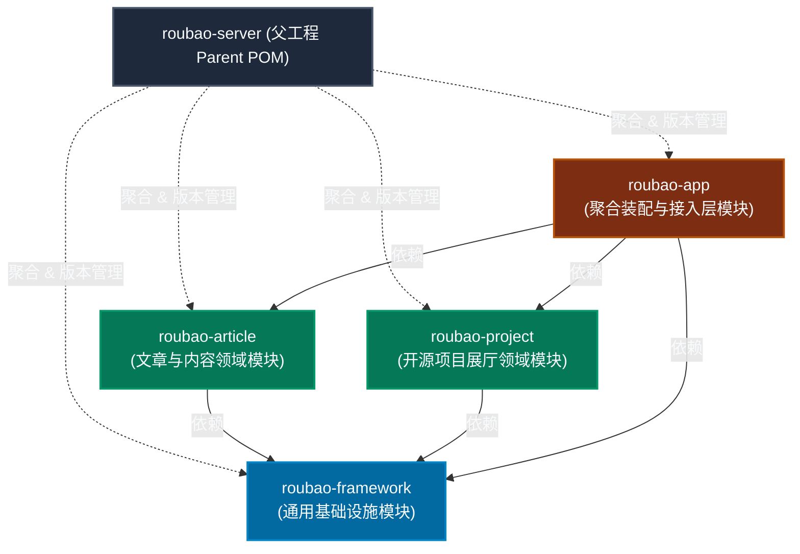

# roubao 后端工程 - 父子多模块架构与职责规划说明书

> **文档版本**: V1.0.0  
> **制定日期**: 2026-11-13  
> **技术基线**: Java 21 LTS (虚拟线程开启) + Spring Boot 3.3.x + MySQL 8.x + Redis 7.x + MinIO/S3 兼容存储  
> **规范依据**:
> 1. 《阿里巴巴 Java 开发手册（终极版 1.3.0）》：工程结构规约、应用分层规约、领域模型规约、二方库依赖规约
> 2. 《Java 后端开发规范手册 (2026 通用版 1.1)》：模块边界与数据所有权、防止过度分层、类职责分层、虚拟线程并发、对象存储契约

---

## 一、 规范统合与设计哲学

结合两份核心规范文档的指导思想，本项目后端工程确立以下四大顶层原则：

1. **模块化单体（Modular Monolith）与高内聚领域**：
   - 避免早期微服务或过度拆包带来的网络延迟与多工程维护负担；
   - 通过 Maven 子模块物理隔离领域边界，实现**编译期强约束**，杜绝层级越权与跨领域代码随意交叉引用。
2. **严格的数据所有权（Data Ownership 规范 2.2）**：
   - 每张业务表必须且仅能指定一个负责的业务领域模块；
   - 严禁任何模块跨领域注入其他模块的 Mapper/DAO，严禁在各自 SQL 中跨域读写其他领域的业务表；
   - 跨模块协作必须通过领域 Service 提供的最小化 Request/Response 契约完成。
3. **防止过度分层（Anti-Over-Engineering 规范 2.4）**：
   - 坚决杜绝为每个领域再机械拆解出 `*-api`, `*-impl`, `*-client`, `*-starter` 等空转子模块；
   - 仅当模块具备明确且独立的架构边界时才设立独立子工程。
4. **统一依赖治理与版本仲裁（阿里规约二方库依赖第 1~7 条）**：
   - 根工程（Root POM）统一充当全局 `<dependencyManagement>`，统一仲裁第三方依赖（Spring Boot、MyBatis-Plus、MySQL Driver、Redis、AWS S3 SDK、Lombok、MapStruct）的精确版本；
   - 子模块继承父工程，按需显式声明依赖，严禁在子模块中硬编码任何第三方库的 `<version>`。

---

## 二、 工程模块结构拓扑与依赖矩阵



### 依赖关系单向无环说明
- **`roubao-framework`**：最底层基础组件，**严禁反向依赖任何业务域模块**。
- **`roubao-article` 与 `roubao-project`**：同级业务领域模块，**相互之间严禁双向依赖**。
- **`roubao-app`**：顶层接入与装配层，负责组装所有领域模块与基础设施，是唯一的 Spring Boot 可执行 JAR 打包目标。

---

## 三、 子模块划分与职责明细

### 1. 根工程：`roubao-server` (Parent POM)
- **定位**: 全局聚合与依赖版本治理中心（Packaging: `pom`）。
- **核心职责**:
  1. 定义全局属性：`<java.version>21</java.version>`, `<maven.compiler.release>21</maven.compiler.release>`, `<project.build.sourceEncoding>UTF-8</project.build.sourceEncoding>`。
  2. 集中统一 `<dependencyManagement>`，锁定核心框架版本：
     - Spring Boot `3.3.4` (引入 `spring-boot-dependencies` BOM)
     - MyBatis-Plus `3.5.7`
     - MySQL Connector/J `8.4.0`
     - AWS S3 SDK `2.28.x` (兼容 MinIO 与阿里云 OSS/S3 协议)
     - MapStruct `1.5.5.Final` / Lombok `1.18.34`
     - Flyway Migration `10.x`
  3. 统一全局插件配置：`maven-compiler-plugin` (配置 Java 21 虚拟线程支持与注解处理器)、`maven-surefire-plugin` (测试驱动)。

---

### 2. 基础设施模块：`roubao-framework`
- **定位**: 技术基础设施、通用脚手架与跨领域通用能力下沉层。
- **业务归属**: 纯技术支撑，不拥有任何业务数据表，无业务分支。
- **内部包结构规划**:
  ```
  com.roubao.framework
  ├── common               # 通用响应模型
  │   ├── Result.java      # 统一 API 返回包装类 (code, msg, data, traceId)
  │   ├── PageResult.java  # 统一分页数据响应包装 (total, list, page, size)
  │   └── PageQuery.java   # 统一分页查询基类
  ├── constant             # 全局技术常量
  │   ├── RedisConstant.java    # 缓存 Key 前缀与 TTL 规则
  │   └── StorageConstant.java  # 对象存储路径规则与支持格式
  ├── exception            # 异常与错误码体系
  │   ├── ErrorCode.java        # 统一错误码枚举契约 (400, 401, 403, 404, 500等)
  │   ├── BusinessException.java# 核心业务受控异常
  │   └── GlobalExceptionHandler.java # 全局 ControllerAdvice 异常兜底拦截
  ├── config               # 基础设施配置类
  │   ├── MyBatisPlusConfig.java # 分页插件、自动填充时间拦截器、乐观锁插件
  │   ├── RedisConfig.java       # Jackson2JsonRedisSerializer 序列化配置
  │   ├── AsyncConfig.java       # 基于 Java 21 虚拟线程的任务执行器配置
  │   ├── CorsConfig.java        # Nginx 穿透与跨域安全配置
  │   └── JacksonConfig.java     # 全局 LocalDateTime / Long 转 String 防前端精度丢失
  ├── storage              # 对象存储适配客户端 (规范 6.1)
  │   ├── StorageClient.java     # 存储抽象接口
  │   ├── S3CompatibleStorageClient.java # MinIO/S3 原生驱动 (签发预签名 URL、Key 生成)
  │   └── StorageProperties.java # 存储配置属性绑定 (endpoint, bucket, cdnDomain)
  ├── context              # 请求上下文与跟踪
  │   ├── UserContext.java       # 线程上下文 (ThreadLocal 请求结束强制清理)
  │   └── TraceIdFilter.java     # 全链路 TraceId 生成与 MDC 注入
  └── util                 # 无状态通用工具
      ├── RedisUtils.java        # Redis 常用操作封装 (INCR, SADD, Expire)
      ├── SecurityUtils.java     # BCrypt 密码加密与 Token 摘要比对
      └── CdnUrlHelper.java      # 将 relative_key 动态组装为 CDN 完整访问 URL
  ```

---

### 3. 文章与内容领域模块：`roubao-article`
- **定位**: 文章内容创作、分类字典、正文大字段管理与冷热高频计数业务域。
- **数据所有权（Data Ownership）**:
  - `tb_category`（文章分类表）
  - `tb_article`（文章主体元数据表）
  - `tb_article_content`（长正文大字段垂直扩展表）
  - `tb_article_stats`（高频统计指标表 - 阅读量/点赞数）
- **内部包结构规划**:
  ```
  com.roubao.article
  ├── entity               # DO 实体类 (严格对齐阿里巴巴规约与表映射)
  │   ├── CategoryDO.java
  │   ├── ArticleDO.java          # tags 映射 List<String>
  │   ├── ArticleContentDO.java   # 存放长正文 Markdown
  │   └── ArticleStatsDO.java     # 存放高频计数指标
  ├── mapper               # MyBatis 数据访问层 (单表操作，严禁跨域 JOIN)
  │   ├── CategoryMapper.java
  │   ├── ArticleMapper.java
  │   ├── ArticleContentMapper.java
  │   └── ArticleStatsMapper.java
  ├── model                # 领域模型与数据传输契约
  │   ├── dto                     # 入参 DTO
  │   │   ├── ArticleCreateDTO.java
  │   │   ├── ArticleUpdateDTO.java
  │   │   ├── ArticleQuery.java
  │   │   └── CategoryDTO.java
  │   └── vo                      # 契约响应 VO / record
  │       ├── ArticleDetailVO.java
  │       ├── ArticleListItemVO.java
  │       └── CategoryVO.java
  └── service              # 业务用例与流程编排
      ├── CategoryService.java
      ├── ArticleService.java
      ├── ArticleContentService.java
      └── ArticleStatsService.java # 核心性能：Redis 缓存打点 + 定时批处理回写 MySQL
  ```
- **核心业务职责**:
  1. 维护分类的增删改查与排序。
  2. 维护文章生命周期（草稿、公开发布、置顶、精选、逻辑删除）。
  3. 文章发布时，事务内同时写入 `tb_article`、`tb_article_content` 并初始化 `tb_article_stats`。
  4. 承载高并发阅读量/点赞打点：在 Redis 中执行 `INCR` 和 24 小时 `SADD` 去重，定期触发批量更新到 `tb_article_stats`，彻底保护 `tb_article` 主表。

---

### 4. 开源项目展厅领域模块：`roubao-project`
- **定位**: 开源实战项目展厅、架构亮点、实测指标与源码仓库路由业务域。
- **数据所有权（Data Ownership）**:
  - `tb_project`（开源与实战项目展厅表）
- **内部包结构规划**:
  ```
  com.roubao.project
  ├── entity
  │   └── ProjectDO.java          # 架构要点 highlights 与 techTags 映射 JSON
  ├── mapper
  │   └── ProjectMapper.java
  ├── model
  │   ├── dto
  │   │   ├── ProjectCreateDTO.java
  │   │   ├── ProjectUpdateDTO.java
  │   │   └── ProjectQuery.java
  │   └── vo
  │       └── ProjectVO.java
  └── service
      └── ProjectService.java     # 项目 CRUD、首页精选拉取与 Star 排序
  ```
- **核心业务职责**:
  1. 维护项目展厅卡片信息、架构亮点列表与技术标签。
  2. 支撑前端首页精选项目（`is_featured = 1`）的高性能索引查询。

---

### 5. 聚合装配与接入层模块：`roubao-app`
- **定位**: 整个 Spring Boot 服务的打包构建目标与外部 HTTP 协议接入层。
- **核心职责**:
  1. **路由与端点接入（Controller）**: 分离前台访客（Portal）与后台管理（Admin）两套端点。
  2. **Flyway 数据库版本化迁移**: 存放并执行 `db/migration/` 脚本。
  3. **环境配置装配**: `application.yml`, `application-dev.yml`, `application-prod.yml`。
  4. **主应用启动入口**: `RoubaoApplication.java`。
- **内部结构规划**:
  ```
  com.roubao.app
  ├── controller
  │   ├── portal           # 面向前台访客读流量 (公开只读、高并发、CDN友好)
  │   │   ├── ArticlePortalController.java # 文章列表分页、详情查询、分类筛选
  │   │   ├── CategoryPortalController.java# 全部分类导航拉取
  │   │   ├── ProjectPortalController.java # 项目展厅与精选拉取
  │   │   └── ViewPortalController.java    # 客户端 24h 去重阅读与点赞打点
  │   └── admin            # 面向博主后台写流量 (强鉴权、管理、直传签发)
  │       ├── AuthAdminController.java     # 博主登录鉴权与 Token 签发
  │       ├── ArticleAdminController.java  # 文章创作、草稿保存、发布与下架
  │       ├── CategoryAdminController.java # 分类权重与字典维护
  │       ├── ProjectAdminController.java  # 开源项目录入与维护
  │       └── StorageAdminController.java  # 签发封面图 OSS/MinIO 预签名上传凭证
  ├── interceptor          # 鉴权与安全拦截
  │   ├── AdminAuthInterceptor.java        # 拦截 /admin/** 校验 Token 签名
  │   └── RateLimiterInterceptor.java      # 基于 Redis 令牌桶的前台打点限流防刷
  └── RoubaoApplication.java               # 启动类 (@SpringBootApplication)
  ```
- **资源目录 (`src/main/resources`)**:
  ```
  resources
  ├── db/migration
  │   ├── V1__init_roubao_schema.sql  # 数据库结构初始化
  │   └── V2__seed_initial_data.sql   # 基线业务种子数据
  ├── application.yml                 # 公共配置 (端口、数据源、Flyway、虚拟线程开关)
  ├── application-dev.yml             # 本地开发环境配置 (MySQL、本地 MinIO、Redis)
  └── application-prod.yml            # 生产环境配置 (云数据库、云存储 OSS、生产 Redis)
  ```

---

## 四、 跨层调用与分层契约规约

根据《阿里巴巴开发手册》与《Java 后端开发规范手册 3.2 节》：

| 分层类型 | 允许做什么 | 严禁做什么 |
| :--- | :--- | :--- |
| **Controller (接入层)** | 接收 HTTP 请求、参数校验 (`@Valid`)、调用 Service 接口、返回统一 `Result<T>`。 | 严禁包含复杂业务逻辑分支；严禁加 `@Transactional` 控制事务；严禁直接注入 Mapper 执行 SQL。 |
| **Service (领域业务层)** | 编排业务流程、状态变更逻辑校验、控制 `@Transactional` 事务边界、发布事件或调用 Redis 工具。 | 严禁包含 HTTP Request/Response 报文参数；严禁解析客户端网络协议；严禁返回持久化 Entity (DO)。 |
| **Mapper (持久层)** | 执行参数绑定的 SQL 映射、处理影响行数、通过 TypeHandler 转换复杂列（如 JSON）。 | 严禁在持久层内调用远程 RPC 或进行业务状态判断；严禁使用 `SELECT *`。 |
| **DO (Entity 实体)** | 与数据表字段严格 1:1 映射，声明主键与逻辑删除。 | 严禁定义请求参数或响应字段；严禁给属性赋硬编码默认值；布尔类型严禁加 `is` 前缀。 |
| **DTO / VO / record** | 承载业务输入命令（DTO）或不可变展示结果（VO / record）。 | 严禁直接把 DO 当作返回对象暴露给外部前端；严禁使用 `Map<String, Object>` 替代强类型契约。 |

---

## 五、 实施计划与步骤编排

在当前规范指导下，后续工程落地顺序如下：

1. **第一阶段：骨架搭建**
   - 创建 `backend/` 根目录与 `pom.xml`，配置 Java 21 与 Spring Boot 3.3.4。
   - 创建 4 个子模块的 `pom.xml`，构建单向依赖关系并通过 Maven 构建校验。
2. **第二阶段：基础设施初始化 (`roubao-framework`)**
   - 实现 `Result<T>`, `ErrorCode`, `BusinessException`。
   - 配置 MyBatis-Plus、Redis 序列化与 Java 21 虚拟线程支持。
   - 配置 S3 预签名直传存储客户端。
3. **第三阶段：领域持久层实现 (`roubao-article` + `roubao-project`)**
   - 编写 5 个符合阿里规范的 DO 实体类与 Mapper 接口。
   - 编写领域 Service 核心用例与测试。
4. **第四阶段：装配启动与联调 (`roubao-app`)**
   - 配置 Flyway 自动迁移并执行迁移脚本。
   - 编写 Portal 与 Admin 控制器，启动 Spring Boot 验证与前端接口连通。
