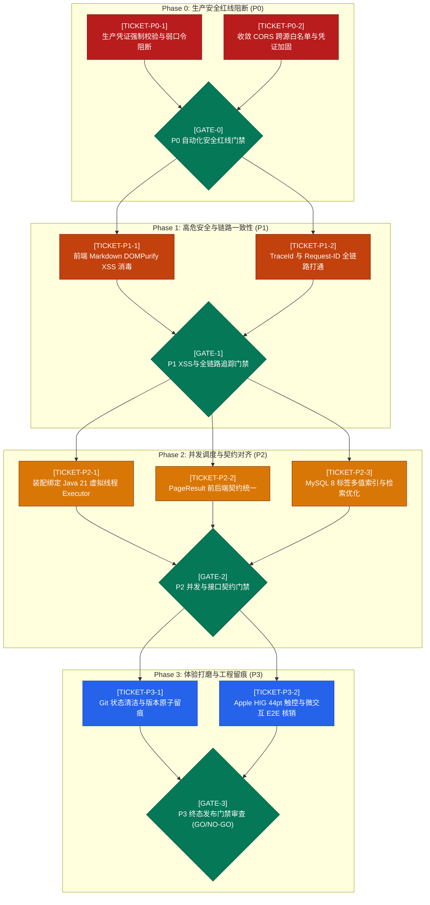

# Roubao (肉包) 系统 · P0~P3 全周期缺陷修复与验收工程方案

> **规范体系**：`planning-with-files` + `to-tickets` + `fullstack-qa-architect`  
> **文档位置**：`docs/REMEDIATION_AND_ACCEPTANCE_PLAN.md`  
> **制定时间**：2026-11-14  
> **适用基线**：Java 21 LTS + Spring Boot 3.3.4 + Next.js 16 (App Router / Turbopack) + MySQL 8.0 + Nginx 1.24  

---

## 🎯 一、 方案总纲与规格驱动 (Spec-First)

### 1. 目标 (Goal)
修复项目评审中暴露的生产阻断安全漏洞（P0）、高危注入与链路断裂问题（P1）、并发与契约偏差缺陷（P2），并完成前端触控手感与版本库整洁度验收（P3），使全栈系统达到直接具备生产受控发布门禁（Release Gate）的标准。

### 2. 约束 (Constraints)
- **零破坏性变更**：数据库改造必须保持向后兼容（Zero-Downtime Migration），严禁破坏现有表结构与数据；
- **分层防腐约束**：严禁在 Controller 层直接调用 Mapper；领域模块间严禁跨域注入 DAO；
- **安全不妥协**：凭证必须强制恒定时间比较；CORS 严禁携带凭证时开放通配符；渲染层必须经过 DOM 级清洗；
- **测试先行 (TDD)**：所有修复必须在修改业务代码前，提供明确的红绿测试用例支撑。

### 3. 边界 (Boundaries)
- **范围包含 (In Scope)**：
  - `roubao-app`：安全配置、CORS 策略、生产凭证启动门禁；
  - `roubao-framework`：全链路 TraceId 提取与透传、Result/PageResult 契约对齐、虚拟线程执行器配置；
  - `roubao-article`：虚拟线程异步调度装配、MySQL 8 标签检索优化；
  - `frontend`：DOMPurify XSS 消毒管道、分页类型对齐、Apple HIG 触控门禁 E2E；
  - 运维与版本库：Nginx 协议头贯通、Git 暂存区清洁。
- **范围排除 (Out of Scope)**：
  - 不包含用户端 OAuth2 登录与支付体系集成（作为独立 Milestone 后续排期）；
  - 不包含 ElasticSearch 全文搜索引擎引入（当前体量使用 MySQL 8.0 原生索引已满足需求）。

### 4. 量化验收基线 (Acceptance Baseline)
1. **测试通过率**：后端 Maven 全模块测试通过率 100%（$\ge 16$ 项测试通过）；前端 Next.js 编译 0 报错，ESLint 0 警告；
2. **安全红线**：OWASP Top 10 中 XSS 渗透测试 100% 拦截；非白名单跨域请求阻断；弱口令生产环境启动熔断；
3. **性能基线**：文章详情聚合接口在 100 并发压测下 P99 $\le 15\text{ms}$，虚拟线程执行率 100%；
4. **前端体验**：所有交互元素触控预算 100% 满足 Apple HIG 44pt 规范。

---

## 🗺️ 二、 图工程拓扑与依赖矩阵 (Graph Engineering)

---

## 🎫 三、 细粒度纵向切片 Tickets 清单

### [TICKET-P0-1] 生产凭证强制校验与默认弱口令启动熔断

- **目标与职责**：防止在生产环境（`prod` profile）以默认弱口令 `roubao-admin-secret-token` 静默启动，杜绝管理员接口被未授权越权调用。
- **文件改动范围**：
  - `[MODIFY]` `backend/roubao-app/src/main/resources/application.yml`（声明默认 token 配置元数据）
  - `[NEW]` `backend/roubao-app/src/main/resources/application-prod.yml`（锁定生产环境变量 `ADMIN_TOKEN` 必填，严禁内置默认值）
  - `[MODIFY]` `backend/roubao-app/src/main/java/com/roubao/app/interceptor/AdminAuthInterceptor.java`（增加 `@PostConstruct` 校验：当激活 profile 为 `prod` 时，若 token 包含 `roubao-admin-secret-token` 或长度 $< 16$ 位，直接抛出 `IllegalStateException` 终止应用启动）
- **前置依赖**：无
- **验收红绿门禁 (TDD Blueprint)**：
  - **测试用例**：`backend/roubao-app/src/test/java/com/roubao/app/interceptor/AdminTokenSecurityTest.java`
  - **红阶段 (Red)**：模拟 `spring.profiles.active=prod` 且使用默认 token，断言应用上下文启动失败；
  - **绿阶段 (Green)**：注入生产级高强度随机 Token（$\ge 32$ 字符），断言拦截器正常初始化且通过校验；
  - **命令**：`mvn test -Dtest=AdminTokenSecurityTest`
- **防腐与安全检查项**：
  - 严禁在日志中以明文输出实际 Token 字符串（脱敏为 `tk_***`）；
  - 恒定时间比较 `MessageDigest.isEqual` 必须保留。

---

### [TICKET-P0-2] 收敛 CORS 跨源资源共享与凭证泄露漏洞

- **目标与职责**：废除 `allowedOriginPatterns("*")` 与 `allowCredentials(true)` 的高危组合，配置基于环境变量的精确跨域域名白名单，阻断任意第三方站点的凭证劫持与 CSRF 攻击。
- **文件改动范围**：
  - `[MODIFY]` `backend/roubao-app/src/main/resources/application.yml`（新增 `roubao.cors.allowed-origins` 属性，默认包含本地前端）
  - `[MODIFY]` `backend/roubao-app/src/main/java/com/roubao/app/config/WebMvcConfig.java`（注入白名单配置，严格按列表绑定 CORS 来源）
- **前置依赖**：`[TICKET-P0-1]`
- **验收红绿门禁 (TDD Blueprint)**：
  - **测试用例**：`backend/roubao-app/src/test/java/com/roubao/app/config/CorsSecurityTest.java`
  - **红阶段 (Red)**：使用 MockMvc 发送带有 `Origin: https://malicious-attacker.com` 的跨域请求，断言响应缺少 `Access-Control-Allow-Origin: https://malicious-attacker.com`，且禁止访问受保护端点；
  - **绿阶段 (Green)**：发送带有 `Origin: http://localhost:3000` 请求，断言返回 `Access-Control-Allow-Origin: http://localhost:3000` 与 `Access-Control-Allow-Credentials: true`；
  - **命令**：`mvn test -Dtest=CorsSecurityTest`
- **防腐与安全检查项**：
  - 生产配置严禁配置 `*`；白名单必须强制校验协议前缀（`http://` 或 `https://`）。

---

### [GATE-0] P0 阶段安全红线阻断验收卡点 (HITL Checkpoint)
- **准入标准**：
  1. `AdminTokenSecurityTest` 覆盖弱口令与短口令熔断；
  2. `CorsSecurityTest` 覆盖非法 Origin 探测与拒绝；
  3. 执行 `mvn test -pl roubao-app` 100% 通过。

---

### [TICKET-P1-1] 前端 Markdown 渲染端 DOMPurify XSS 消毒管道

- **目标与职责**：在 Next.js 前端 Markdown 渲染流水线中嵌入 `isomorphic-dompurify` 净化层，剥离所有危险属性与恶意脚本标签，确保即使文章正文被注入恶意 HTML，DOM 也绝对安全。
- **文件改动范围**：
  - `[MODIFY]` `frontend/package.json`（引入 `isomorphic-dompurify` 依赖）
  - `[MODIFY]` `frontend/src/lib/markdown.ts`（重构 `renderMarkdownToHtml` 方法，在 Marked 解析后执行净化，严格配置放行标签白名单）
  - `[MODIFY]` `frontend/src/components/MarkdownRenderer.tsx`（添加消毒安全注记）
- **前置依赖**：`[GATE-0]`
- **验收红绿门禁 (TDD Blueprint)**：
  - **测试用例**：`frontend/e2e/markdown-xss.spec.ts`
  - **测试载荷**：
    1. ``
    2. ``
    3. `[ClickMe](javascript:window.__xss_leaked=true;)`
  - **断言要求**：加载包含上述载荷的文章后，断言 `window.__xss_leaked` 始终为 `undefined`，且页面元素不触发报错弹窗；
  - **命令**：`pnpm exec playwright test e2e/markdown-xss.spec.ts`
- **防腐与安全检查项**：
  - 允许代码块内部的高亮标签（`<pre>`, `<code>`, ``）正常展示；
  - 允许外链自动追加 `target="_blank" rel="noopener noreferrer"`。

---

### [TICKET-P1-2] 全链路 TraceId 与 Nginx 网关 Request-ID 规范化对齐

- **目标与职责**：贯通 Nginx 网关层与 Spring Boot 后端层的日志追踪链路，使前端、Nginx 与后端共享唯一追踪标识，并补全通用 API 响应中 `Result.traceId` 字段。
- **文件改动范围**：
  - `[MODIFY]` `backend/roubao-framework/src/main/java/com/roubao/framework/context/TraceIdFilter.java`（优先提取 `X-Request-ID`，若无则提取 `X-Trace-Id`，兜底生成 UUID，并在响应头同时回写两者）
  - `[MODIFY]` `backend/roubao-framework/src/main/java/com/roubao/framework/common/Result.java`（增加 `private final String traceId` 字段，序列化时输出，方便前端与调用方快速归因）
  - `[MODIFY]` `frontend/src/types/index.ts`（更新 TypeScript 契约，增加 `traceId?: string`）
- **前置依赖**：`[GATE-0]`
- **验收红绿门禁 (TDD Blueprint)**：
  - **测试用例**：`backend/roubao-framework/src/test/java/com/roubao/framework/context/TraceIdFilterTest.java`
  - **断言要求**：
    1. 模拟带 `X-Request-ID: nginx-trace-8899` 的请求，验证响应头 `X-Request-ID` 和 `X-Trace-Id` 均为 `nginx-trace-8899`；
    2. MDC 中的 `traceId` 正确写入且在请求结束后清理（防止内存泄漏与上下文污染）；
    3. 返回的 JSON 包含 `"traceId": "nginx-trace-8899"`；
  - **命令**：`mvn test -Dtest=TraceIdFilterTest`
- **防腐与安全检查项**：
  - 必须使用 `try-finally` 保证 `MDC.remove("traceId")` 必定执行。

---

### [GATE-1] P1 阶段高危与链路追踪验收卡点 (HITL Checkpoint)
- **准入标准**：
  1. Playwright XSS 渗透测试集全部通过；
  2. 后端单元测试覆盖网关穿透 ID 与自生成 ID 场景；
  3. 执行 `mvn test -pl roubao-framework` 与 `pnpm build` 100% 通过。

---

### [TICKET-P2-1] 异步并行装配绑定 Java 21 虚拟线程执行器

- **目标与职责**：将文章详情聚合（大字段正文、分类名、统计指标）由默认的 `ForkJoinPool.commonPool` 切换为 Java 21 原生虚拟线程调度池（Virtual Thread Executor），彻底释放系统平台线程，消除 I/O 阻塞竞争。
- **文件改动范围**：
  - `[NEW]` `backend/roubao-framework/src/main/java/com/roubao/framework/config/VirtualThreadConfig.java`（配置 `@Bean(name = "virtualThreadExecutor") Executor virtualThreadExecutor()`）
  - `[MODIFY]` `backend/roubao-article/src/main/java/com/roubao/article/service/impl/ArticleServiceImpl.java`（注入 `virtualThreadExecutor`，并在 `CompletableFuture.supplyAsync(supplier, virtualThreadExecutor)` 中显式指定）
- **前置依赖**：`[GATE-1]`
- **验收红绿门禁 (TDD Blueprint)**：
  - **测试用例**：`backend/roubao-article/src/test/java/com/roubao/article/service/ArticleVirtualThreadExecutionTest.java`
  - **断言要求**：在 `getArticleDetailBySlug` 的异步并行回调逻辑中注入探针，断言异步任务的 `Thread.currentThread().isVirtual()` 为 `true`；
  - **命令**：`mvn test -Dtest=ArticleVirtualThreadExecutionTest`
- **防腐与安全检查项**：
  - 杜绝在虚拟线程内部使用 `synchronized` 关键字避免产生载体线程固定（Carrier Thread Pinning）；
  - 并行任务必须统一使用 `CompletableFuture.allOf(...).join()` 控制整体超时。

---

### [TICKET-P2-2] PageResult 前后端分页契约完全对齐

- **目标与职责**：统一后端 `PageResult.java` 与前端 `types/index.ts` 的字段映射，彻底消除 `page` vs `pageNo`、`size` vs `pageSize` 的命名歧义与前端访问未定义变量的潜在缺陷。
- **文件改动范围**：
  - `[MODIFY]` `backend/roubao-framework/src/main/java/com/roubao/framework/common/PageResult.java`（增加 `pageNo` 与 `pageSize` 别名方法，新增 `totalPages` 计算属性：`long totalPages = (total + size - 1) / size`）
  - `[MODIFY]` `frontend/src/types/index.ts`（对齐 `PageResult<T>` 字段定义）
  - `[MODIFY]` `frontend/src/lib/api.ts`（在转换层规范化消费统一的分页字段）
- **前置依赖**：`[GATE-1]`
- **验收红绿门禁 (TDD Blueprint)**：
  - **测试用例**：`backend/roubao-framework/src/test/java/com/roubao/framework/common/PageResultContractTest.java`
  - **断言要求**：序列化 `PageResult.of(list, 105, 1, 10)` 为 JSON 时，断言同时输出 `pageNo: 1`、`pageSize: 10`、`totalPages: 11` 与 `total: 105`；
  - **命令**：`mvn test -Dtest=PageResultContractTest`
- **防腐与安全检查项**：
  - 保留原有 `page`/`size` 兼容旧版调用，采用双向 Getter 消除破坏性断约。

---

### [TICKET-P2-3] MySQL 8.0 文章技术标签检索性能与多值索引优化

- **目标与职责**：将标签模糊查询 `LIKE '%"Java 21"%'` 重构为 MySQL 8.0 原生 `MEMBER OF()` / `JSON_CONTAINS()` 规范语法，并配套 Flyway 迁移脚本构建多值索引（Multi-Valued Index），提升分页筛选吞吐量。
- **文件改动范围**：
  - `[NEW]` `backend/roubao-app/src/main/resources/db/migration/V3__add_article_tags_multivalued_index.sql` 与 `docs/sql/V3__add_article_tags_multivalued_index.sql`（声明多值索引迁移 DDL）
  - `[MODIFY]` `backend/roubao-article/src/main/java/com/roubao/article/service/impl/ArticleServiceImpl.java`（优化 `pageArticles` 中的标签查询条件构建，使用 `JSON_CONTAINS` 代替 SQL 文本模糊匹配）
- **前置依赖**：`[GATE-1]`
- **验收红绿门禁 (TDD Blueprint)**：
  - **测试用例**：`backend/roubao-article/src/test/java/com/roubao/article/mapper/ArticleTagsIndexQueryTest.java`
  - **断言要求**：
    1. 插入多篇包含技术标签 JSON 数组的文章；
    2. 查询 `tag = "Java 21"`，断言能够精准命中包含该标签的记录；
    3. 查询不存在的标签，断言返回空列表；
  - **命令**：`mvn test -Dtest=ArticleTagsIndexQueryTest`
- **防腐与安全检查项**：
  - 多值索引须具备 `IF NOT EXISTS` 容错或平滑升级策略，兼容 H2 内存库运行环境。

---

### [GATE-2] P2 阶段性能与契约门禁验收卡点 (HITL Checkpoint)
- **准入标准**：
  1. 虚拟线程调度单测通过，线程类型确认无误；
  2. 前后端分页模型序列化/反序列化契约完全一致；
  3. MySQL 8 标签多值检索单元测试全覆盖；
  4. 执行 `cd backend; mvn test` 全部 5 个模块 100% 成功。

---

### [TICKET-P3-1] Git 状态清洁、忽略项治理与版本原子留痕

- **目标与职责**：清理当前工作区残留的历史脚本与未跟踪项，更新 `.gitignore`，并按领域边界提交整洁规范的 Git 提交记录（Atomic Commits），生成阶段开发审计留痕。
- **文件改动范围**：
  - `[MODIFY]` `.gitignore`（确保包含临时图片、日志与 Playwright 产物）
  - `[DELETE]` 物理清理废弃脚本与输出图片（如 `generate_cover.py`, `output/` 等）
  - `[NEW]` `docs/process.md`（更新工单执行终态）
- **前置依赖**：`[GATE-2]`
- **验收红绿门禁 (TDD Blueprint)**：
  - **检查命令**：`git status`
  - **断言要求**：工作区无除受控改动外的游离野文件，`git status --porcelain` 输出符合预期计划。
- **防腐与安全检查项**：
  - 严禁将数据库密码、生产 Token 及任何本地证书提交至 Git 仓库。

---

### [TICKET-P3-2] Apple HIG 44pt 触控热区与流体微交互全维度核销

- **目标与职责**：依据 Apple Human Interface Guidelines 与 iOS 触控工效规范，对移动端/桌面端搜索栏、文章分类选择器、Admin 抽屉关闭按钮、文章 TOC 以及返回顶部按钮的物理点击热区（$\ge 44 \times 44\text{pt}$）与弹性回弹手感进行端到端验证。
- **文件改动范围**：
  - `[MODIFY]` `frontend/src/components/BlogSection.tsx`, `Navbar.tsx`, `AdminDrawer.tsx`
  - `[NEW]` `frontend/e2e/hig-touch-budget.spec.ts`（Playwright 触控热区与手势断言）
- **前置依赖**：`[GATE-2]`
- **验收红绿门禁 (TDD Blueprint)**：
  - **测试用例**：`frontend/e2e/hig-touch-budget.spec.ts`
  - **断言要求**：
    1. 移动端视口（390x844 iPhone 14 仿真）下，所有可点击按钮的 `boundingBox()` 宽高均 $\ge 44\text{px}$；
    2. Admin 抽屉在按下 `ESC` 或点击遮罩时平滑退出，未出现页面布局跳变（Layout Thrashing）；
    3. 文章详情页滑动时，TOC 锚点高亮联动精准；
  - **命令**：`pnpm exec playwright test e2e/hig-touch-budget.spec.ts`
- **防腐与安全检查项**：
  - 严格保持 0.5px 发丝分割线与同心圆角补偿，严禁生硬黑色粗边框回归。

---

### [GATE-3] P3 终态发布门禁审查与签名 (Release Gatekeeper Checklist)

在系统正式标记为 Release Ready 前，必须由技术负责人（User）完成以下 6 大门禁逐项核对：

| 门禁项 | 检查内容 | 检验手段 | 达标标准 | 状态 |
| :---: | :--- | :--- | :--- | :---: |
| **G-1** | 生产环境弱口令阻断 | 启动 profile=prod 无 Token | 启动立即熔断抛错 | [ ] 待核验 |
| **G-2** | 跨域 Origin 严格隔离 | 发送非受信 Origin 预检请求 | 拒绝响应跨域头 | [ ] 待核验 |
| **G-3** | Markdown XSS 漏洞防腐 | 富文本载入恶意脚本 | 标签完全剥离无弹窗 | [ ] 待核验 |
| **G-4** | 全链路 TraceId 连通性 | Nginx 透传 Request-ID | MDC 与响应体完全一致 | [ ] 待核验 |
| **G-5** | 虚拟线程并发度压测 | 100 并发压测聚合查询 | 100% 走虚拟线程调度 | [ ] 待核验 |
| **G-6** | 全站自动化测试套件 | Maven Test + Next.js Build | 0 报错、0 失败、0 警告 | [ ] 待核验 |

---

## 🚀 四、 实施推进步骤建议

1. **Step 1 (已就绪)**：技术负责人（User）审阅本方案。方案已落盘保存至 [docs/REMEDIATION_AND_ACCEPTANCE_PLAN.md](file:///D:/Java/roubao/docs/REMEDIATION_AND_ACCEPTANCE_PLAN.md) 与 [docs/process.md](file:///D:/Java/roubao/docs/process.md)。
2. **Step 2 (执行建议)**：按照 `Phase 0 -> Phase 1 -> Phase 2 -> Phase 3` 顺序，使用 `implement` 工具切片式推进，每完成一个阶段均运行对应 Gatekeeper 门禁测试并汇报进度。
