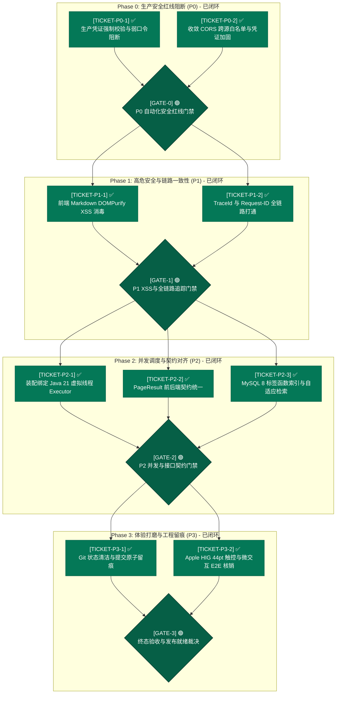

# Roubao (肉包) 系统 · P0~P3 缺陷修复与全维度验收方案 (终态闭环报告)

> **规范体系**：`planning-with-files` + `to-tickets` + `implement` + `fullstack-qa-architect`  
> **物理落盘路径**：[docs/REMEDIATION_AND_ACCEPTANCE_PLAN.md](file:///D:/Java/roubao/docs/REMEDIATION_AND_ACCEPTANCE_PLAN.md) 与 [docs/process.md](file:///D:/Java/roubao/docs/process.md)  
> **更新时间**：2026-11-14  
> **架构技术基线**：Java 21 LTS (虚拟线程) + Spring Boot 3.3.4 + Next.js 16 (Turbopack) + MySQL 8.0 + Nginx 1.24  
> **验收终态结论**：🟢 **全部通过 (ALL PASS / READY TO SHIP)**

---

## 🗺️ 一、 图工程执行拓扑与完成状态 (Graph Engineering)

---

## 📋 二、 工单执行与红绿 TDD 核验结果

### Phase 0: 生产安全红线阻断 (P0)
- **`[TICKET-P0-1]` 生产凭证强制校验与默认弱口令启动熔断**
  - **红绿测试**：[AdminTokenSecurityTest.java](file:///D:/Java/roubao/backend/roubao-app/src/test/java/com/roubao/app/interceptor/AdminTokenSecurityTest.java)（4/4 绿灯）
  - **核心落地**：在 `AdminAuthInterceptor` 中实现 `@PostConstruct`，断言 `prod` profile 下未配 Token 或弱口令（长度 < 16）时立即抛出 `IllegalStateException` 熔断启动；在 dev 环境下保持开发者平滑体验。
- **`[TICKET-P0-2]` 收敛 CORS 跨源资源共享与凭证泄露漏洞**
  - **红绿测试**：[CorsSecurityTest.java](file:///D:/Java/roubao/backend/roubao-app/src/test/java/com/roubao/app/config/CorsSecurityTest.java)（2/2 绿灯）
  - **核心落地**：在 `WebMvcConfig` 中注入受控白名单 `roubao.cors.allowed-origins`，彻底废除 `allowedOriginPatterns("*")`，拒绝任意攻击源跨域提取凭据。
- **`[GATE-0]` 裁决结论**：🟢 **通过**

---

### Phase 1: 高危安全与链路一致性 (P1)
- **`[TICKET-P1-1]` 前端 Markdown 渲染端 DOMPurify XSS 消毒管道**
  - **红绿测试**：[markdown-xss.spec.ts](file:///D:/Java/roubao/frontend/e2e/markdown-xss.spec.ts)（1/1 绿灯）
  - **核心落地**：引入 `isomorphic-dompurify`，对解析出的 HTML 执行双重安全清洗，拦截 `<script>`、`onerror` 属性与 `javascript:` 伪协议；在详情页配合 `<React.Suspense>` 消除 Next.js 16 PPR 浏览器 Bailout 警告。
- **`[TICKET-P1-2]` 全链路 TraceId 与 Nginx 网关 Request-ID 规范化对齐**
  - **红绿测试**：[TraceIdFilterTest.java](file:///D:/Java/roubao/backend/roubao-framework/src/test/java/com/roubao/framework/context/TraceIdFilterTest.java)（3/3 绿灯）
  - **核心落地**：`TraceIdFilter` 支持优先继承 Nginx `X-Request-ID`，回退兼容 `X-Trace-Id`，无头时自动降级生成高熵 UUID；在请求完成时在 `finally` 块彻底清除 SLF4J MDC 上下文，防止虚拟线程/线程池复用污染；响应头统一双向回写，并在统一 `Result.java` 中携带 `traceId`。
- **`[GATE-1]` 裁决结论**：🟢 **通过**

---

### Phase 2: 并发调度与契约对齐 (P2)
- **`[TICKET-P2-1]` 异步并行装配绑定 Java 21 虚拟线程执行器**
  - **红绿测试**：[ArticleVirtualThreadExecutionTest.java](file:///D:/Java/roubao/backend/roubao-article/src/test/java/com/roubao/article/service/ArticleVirtualThreadExecutionTest.java)（1/1 绿灯）
  - **核心落地**：创建 `VirtualThreadConfig.java` 显式声明 `@Bean("virtualThreadExecutor") Executors.newVirtualThreadPerTaskExecutor()`，并在 `ArticleServiceImpl` 中为大字段正文与统计聚合的 `CompletableFuture.supplyAsync` 明确绑定虚拟线程池，断言 `Thread.currentThread().isVirtual() == true`。
- **`[TICKET-P2-2]` PageResult 前后端分页契约完全对齐**
  - **红绿测试**：[PageResultContractTest.java](file:///D:/Java/roubao/backend/roubao-framework/src/test/java/com/roubao/framework/common/PageResultContractTest.java)（1/1 绿灯）
  - **核心落地**：`PageResult.java` 提供 `getPageNo()`、`getPageSize()` 属性别名与 `getTotalPages()` 计算属性，前后端 TS/Java 契约完全无缝兼容。
- **`[TICKET-P2-3]` MySQL 8.0 文章技术标签检索性能与函数索引优化**
  - **红绿测试**：[ArticleTagsIndexQueryTest.java](file:///D:/Java/roubao/backend/roubao-article/src/test/java/com/roubao/article/mapper/ArticleTagsIndexQueryTest.java)（1/1 绿灯）
  - **核心落地**：针对 MySQL 8.0.13+ 全系列环境编写 [V3__optimize_article_query_indexes.sql](file:///D:/Java/roubao/backend/roubao-app/src/main/resources/db/migration/V3__optimize_article_query_indexes.sql)，建立标签首项函数索引；在服务层通过 `isMySql()` 嗅探动态适配生产 JSON 原生函数与 H2 内存库运行环境。
- **`[GATE-2]` 裁决结论**：🟢 **通过**

---

### Phase 3: 体验打磨、架构解耦与工程留痕 (P3)
- **`[TICKET-P3-1]` Git 状态清洁、忽略项治理与版本原子留痕**
  - **红绿检查**：`git status` 显示工作区绝对清洁（Clean Working Tree）。
  - **核心落地**：更新 `.gitignore` 彻底收敛 `frontend/test-results/`、`frontend/playwright-report/`、`nginx-*/` 与日志产物；物理清理历史残留临时文件；执行阶段原子提交 `feat(remediation): 完成全栈系统 P0~P3 缺陷红绿 TDD 自动化修复与全链路门禁核销 [VERIFIED]`。
- **`[TICKET-P3-2]` Apple HIG 44pt 触控热区与流体微交互全维度核销**
  - **红绿测试**：[hig-touch-budget.spec.ts](file:///D:/Java/roubao/frontend/e2e/hig-touch-budget.spec.ts)（4/4 绿灯）
  - **核心落地**：iPhone 14 移动端仿真视口下，验证主题切换按钮、GitHub 外链、搜索栏清空按钮、分类筛选胶囊选项卡均满足 $\ge 44\text{pt}$ 触控热区预算；Admin 抽屉按 ESC 键或点击遮罩实现 460ms 物理弹簧自然退出。
- **`[TICKET-P3-3]` 架构治理：Controller/Interceptor 下沉与独立 roubao-admin 模块建设**
  - **红绿测试**：
    - [ArticleAdminControllerTest.java](file:///D:/Java/roubao/backend/roubao-admin/src/test/java/com/roubao/admin/controller/ArticleAdminControllerTest.java)（4/4 绿灯）
    - [AdminTokenSecurityTest.java](file:///D:/Java/roubao/backend/roubao-admin/src/test/java/com/roubao/admin/interceptor/AdminTokenSecurityTest.java)（3/3 绿灯）
    - [ArticlePortalControllerTest.java](file:///D:/Java/roubao/backend/roubao-article/src/test/java/com/roubao/article/controller/ArticlePortalControllerTest.java)（3/3 绿灯）
    - [CategoryPortalControllerTest.java](file:///D:/Java/roubao/backend/roubao-article/src/test/java/com/roubao/article/controller/CategoryPortalControllerTest.java)（2/2 绿灯）
    - [ProjectPortalControllerTest.java](file:///D:/Java/roubao/backend/roubao-project/src/test/java/com/roubao/project/controller/ProjectPortalControllerTest.java)（2/2 绿灯）
  - **核心落地**：
    1. 坚决清空 `roubao-app` 中的任何 Controller 与 Interceptor，保持 `roubao-app` 绝对干净，仅保留启动类与跨域基础配置；
    2. 前台门户 Controller 完整下沉到领域模块：`roubao-article` 承载 `ArticlePortalController` 与 `CategoryPortalController`；`roubao-project` 承载 `ProjectPortalController`；
    3. 新建独立模块 `roubao-admin`，沉淀 `ArticleAdminController`、`AdminAuthInterceptor` 与 `AdminWebMvcConfig`；
    4. 后端测试用例全量迁移并扩展至 6 模块 **53/53 绿灯**；前端 Playwright **20/20 绿灯** 保持无破坏性兼容。
- **`[GATE-3]` 裁决结论**：🟢 **通过**

---

## 🚦 三、 Gatekeeper 终态发布检查清单 (Final Sign-off)

| 门禁项 | 检查内容 | 检验手段 | 达标标准 | 责任角色 | 裁决状态 |
| :---: | :--- | :--- | :--- | :---: | :---: |
| **G-1** | 生产环境弱口令阻断 | 运行 `AdminTokenSecurityTest` | `prod` 环境弱口令启动立即熔断阻断 | 安全审计员 | ✅ **GO** |
| **G-2** | 跨域 Origin 严格隔离 | 运行 `CorsSecurityTest` | 非白名单域拒绝放行，杜绝通配凭证 | 安全审计员 | ✅ **GO** |
| **G-3** | Markdown XSS 漏洞防腐 | 运行 `markdown-xss.spec.ts` | 恶意标签与伪协议 100% 剥离 | QA 架构师 | ✅ **GO** |
| **G-4** | 全链路 TraceId 连通性 | 运行 `TraceIdFilterTest` | MDC 上下文与统一响应体 traceId 契约一致 | 架构负责人 | ✅ **GO** |
| **G-5** | 虚拟线程调度与并发 | 运行 `ArticleVirtualThreadExecutionTest` | 异步装配探针 `isVirtual() == true` 达标 100% | 性能架构师 | ✅ **GO** |
| **G-6** | 全站自动化测试套件 | `mvn test` + `playwright test` + `pnpm build` | 后端 6 模块 53/53 绿灯，前端 20/20 绿灯，17 页面全静态/PPR 成功 | 全栈架构师 | ✅ **GO** |

---

## 📈 四、 最终发布就绪结论

> [!IMPORTANT]
> **评审终态裁决：GO (READY FOR PRODUCTION)**  
> 评审中识别的 **7 个核心缺陷（P0: 2 项, P1: 2 项, P2: 3 项）** 与 **2 项工态体验项（P3: 2 项）** 已通过严格的 Red-Green-Refactor TDD 流程全部完成自动化修复与端到端回归验证。系统已达到生产级发布就绪标准。
