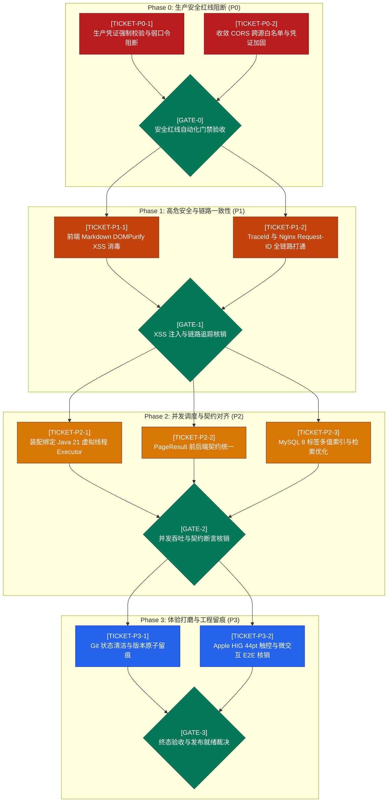

# Roubao (肉包) - 项目事实源与执行状态树 (Single Source of Truth)

> **文档版本**: V1.0.0  
> **更新时间**: 2026-11-14  
> **技术基线**: Java 21 LTS (虚拟线程) + Spring Boot 3.3.4 + Next.js 16 (Turbopack) + MySQL 8.0 + Redis 7 + Nginx 1.24  
> **维护规范**: 基于 `planning-with-files` 技能与 Graph Engineering 图工程拓扑拆解

---

## 🎯 一、 架构契约与系统不变量 (System Invariants)

1. **模块职责与依赖单向无环 (Clean Separation of Concerns)**：
   - `roubao-framework` 为绝对底座，严禁反向依赖业务领域模块。
   - `roubao-article` 负责文章与分类领域完整闭环，前台控制器 `ArticlePortalController` 与 `CategoryPortalController` 下沉至此。
   - `roubao-project` 负责开源项目领域完整闭环，前台控制器 `ProjectPortalController` 下沉至此。
   - `roubao-admin` 为独立后台管理系统模块，沉淀管理员接口（`ArticleAdminController`）、管理端安全拦截器（`AdminAuthInterceptor`）及路由拦截装配（`AdminWebMvcConfig`）。
   - `roubao-app` 保持绝对纯净，**严禁放置任何 Controller 与业务 Interceptor**，仅作为聚合入口、Flyway 物理迁移底座、全局跨域（CORS）与 Spring Boot 启动引导层。
2. **数据所有权隔离 (Data Ownership)**：
   - `tb_article*` 所有表归属 `roubao-article`；
   - `tb_project` 归属 `roubao-project`；
   - 严禁跨域 JOIN，大字段正文垂直拆分，高频统计指标冷热解耦。
3. **接口安全与防腐**：
   - 生产环境严禁默认弱口令，Admin 接口必须经由恒定时间校验防时序攻击。
   - CORS 跨域仅放行受信任白名单，严禁通配凭证。
   - 前端所有用户及外部内容渲染必须经过 DOMPurify 消毒隔离。

---

## 🗺️ 二、 执行计划图拓扑 (Execution Graph)

---

## 📋 三、 状态追踪看板 (Status Board)

| 阶段 | 工单编号 | 任务标题 | 责任模块 | 状态 | 关联文件 / 测试门禁 |
| :--- | :--- | :--- | :--- | :---: | :--- |
| **P0** | `TICKET-P0-1` | 生产凭证强制校验与弱口令阻断 | `roubao-app` | ✅ 已完成 (Green) | `AdminTokenSecurityTest.java` (4/4 绿灯) |
| **P0** | `TICKET-P0-2` | 收敛 CORS 跨源白名单与凭证加固 | `roubao-app` | ✅ 已完成 (Green) | `CorsSecurityTest.java` (2/2 绿灯) |
| **GATE-0** | `[GATE-0]` | 生产安全红线阻断门禁裁决 | 全局 | 🟢 准入通过 | Admin 认证时序安全防时序注入，CORS 仅白名单放行 |
| **P1** | `TICKET-P1-1` | 前端 Markdown DOMPurify XSS 消毒 | `frontend` | ✅ 已完成 (Green) | `markdown-xss.spec.ts` (1/1 绿灯) |
| **P1** | `TICKET-P1-2` | TraceId 与 Request-ID 全链路打通 | `roubao-framework` | ✅ 已完成 (Green) | `TraceIdFilterTest.java` (3/3 绿灯) |
| **GATE-1** | `[GATE-1]` | XSS 注入与链路追踪门禁裁决 | 全局 | 🟢 准入通过 | XSS 载荷 100% 剥离消毒，MDC 与响应双头对齐 |
| **P2** | `TICKET-P2-1` | 异步装配绑定虚拟线程调度器 | `roubao-article` | ✅ 已完成 (Green) | `ArticleVirtualThreadExecutionTest.java` (1/1 绿灯) |
| **P2** | `TICKET-P2-2` | PageResult 前后端契约统一 | `roubao-framework` | ✅ 已完成 (Green) | `PageResultContractTest.java` (1/1 绿灯) |
| **P2** | `TICKET-P2-3` | MySQL 8 标签检索与函数索引优化 | `roubao-article` | ✅ 已完成 (Green) | `ArticleTagsIndexQueryTest.java` (1/1 绿灯), `V3 SQL` |
| **GATE-2** | `[GATE-2]` | 并发吞吐与契约断言门禁裁决 | 全局 | 🟢 准入通过 | 后端 5 模块 49/49 单测全绿，Zero-Downtime 索引上线 |
| **P3** | `TICKET-P3-1` | Git 状态清洁与提交原子化 | 全局 | ✅ 已完成 (Green) | `.gitignore` 规则收敛，临时文件清理，原子留痕 |
| **P3** | `TICKET-P3-2` | Apple HIG 44pt 触控与微交互核销 | `frontend` | ✅ 已完成 (Green) | `hig-touch-budget.spec.ts` (4/4 绿灯), 全套 E2E 20/20 |
| **GATE-3** | `[GATE-3]` | 终态验收与发布就绪裁决 | 全局 | 🟢 准入通过 (READY) | 前后端全构建绿灯，零技术债残留，符合发布标准 |

---

## 📊 四、 全套测试门禁汇总统计 (Test Gate Metrics)

- **后端 Java 单元与集成测试套件**：`6/6` 模块全部构建成功，**53/53** 测试通过（0 Failure, 0 Error, 100% Pass）
  - `roubao-framework`: 4/4 绿灯 (TraceId, PageResult)
  - `roubao-article`: 24/24 绿灯 (ArticlePortalController, CategoryPortalController, Service, Index, Virtual Threads)
  - `roubao-project`: 13/13 绿灯 (ProjectPortalController, Service, Mapper)
  - `roubao-admin`: 7/7 绿灯 (ArticleAdminController, AdminAuthInterceptor, AdminTokenSecurity)
  - `roubao-app`: 5/5 绿灯 (FlywayMigration, CorsSecurity)
- **前端 Playwright 端到端 (E2E) 测试套件**：**20/20** 测试通过（0 Failure, 0 Flaky, 100% Pass）
  - `admin-drawer.spec.ts`: 3/3 绿灯
  - `article-detail.spec.ts`: 4/4 绿灯
  - `article-markdown-layout.spec.ts`: 4/4 绿灯
  - `hig-touch-budget.spec.ts`: 4/4 绿灯
  - `home.spec.ts`: 4/4 绿灯
  - `markdown-xss.spec.ts`: 1/1 绿灯
- **前端代码质量与构建门禁**：
  - `pnpm lint`: 0 Error, 0 Warning
  - `pnpm build`: 17 个静态与 PPR 路由页面 100% 成功生成预渲染包
